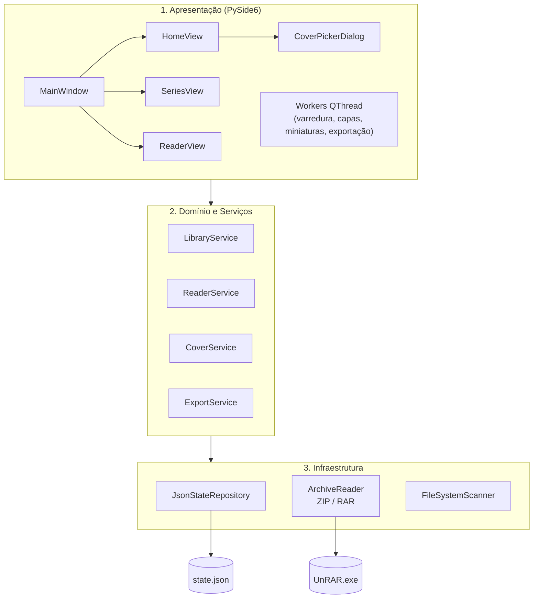
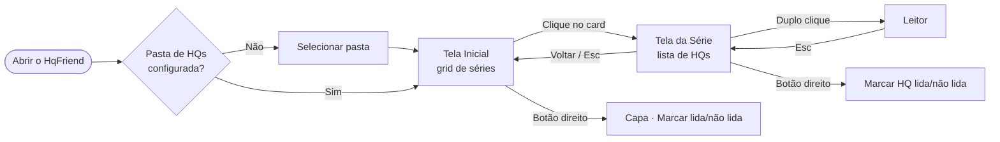
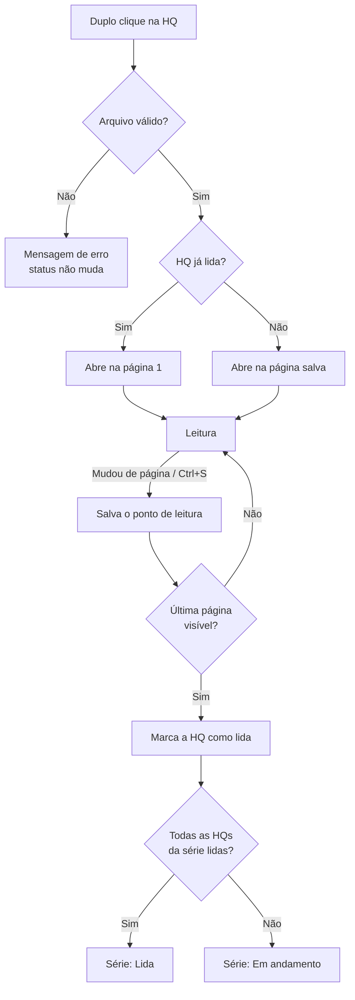

# HqFriend

Aplicativo desktop para **organizar e ler histórias em quadrinhos** (`.cbz` e `.cbr`) no Windows. Ele lê as suas pastas de HQs, mostra cada série com capa, status e progresso de leitura, e tem um leitor com zoom, página dupla e exportação de páginas.

Funciona **100% offline**: não precisa de internet nem de servidor. O progresso fica salvo em um arquivo JSON no seu computador.

---

## Funcionalidades

- **Biblioteca de séries:** cada subpasta da pasta escolhida é uma série, exibida como um card com capa, status (*Não lida*, *Em andamento*, *Lida*) e contador `X / Y obras`.
- **Capa da série:** por padrão, a primeira página da primeira HQ. Você pode escolher qualquer página de qualquer HQ da série como capa, ou voltar para a padrão.
- **Progresso de leitura:**
  - a leitura retoma da página em que você parou;
  - a HQ é marcada como lida ao chegar à última página;
  - dá para marcar lida/não lida manualmente, por HQ ou pela série inteira.
- **Status dinâmico:** se uma série "Lida" recebe um arquivo novo, ela volta a ficar "Em andamento".
- **Leitor integrado:**
  - página única ou dupla (pares 1–2, 3–4, …);
  - zoom no ponto do cursor e arrastar a página ampliada;
  - indicador de página;
  - troca de página em menos de 200 ms, com as próximas páginas carregadas em segundo plano.
- **Exportação de página (`Ctrl + P`):** salva a página, ou as duas páginas lado a lado, como PNG na resolução original, sem sobrescrever capturas anteriores.
- **Robustez:**
  - ignora arquivos corrompidos ou protegidos por senha;
  - recupera um `state.json` corrompido a partir de backup;
  - registra erros em log;
  - impede abrir duas instâncias do app ao mesmo tempo.

---

## Tecnologias

| Camada | Tecnologia | Uso |
| :--- | :--- | :--- |
| Linguagem | **Python 3.12+** (64-bit) | Todo o sistema |
| Interface | **PySide6 6.8** (Qt 6) | Janelas, grid de séries, leitor (`QGraphicsView`), threads (`QThread`) |
| Imagens | **Pillow 11** | Capas, miniaturas, união de páginas e exportação PNG |
| Persistência | **Pydantic 2** + JSON | Modelo validado do `state.json`, com escrita atômica |
| Arquivos `.cbz` | `zipfile` (biblioteca padrão) | Leitura das páginas direto da memória |
| Arquivos `.cbr` | **rarfile 4.2** + `UnRAR.exe` embutido | Listagem e extração em uma única passada para a memória |
| Testes | **pytest 8** | 232 testes (domínio, serviços, infraestrutura e interface em modo *offscreen*) |
| Distribuição | **PyInstaller 6** | Executável `HqFriend.exe` (modo *onedir*) |

**Plataforma alvo:** Windows 11 (x64).

---

## Arquitetura

O projeto segue uma **arquitetura em 3 camadas**. A interface é separada das regras de negócio, e as camadas de domínio, serviços e infraestrutura **não dependem do Qt**.



Para os detalhes, veja a pasta [`docs/`](docs/):

| Documento | Conteúdo |
| :--- | :--- |
| [`REQUISITOS.md`](docs/REQUISITOS.md) | Requisitos funcionais e não funcionais, histórias de usuário e fluxo do sistema |
| [`PLANO_ARQUITETURA.md`](docs/PLANO_ARQUITETURA.md) | Camadas, contrato do `state.json`, diagramas de sequência e ADRs |
| [`PLANO_TECNICO.md`](docs/PLANO_TECNICO.md) | Stack, algoritmos, interface e empacotamento |
| [`PLANO_DESENVOLVIMENTO.md`](docs/PLANO_DESENVOLVIMENTO.md) | Backlog das 13 features e critérios de aceite |
| [`STATUS_PROJETO.md`](docs/STATUS_PROJETO.md) | Quadro de features e histórico de atualizações |

---

## Fluxos

### Fluxo geral de navegação



### Organização das pastas

O HqFriend espera **um nível de subpastas**: cada subpasta da pasta raiz é uma série. Dentro dela, só os arquivos `.cbr` e `.cbz` do primeiro nível são considerados.

```text
HQ/                          ← pasta raiz selecionada no app
├── Batman/                  ← série
│   ├── Batman 01.cbz
│   ├── Batman 02.cbr
│   └── Batman 10.cbz        ← ordenação natural: 01, 02, 10
├── Homem-Aranha/            ← série
│   └── Homem-Aranha 01.cbr
└── Solto na raiz.cbz        ← ignorado (fora de uma série)
```

### Ciclo de leitura e status



**Regras de status da série:**

| Status | Condição |
| :--- | :--- |
| **Não lida** | Nenhuma HQ lida nem em andamento |
| **Em andamento** | Alguma HQ lida ou em andamento, mas não todas lidas |
| **Lida** | Todas as HQs presentes na pasta estão lidas |

### Seleção de capa

1. Botão direito na série → **Selecionar imagem de capa**.
2. Escolha a HQ na lista.
3. Clique na página desejada na galeria de miniaturas → **Definir como capa**.

### Atalhos

| Onde | Atalho | Ação |
| :--- | :--- | :--- |
| Tela Inicial | `F5` | Atualizar a biblioteca |
| Tela da Série | `Esc` | Voltar para a Tela Inicial |
| Leitor | `→` ou `Espaço` | Próxima página (ou par) |
| Leitor | `←` | Página (ou par) anterior |
| Leitor | `Ctrl + S` | Alternar página única / dupla |
| Leitor | `Ctrl + Scroll` | Zoom (0,5x a 5x) |
| Leitor | Arrastar com o mouse | Mover a página ampliada |
| Leitor | `Ctrl + P` | Salvar a página como PNG |
| Leitor | `Esc` | Fechar a HQ |

### Onde ficam os dados

As pastas são as pastas reais do usuário, inclusive quando redirecionadas para o OneDrive. São criadas automaticamente.

| Caminho | Conteúdo |
| :--- | :--- |
| `Documentos\HqFriend\state.json` | Pasta configurada, progresso de leitura e preferências |
| `Documentos\HqFriend\state.json.bak` | Backup da última versão válida |
| `Documentos\HqFriend\covers\` | Cache das capas das séries |
| `Documentos\HqFriend\logs\hqfriend.log` | Log de erros |
| `Imagens\HQs\` | Páginas exportadas com `Ctrl + P` |

> O progresso é identificado pelo **nome da pasta da série** e pelo **nome do arquivo**. Mover a pasta raiz de lugar preserva o progresso. Renomear uma série ou uma HQ faz o app tratá-la como nova.

---

## Como executar

### Opção 1: executável (usuário final)

1. Baixe ou gere a pasta `dist\HqFriend\` (veja [Gerar o executável](#gerar-o-executável)).
2. Abra `HqFriend.exe`.
3. Clique em **Selecionar pasta** e escolha a pasta onde estão as suas HQs.

Não é preciso instalar Python nem nenhuma dependência.

### Opção 2: código-fonte (desenvolvimento)

**Pré-requisitos**
- Windows 11 (x64)
- [Python 3.12+](https://www.python.org/downloads/) (64-bit)
- `bin\UnRAR.exe`, já incluído no repositório. Para atualizá-lo, copie de `C:\Program Files\WinRAR\UnRAR.exe` ou baixe o *UnRAR for Windows* em [rarlab.com](https://www.rarlab.com/rar_add.htm).

**Instalação**

```powershell
git clone https://github.com/Pedrohcs/HqFriend.git
cd HqFriend
py -3.12 -m venv .venv
.venv\Scripts\python.exe -m pip install -r requirements-dev.txt
```

**Executar o app**

```powershell
.venv\Scripts\python.exe -m src.main
```

### Testes

```powershell
.venv\Scripts\python.exe -m pytest
```

Os testes de interface rodam em modo *offscreen*, sem abrir janelas. Nenhum teste grava nas pastas reais `Documentos\HqFriend` e `Imagens\HQs`: todos usam diretórios temporários.

Para gerar de novo as HQs de exemplo usadas nos testes (requer o WinRAR instalado):

```powershell
.venv\Scripts\python.exe tests\fixtures\build_fixtures.py
```

### Gerar o executável

```powershell
.venv\Scripts\pyinstaller.exe --noconfirm --clean HqFriend.spec
```

O resultado fica em `dist\HqFriend\`, com cerca de 128 MB, e já inclui o `UnRAR.exe`, o ícone e o tema. Para distribuir, compacte a **pasta inteira** (o `HqFriend.exe` depende da subpasta `_internal\`).

---

## Estrutura do projeto

```text
HqFriend/
├── assets/                  # Ícone e tema Dark Mode (dark_theme.qss)
├── bin/UnRAR.exe            # Binário embutido para leitura de .cbr
├── docs/                    # Especificação e status do projeto
├── src/
│   ├── main.py              # Ponto de entrada
│   ├── config.py            # Caminhos do sistema (Documentos/Imagens) e recursos
│   ├── domain/              # Modelos Pydantic, enums, erros, ordenação natural
│   ├── infrastructure/      # state.json, leitura ZIP/RAR, varredura de pastas, logs
│   ├── services/            # Biblioteca, leitor, capas e exportação (sem Qt)
│   └── ui/                  # Janela, telas, diálogo de capa e workers (PySide6)
├── tests/                   # pytest: domain, infrastructure, services, ui + fixtures
├── HqFriend.spec            # Configuração do PyInstaller
├── requirements.txt
└── requirements-dev.txt
```
