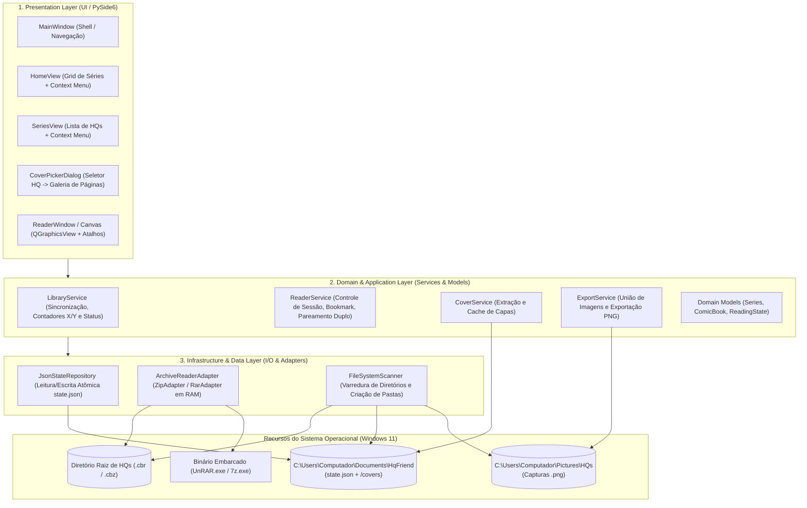
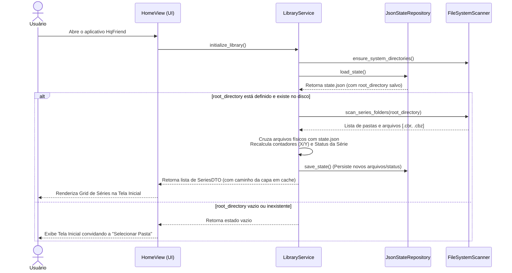
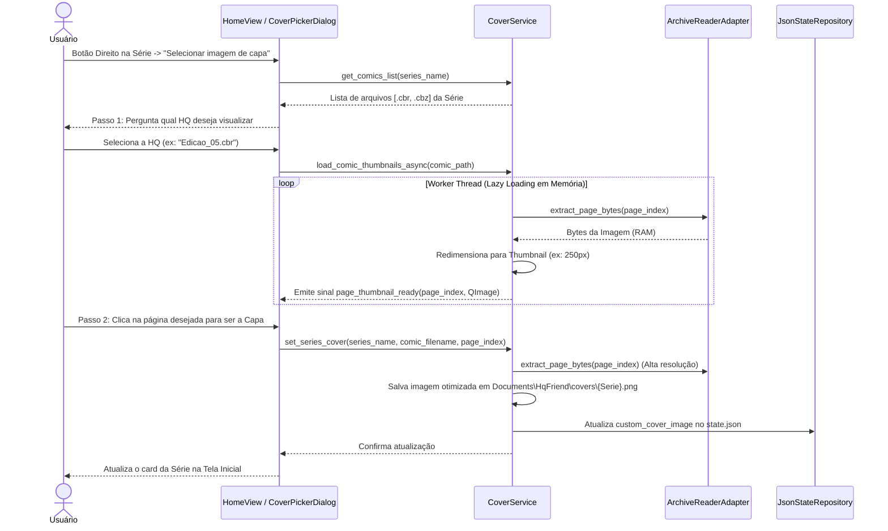
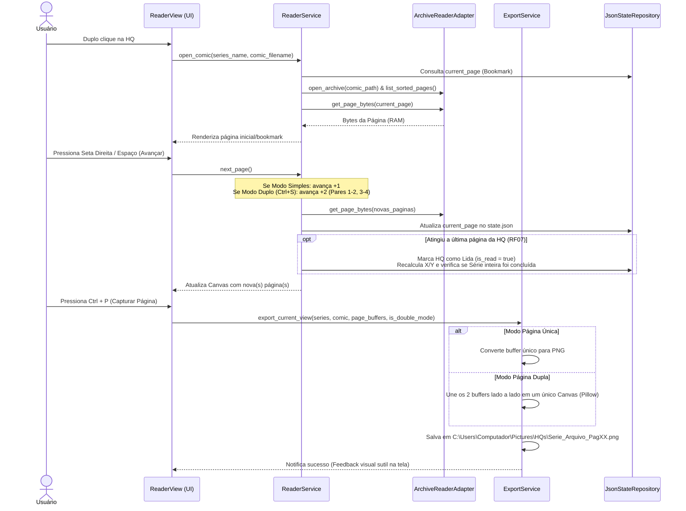

# PLANO_ARQUITETURA.md — Arquitetura de Software (HqFriend)

## 1. Visão Arquitetural e Diretrizes de Design
O **HqFriend** segue uma arquitetura **Monolítica Modular em Camadas (Layered Architecture)** orientada a eventos para Desktop (Windows 11), desenvolvida em **Python** com interface gráfica nativa baseada em **Qt (PySide6)**.

### Princípios Arquiteturais Adotados:
* **Offline-First & Zero-Install Dependencies:** O sistema opera 100% localmente, embarcando binários auxiliares de descompactação na própria estrutura do projeto para não exigir instalações externas no sistema operacional.
* **In-Memory Streaming (Zero Temp-Files na Leitura):** As páginas das HQs (`.cbr` e `.cbz`) são descompactadas sob demanda diretamente em buffers de memória RAM (`BytesIO`), evitando escrita e fragmentação desnecessária no disco (SSD) durante a leitura.
* **Separação de Responsabilidades (SoC):** A interface gráfica (UI) é estritamente desacoplada das regras de negócio e do mecanismo de persistência em JSON, permitindo manutenção isolada e evolução futura (ex: migração de JSON para SQLite sem impacto nas telas).
* **Execução Não-Bloqueante (UI Responsiva):** Operações de I/O pesado (varredura de diretórios e extração de miniaturas para seleção de capa) rodam em *Worker Threads* assíncronas para garantir fluidez constante na thread principal da interface (RNF05).

---

## 2. Arquitetura em 3 Camadas (Layered Architecture)



### 2.1. Camada de Apresentação (`Presentation Layer`)
Responsável exclusivamente pela renderização visual, captura de eventos de mouse/teclado e delegação de ações para a camada de aplicação.
* **`HomeView` (Tela Inicial):** Exibe o botão de seleção de diretório raiz (RF01) e o grid de cards das Séries com capa, título, badge de status (`Não lida`, `Em andamento`, `Lida`) e contador `X / Y obras` (RF04). Captura o clique direito na série para acionar *"Marcar como lida"* (RF10) ou *"Selecionar imagem de capa"* (RF11).
* **`CoverPickerDialog` (Fluxo em 2 Etapas - RF12):**
    1. Exibe um seletor (lista/dropdown) perguntando **qual HQ (`.cbr`/`.cbz`)** daquela série o usuário deseja inspecionar.
    2. Após escolhida a HQ, carrega em background as miniaturas (*thumbnails*) apenas das páginas daquele arquivo específico para que o usuário selecione a nova capa da série.
* **`SeriesView` (Tela da Série):** Lista os arquivos `.cbr`/`.cbz` da série selecionada (RF05). Captura o duplo clique para abrir o leitor (RF13) e o clique direito para alternar manualmente entre *"Lida"* e *"Não lida"* (RF08).
* **`ReaderView` (Motor Visual de Leitura):** Baseado em `QGraphicsView` + `QGraphicsScene` (acelerado por hardware). Gerencia:
    * Navegação por `Seta Esquerda`, `Seta Direita`, `Espaço` e `ESC` (RF14);
    * Zoom matricial suave no cursor via `Ctrl + Scroll` (RF15);
    * Alternância de layout entre 1 ou 2 páginas lado a lado via `Ctrl + S` (RF16);
    * Disparo de captura de tela via `Ctrl + P` (RF17).

### 2.2. Camada de Domínio e Aplicação (`Domain & Application Layer`)
Contém toda a inteligência e regras de negócio do **HqFriend**, sem qualquer dependência de interface gráfica.
* **`LibraryService`:** Orquestra o cruzamento entre os arquivos físicos encontrados no disco e os dados salvos no JSON. Calcula os contadores `X / Y`, aplica a regra de regressão automática de status (se uma série `"Lida"` `11/11` recebe um 12º arquivo no disco, seu status passa automaticamente para `"Em andamento"` `11/12` — RF09) e executa a marcação em lote da série (RF10).
* **`ReaderService`:** Controla o estado da leitura aberta. Recupera a página inicial via *Bookmark* (RF06), calcula os índices das páginas exibidas (considerando o pareamento a partir da página 1 no modo Página Dupla — RF16) e verifica a cada avanço se o índice atingiu a última página da HQ para disparar a marcação automática de conclusão (RF07).
* **`CoverService`:** Gerencia as capas das séries. Se a série ainda não possui capa customizada, extrai a primeira página da primeira HQ da pasta e salva no cache local. Quando o usuário define uma nova capa via `CoverPickerDialog`, renderiza e persiste a imagem otimizada em `C:\Users\Computador\Documents\HqFriend\covers\`.
* **`ExportService`:** Processa a ação do `Ctrl + P` (RF17). Recebe o(s) buffer(s) da(s) página(s) ativa(s):
    * Em **Página Única**: Salva diretamente o buffer como `.png`.
    * Em **Página Dupla**: Cria um canvas em memória unindo as duas páginas lado a lado (respeitando a maior altura e mantendo a proporção) e exporta um único arquivo `NomeDaSerie_NomeDoArquivo_PagXX.png` em `C:\Users\Computador\Pictures\HQs`.

### 2.3. Camada de Infraestrutura e Dados (`Infrastructure & Data Layer`)
Isola o acesso ao sistema operacional, arquivos compactados e persistência.
* **`JsonStateRepository`:** Gerencia a leitura e gravação do arquivo `C:\Users\Computador\Documents\HqFriend\state.json` (RNF02). Utiliza **escrita atômica** (grava em `state.json.tmp` e aplica `os.replace` para `state.json`), prevenindo corrupção do arquivo JSON caso o computador desligue ou o programa seja fechado abruptamente durante o salvamento de página.
* **`ArchiveReaderAdapter` (Padrão Strategy/Adapter):** Interface unificada (`IComicArchive`) que abstrai a diferença entre `.cbz` e `.cbr` (RNF04):
    * `ZipArchiveStrategy`: Usa a biblioteca nativa `zipfile` para listar entradas de imagem ordenadas de forma natural (*natural sort*, garantindo que `pag_2.jpg` venha antes de `pag_10.jpg`) e extrair bytes direto para a RAM.
    * `RarArchiveStrategy`: Usa `rarfile` / `subprocess` comunicando via *stdout pipe* com o binário `UnRAR.exe` embarcado no projeto para extrair a página solicitada diretamente para a memória RAM.
* **`FileSystemScanner`:** Responsável por inicializar automaticamente as pastas obrigatórias do sistema (`Documents\HqFriend`, `Documents\HqFriend\covers`, `Pictures\HQs` — RNF03) e escanear o primeiro nível de subpastas do diretório raiz configurado (RF03).

---

## 3. Arquitetura de Dados e Persistência (`JSON` + Cache)

### 3.1. Estrutura de Diretórios do Sistema
```text
C:\Users\Computador\
├── Documents\
│   └── HqFriend\
│       ├── state.json                 # Banco de dados em arquivo estruturado (Memória do Sistema)
│       └── covers\                    # Cache de capas otimizadas das séries (carregamento instantâneo)
│           ├── Batman.png
│           └── Homem-Aranha.png
└── Pictures\
    └── HQs\                           # Destino de exportação do atalho Ctrl+P
        └── Batman_Edicao01_Pag01.png
```

### 3.2. Contrato do Arquivo de Estado (`state.json`)
A modelagem utiliza o **nome da pasta** como chave da Série e o **nome do arquivo** como chave da HQ. Dessa forma, os metadados permanecem íntegros e desacoplados caso o usuário mova a pasta raiz de lugar no futuro.

```json
{
  "version": "1.0",
  "root_directory": "C:\\Users\\Computador\\Desktop\\Pedro\\Leitura\\HQ",
  "reader_preferences": {
    "double_page_mode": false
  },
  "series": {
    "Batman": {
      "status": "IN_PROGRESS",
      "custom_cover_image": "C:\\Users\\Computador\\Documents\\HqFriend\\covers\\Batman.png",
      "cover_source": {
        "comic_filename": "Batman_01.cbz",
        "page_index": 0
      },
      "comics": {
        "Batman_01.cbz": {
          "is_read": true,
          "current_page": 24,
          "total_pages": 24,
          "last_read_at": "2026-10-24T16:00:00"
        },
        "Batman_02.cbr": {
          "is_read": false,
          "current_page": 11,
          "total_pages": 32,
          "last_read_at": "2026-10-24T16:15:00"
        }
      }
    }
  }
}
```
> **Nota Arquitetural sobre o Status da Série:** Embora o campo `"status"` (`UNREAD`, `IN_PROGRESS`, `READ`) seja persistido no JSON, ele é **sempre revalidado em tempo de execução** pelo `LibraryService` ao escanear a pasta física. Se `Batman` tinha 2 arquivos lidos (`2/2` = `READ`) e o `FileSystemScanner` detectar um 3º arquivo (`Batman_03.cbz`), o `LibraryService` recalcula imediatamente o contador para `2 / 3 obras` e atualiza o status para `IN_PROGRESS` (atendendo integralmente ao **RF09**).

---

## 4. Fluxos Arquiteturais Críticos (Diagramas de Sequência)

### 4.1. Inicialização e Sincronização Dinâmica de Séries (RF02, RF04, RF09)


### 4.2. Seleção Customizada de Capa em 2 Etapas (RF11, RF12 Otimizado)


### 4.3. Leitura, Pareamento Duplo, Bookmark e Exportação `Ctrl+P` (RF06, RF07, RF16, RF17)


---

## 5. Decisões Arquiteturais e Tratamento de Casos de Borda (ADRs)

| ID | Decisão Arquitetural | Justificativa e Tratamento de Exceções |
| :--- | :--- | :--- |
| **ADR-01** | **Ordenação Natural de Páginas (*Natural Sorting*)** | Muitos arquivos `.cbr`/`.cbz` nomeiam imagens como `1.jpg`, `2.jpg` ... `10.jpg`. A ordenação ASCII padrão colocaria `10.jpg` logo após `1.jpg`. O `ArchiveReaderAdapter` aplicará obrigatoriamente ordenação natural via expressões regulares (`re.split(r'(\d+)', filename)`) ao indexar qualquer arquivo compactado. |
| **ADR-02** | **Página Ímpar Final no Modo Página Dupla (`Ctrl+S`)** | Como o pareamento começa na primeira página (`[1,2]`, `[3,4]`), caso uma HQ possua número ímpar de páginas (ex: 25 páginas), ao chegar na página 25 no modo duplo, o `ReaderService` entregará apenas o buffer da página 25, exibindo-a centralizada, e ainda assim disparará o gatilho de conclusão da HQ (**RF07**). |
| **ADR-03** | **Resiliência a Arquivos Corrompidos ou Renomeados** | Caso um arquivo `.cbr`/`.cbz` listado no `state.json` seja deletado da pasta pelo Windows Explorer, o `LibraryService` ignorará as entradas órfãs no cálculo do contador `X / Y` da série atual, evitando contadores inconsistentes (como `12 / 11 obras`). |
| **ADR-04** | **Prefetching de Próxima Página em Memória** | Para cumprir o **RNF05** (transição abaixo de 200ms), enquanto o usuário lê a página `N`, uma thread secundária já descompacta em background a página `N+1` (ou o par `N+1, N+2`) em um cache LRU em memória RAM limitado às últimas/próximas 4 páginas. |