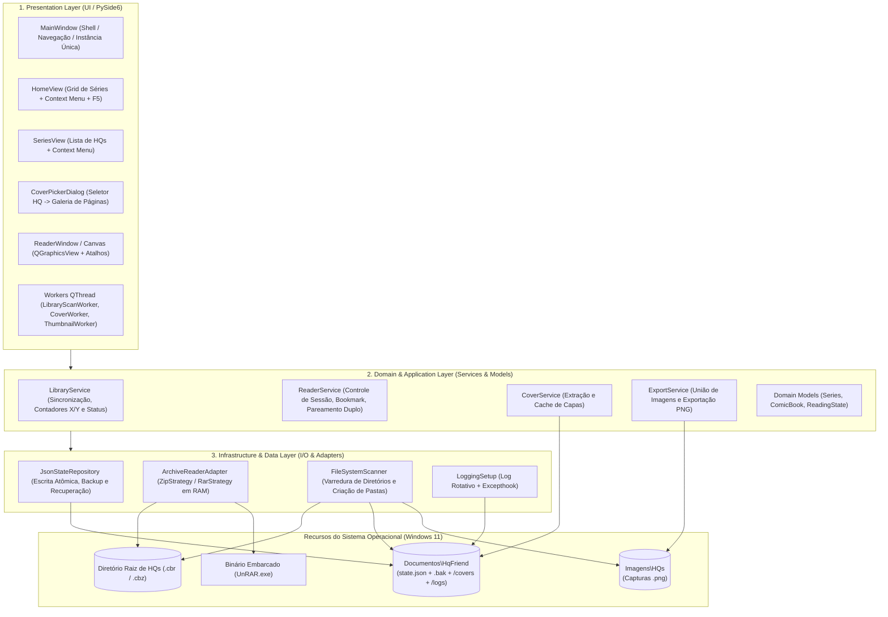
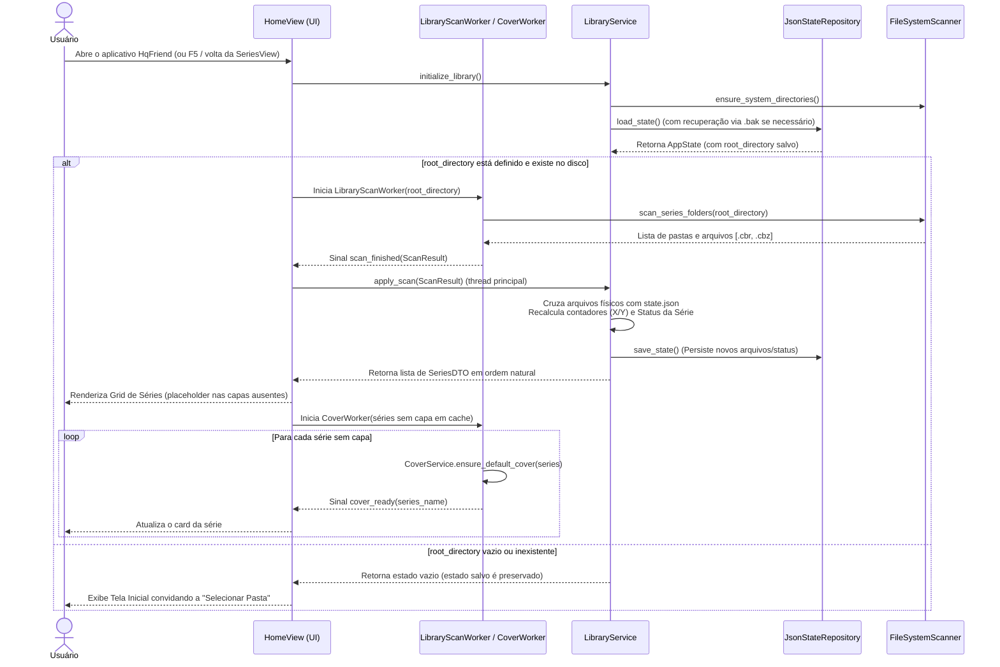
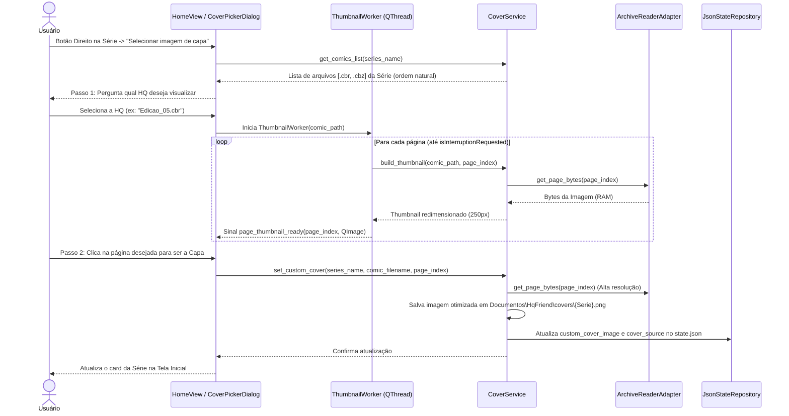
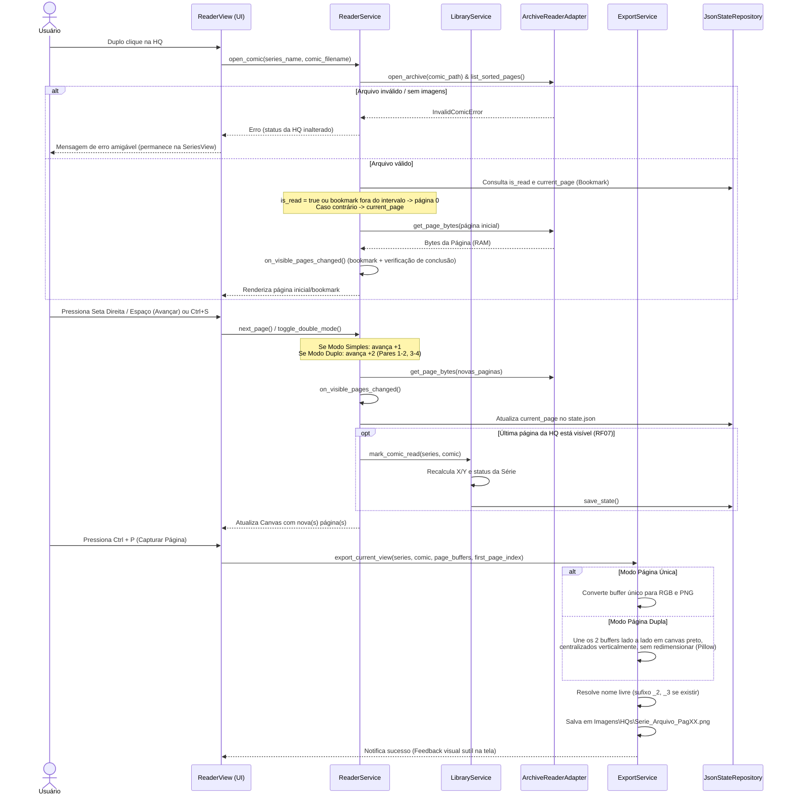

# PLANO_ARQUITETURA.md — Arquitetura de Software (HqFriend)

## 1. Visão Arquitetural e Diretrizes de Design
O **HqFriend** segue uma arquitetura **Monolítica Modular em Camadas (Layered Architecture)** orientada a eventos para Desktop (Windows 11), desenvolvida em **Python** com interface gráfica nativa baseada em **Qt (PySide6)**.

> **Convenção de caminhos:** `%DOCUMENTOS%` e `%IMAGENS%` são as pastas conhecidas do Windows do usuário, resolvidas em tempo de execução (ver `REQUISITOS.md`, seção 1.1, e ADR-05).

### Princípios Arquiteturais Adotados:
* **Offline-First & Zero-Install Dependencies:** O sistema opera 100% localmente, embarcando binários auxiliares de descompactação na própria estrutura do projeto para não exigir instalações externas no sistema operacional.
* **In-Memory Streaming (Zero Temp-Files na Leitura):** As páginas das HQs (`.cbr` e `.cbz`) são descompactadas diretamente em buffers de memória RAM (`bytes` / `BytesIO`), evitando escrita e fragmentação desnecessária no disco (SSD) durante a leitura.
* **Separação de Responsabilidades (SoC):** A interface gráfica (UI) é estritamente desacoplada das regras de negócio e do mecanismo de persistência em JSON, permitindo manutenção isolada e evolução futura (ex: migração de JSON para SQLite sem impacto nas telas). As camadas de Domínio/Aplicação e Infraestrutura **não importam PySide6**; toda integração com sinais Qt e threads Qt ocorre na camada de Apresentação (Workers).
* **Execução Não-Bloqueante (UI Responsiva):** Operações de I/O pesado (varredura de diretórios, geração de capas padrão e extração de miniaturas para seleção de capa) rodam em *Worker Threads* (`QThread`) da camada de Apresentação, que invocam os serviços puros em Python e devolvem resultados via sinais (RNF05).
* **Estado Mutado em Thread Única:** O `AppState` em memória só é alterado na thread principal (UI). Workers apenas produzem dados (listagens de disco, imagens) e os entregam via sinais; a mesclagem com o estado e a persistência acontecem na thread principal, eliminando condições de corrida.

---

## 2. Arquitetura em 3 Camadas (Layered Architecture)



### 2.1. Camada de Apresentação (`Presentation Layer`)
Responsável exclusivamente pela renderização visual, captura de eventos de mouse/teclado, orquestração de threads e delegação de ações para a camada de aplicação.
* **`MainWindow`:** Shell de navegação. Garante instância única do aplicativo (RNF07) e exibe avisos de recuperação de estado ou erros inesperados (RNF02, RNF06).
* **`HomeView` (Tela Inicial):** Exibe o botão de seleção de diretório raiz (RF01), o botão **"Atualizar"** / tecla `F5` (RF19) e o grid de cards das Séries em ordem natural (RF18) com capa, título, badge de status (`Não lida`, `Em andamento`, `Lida`) e contador `X / Y obras` (RF04, sempre no formato `0 / Y` quando nada foi lido). Captura o clique direito na série para acionar *"Marcar como lida"*, *"Marcar como não lida"* (RF10), *"Selecionar imagem de capa"* e *"Restaurar capa padrão"* (RF11). Enquanto a capa padrão de uma série ainda está sendo gerada, o card exibe um *placeholder*.
* **`CoverPickerDialog` (Fluxo em 2 Etapas - RF12):**
    1. Exibe um seletor (lista/dropdown) perguntando **qual HQ (`.cbr`/`.cbz`)** daquela série o usuário deseja inspecionar.
    2. Após escolhida a HQ, dispara o `ThumbnailWorker`, que carrega em background as miniaturas apenas das páginas daquele arquivo específico para que o usuário selecione a nova capa da série.
* **`SeriesView` (Tela da Série):** Lista os arquivos `.cbr`/`.cbz` da série selecionada em ordem natural (RF05, RF18). Captura o duplo clique para abrir o leitor (RF13) — exibindo mensagem de erro se o arquivo for inválido (RF20) — e o clique direito para alternar manualmente entre *"Lida"* e *"Não lida"* (RF08).
* **`ReaderView` (Motor Visual de Leitura):** Baseado em `QGraphicsView` + `QGraphicsScene` (acelerado por hardware). Gerencia:
    * Navegação por `Seta Esquerda`, `Seta Direita`, `Espaço` e `ESC` (RF14);
    * Zoom matricial suave no cursor via `Ctrl + Scroll` (RF15);
    * Alternância de layout entre 1 ou 2 páginas lado a lado via `Ctrl + S` (RF16);
    * Disparo da exportação de página via `Ctrl + P` (RF17).
* **Workers (`QThread`):**
    * `LibraryScanWorker`: executa a varredura do disco (`FileSystemScanner`) fora da thread principal e entrega o resultado bruto para o `LibraryService` mesclar na thread principal.
    * `CoverWorker`: gera progressivamente as capas padrão ausentes via `CoverService` e emite `cover_ready(series_name)` para atualizar cada card.
    * `ThumbnailWorker`: extrai e redimensiona as páginas da HQ escolhida no `CoverPickerDialog`, emitindo `page_thumbnail_ready(page_index, QImage)`; verifica `isInterruptionRequested()` entre páginas.

### 2.2. Camada de Domínio e Aplicação (`Domain & Application Layer`)
Contém toda a inteligência e regras de negócio do **HqFriend**, sem qualquer dependência de interface gráfica (não importa PySide6).
* **`LibraryService`:** Orquestra o cruzamento entre os arquivos físicos encontrados no disco e os dados salvos no JSON. Calcula os contadores `X / Y`, aplica a regra de status (`UNREAD`, `IN_PROGRESS`, `READ`), incluindo a regressão automática (se uma série `"Lida"` `11/11` recebe um 12º arquivo no disco, seu status passa automaticamente para `"Em andamento"` `11/12` — RF09), executa a marcação em lote da série como lida ou não lida (RF10) e a alternância manual de HQ (RF08). Marcar como "Não lida" (individual ou em lote) zera o bookmark (`current_page = 0`).
* **`ReaderService`:** Controla o estado da leitura aberta. Valida o arquivo antes da abertura (RF20), recupera a página inicial via *Bookmark* (RF06 — HQs já lidas reabrem na página 1), calcula os índices das páginas exibidas (considerando o pareamento a partir da página 1 no modo Página Dupla — RF16) e verifica, **a cada mudança no conjunto de páginas visíveis** (abertura, navegação ou `Ctrl + S`), se a última página está visível para disparar a marcação automática de conclusão (RF07) via `LibraryService`.
* **`CoverService`:** Gerencia as capas das séries. Se a série ainda não possui capa no cache, extrai a primeira página da primeira HQ da pasta (em ordem natural) e salva no cache local. Quando o usuário define uma nova capa via `CoverPickerDialog`, renderiza e persiste a imagem otimizada em `%DOCUMENTOS%\HqFriend\covers\`. Também restaura a capa padrão sob demanda. Expõe apenas funções Python puras (retornando `bytes`/`PIL.Image`); a emissão de sinais Qt é responsabilidade dos Workers.
* **`ExportService`:** Processa a ação do `Ctrl + P` (RF17). Recebe o(s) buffer(s) original(is) da(s) página(s) ativa(s), ignorando o zoom da tela:
    * Em **Página Única**: Converte o buffer para RGB e salva como `.png`.
    * Em **Página Dupla**: Cria um canvas em memória com **fundo preto**, largura igual à soma das larguras e altura igual à maior altura, colando as duas páginas lado a lado **sem redimensioná-las** e centralizando verticalmente a de menor altura. Exporta um único arquivo `NomeDaSerie_NomeDoArquivo_PagXX.png` em `%IMAGENS%\HQs`.
    * Nunca sobrescreve capturas existentes: em caso de colisão de nome, acrescenta sufixo `_2`, `_3`, ...

### 2.3. Camada de Infraestrutura e Dados (`Infrastructure & Data Layer`)
Isola o acesso ao sistema operacional, arquivos compactados e persistência.
* **`JsonStateRepository`:** Gerencia a leitura e gravação do arquivo `%DOCUMENTOS%\HqFriend\state.json` (RNF02):
    * **Escrita atômica:** grava em `state.json.tmp` e aplica `os.replace` para `state.json`, com novas tentativas curtas em caso de `PermissionError` (arquivo bloqueado momentaneamente por OneDrive/antivírus).
    * **Backup:** após carregar com sucesso um `state.json` válido, copia-o para `state.json.bak` (um snapshot por sessão).
    * **Recuperação:** se o `state.json` for inválido (JSON malformado ou schema inválido), renomeia-o para `state.corrupt-<timestamp>.json`, tenta carregar o `.bak` e, se este também falhar, inicia com `AppState` limpo — sinalizando à UI para avisar o usuário.
* **`ArchiveReaderAdapter` (Padrão Strategy/Adapter):** Interface unificada (`IComicArchive`) que abstrai a diferença entre `.cbz` e `.cbr` (RNF04). O formato real é detectado pelos *Magic Bytes* do arquivo, não pela extensão:
    * `ZipArchiveStrategy`: Usa a biblioteca nativa `zipfile` para listar entradas de imagem ordenadas de forma natural (*natural sort*, garantindo que `pag_2.jpg` venha antes de `pag_10.jpg`) e extrair bytes sob demanda direto para a RAM.
    * `RarArchiveStrategy`: Lista as entradas via `rarfile` e, na abertura, extrai **todo o arquivo para a RAM em uma única passada** do binário `UnRAR.exe` embarcado (via *stdout pipe*), evitando um processo por página e a re-descompactação O(n²) de arquivos RAR *solid*.
    * Arquivos corrompidos, protegidos por senha ou sem imagens válidas lançam `InvalidComicError` (RF20).
* **`FileSystemScanner`:** Responsável por inicializar automaticamente as pastas obrigatórias do sistema (`%DOCUMENTOS%\HqFriend`, `covers\`, `logs\`, `%IMAGENS%\HQs` — RNF03) e escanear o primeiro nível de subpastas do diretório raiz configurado (RF03).
* **`LoggingSetup`:** Configura log rotativo em `%DOCUMENTOS%\HqFriend\logs\hqfriend.log` e instala `sys.excepthook` / `threading.excepthook` para registrar exceções não tratadas (RNF06).

---

## 3. Arquitetura de Dados e Persistência (`JSON` + Cache)

### 3.1. Estrutura de Diretórios do Sistema
```text
%DOCUMENTOS%\
└── HqFriend\
    ├── state.json                 # Banco de dados em arquivo estruturado (Memória do Sistema)
    ├── state.json.bak             # Snapshot da última versão válida carregada
    ├── hqfriend.lock              # Trava de instância única (RNF07)
    ├── covers\                    # Cache de capas otimizadas das séries (carregamento instantâneo)
    │   ├── Batman.png
    │   └── Homem-Aranha.png
    └── logs\
        └── hqfriend.log           # Log rotativo de erros (RNF06)

%IMAGENS%\
└── HQs\                           # Destino de exportação do atalho Ctrl+P
    ├── Batman_Edicao01_Pag01.png
    └── Batman_Edicao01_Pag01_2.png
```

### 3.2. Contrato do Arquivo de Estado (`state.json`)
A modelagem utiliza o **nome da pasta** como chave da Série e o **nome do arquivo** como chave da HQ. Dessa forma, os metadados permanecem íntegros caso o usuário mova a pasta raiz de lugar no futuro.

> **Decisão QA-01 (`REQUISITOS.md`, opção C):** estado único, sem reset ao trocar de diretório raiz. Como as chaves independem do caminho da raiz, uma segunda biblioteca com séries/arquivos de mesmo nome herda o progresso existente — limitação aceita.

```json
{
  "version": "1.0",
  "root_directory": "C:\\Users\\Computador\\Desktop\\Pedro\\Leitura\\HQ",
  "reader_preferences": {
    "double_page_mode": false
  },
  "series": {
    "Batman": {
      "status": "IN_PROGRESS",
      "custom_cover_image": "covers\\Batman.png",
      "cover_source": {
        "comic_filename": "Batman_01.cbz",
        "page_index": 0
      },
      "comics": {
        "Batman_01.cbz": {
          "is_read": true,
          "current_page": 23,
          "total_pages": 24,
          "last_read_at": "2026-10-24T16:00:00"
        },
        "Batman_02.cbr": {
          "is_read": false,
          "current_page": 11,
          "total_pages": 32,
          "last_read_at": "2026-10-24T16:15:00"
        }
      }
    }
  }
}
```
> **Notas do contrato:**
> * `current_page` é um índice **base-0** (a última página de uma HQ de 24 páginas é `23`).
> * `custom_cover_image` é armazenado **relativo** a `%DOCUMENTOS%\HqFriend`, para não quebrar caso a pasta Documentos seja redirecionada. É `null` quando a série usa a capa padrão.
> * `total_pages` é preenchido/atualizado sempre que a HQ é aberta (a varredura não abre os arquivos compactados).

> **Nota Arquitetural sobre o Status da Série:** Embora o campo `"status"` (`UNREAD`, `IN_PROGRESS`, `READ`) seja persistido no JSON, ele é **sempre revalidado em tempo de execução** pelo `LibraryService` ao escanear a pasta física. Se `Batman` tinha 2 arquivos lidos (`2/2` = `READ`) e o `FileSystemScanner` detectar um 3º arquivo (`Batman_03.cbz`), o `LibraryService` recalcula imediatamente o contador para `2 / 3 obras` e atualiza o status para `IN_PROGRESS` (atendendo integralmente ao **RF09**).

---

## 4. Fluxos Arquiteturais Críticos (Diagramas de Sequência)

### 4.1. Inicialização e Sincronização Dinâmica de Séries (RF02, RF04, RF09, RF19)


### 4.2. Seleção Customizada de Capa em 2 Etapas (RF11, RF12 Otimizado)


### 4.3. Leitura, Pareamento Duplo, Bookmark e Exportação `Ctrl+P` (RF06, RF07, RF16, RF17, RF20)


---

## 5. Decisões Arquiteturais e Tratamento de Casos de Borda (ADRs)

| ID | Decisão Arquitetural | Justificativa e Tratamento de Exceções |
| :--- | :--- | :--- |
| **ADR-01** | **Ordenação Natural (*Natural Sorting*)** | Muitos arquivos `.cbr`/`.cbz` nomeiam imagens como `1.jpg`, `2.jpg` ... `10.jpg`. A ordenação ASCII padrão colocaria `10.jpg` logo após `1.jpg`. A mesma função de ordenação natural (`re.split(r'(\d+)', filename)`, sem distinção de maiúsculas) é aplicada às páginas dentro dos arquivos compactados, à lista de séries e à lista de HQs de cada série (RF18). |
| **ADR-02** | **Página Ímpar Final no Modo Página Dupla (`Ctrl+S`)** | Como o pareamento começa na primeira página (`[1,2]`, `[3,4]`), caso uma HQ possua número ímpar de páginas (ex: 25 páginas), ao chegar na página 25 no modo duplo, o `ReaderService` entregará apenas o buffer da página 25, exibindo-a centralizada, e ainda assim disparará o gatilho de conclusão da HQ (**RF07**). |
| **ADR-03** | **Resiliência a Arquivos Removidos, Renomeados e Corrompidos** | **Removidos:** entradas do `state.json` cujos arquivos não existem mais no disco são mantidas (para preservar o progresso caso o arquivo volte, ex: unidade desconectada), mas ignoradas no contador `X / Y`, evitando contadores inconsistentes (como `12 / 11 obras`). **Renomeados:** são tratados como arquivo novo (limitação conhecida). **Corrompidos/sem imagens:** `InvalidComicError` impede a abertura e qualquer alteração de status (RF20). |
| **ADR-04** | **Prefetching de Próxima Página em Memória** | Para cumprir o **RNF05** (transição abaixo de 200ms), enquanto o usuário lê a página `N`, uma thread secundária já decodifica em background a página `N+1` (ou o par `N+1, N+2`) em um cache LRU em memória RAM limitado às últimas/próximas 4 páginas. O cache é protegido por `threading.Lock`; cada thread usa seu próprio *handle* de `zipfile` (CBR já está integralmente em RAM, compartilhado em modo somente leitura). |
| **ADR-05** | **Caminhos de Sistema via Pastas Conhecidas do Windows** | Em vez de caminhos fixos (`C:\Users\Computador\...`), o sistema resolve `%DOCUMENTOS%` e `%IMAGENS%` com a API `SHGetKnownFolderPath`, respeitando redirecionamentos para o OneDrive e funcionando com qualquer nome de usuário. |
| **ADR-06** | **Extração RAR em Passada Única** | Invocar `UnRAR.exe` por página custa um processo por virada e, em arquivos RAR *solid*, obriga a descompactar todas as páginas anteriores a cada extração. Na abertura, a `RarArchiveStrategy` executa uma única extração para `stdout` e fatia o fluxo pelos tamanhos das entradas, mantendo todas as páginas em RAM durante a sessão de leitura. |
| **ADR-07** | **Logs e Exceções Não Tratadas** | Como o executável roda sem console (`console=False`), exceções sem tratamento seriam perdidas. Toda exceção é registrada em log rotativo e, quando ocorre na UI, exibida ao usuário em mensagem amigável (RNF06). |
| **ADR-08** | **Instância Única via `QLockFile`** | Duas instâncias gravando o mesmo `state.json` causariam perda de atualizações. A `MainWindow` adquire `hqfriend.lock` na inicialização; se a trava estiver ativa, avisa o usuário e encerra a nova instância (RNF07). |
