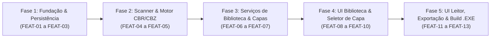

# PLANO_DESENVOLVIMENTO.md — Backlog e Roteiro de Desenvolvimento (HqFriend)

## 1. Visão Geral e Estratégia de Execução
O desenvolvimento do **HqFriend** está organizado em **5 Fases (Épicos)** e **13 Features (`FEAT-01` a `FEAT-13`)**. A sequência respeita a dependência entre as 3 camadas definidas no `PLANO_ARQUITETURA.md`, garantindo que nenhuma tela seja construída antes que seus serviços e adaptadores de infraestrutura estejam testados e operacionais.

---

## 2. Mapa de Fases (Roadmap)

---

## 3. Detalhamento do Backlog de Features

### FASE 1: Fundação, Domínio e Persistência Local

#### `FEAT-01` — Setup do Projeto, Configuração de Caminhos e Bootstrap de Pastas
* **Requisitos Atendidos:** RNF01, RNF02, RNF03
* **Arquivos Envolvidos:** `requirements.txt`, `src/config.py`, `src/infrastructure/fs_scanner.py` (método de bootstrap), `bin/UnRAR.exe`
* **Descrição Técnica:** Configurar a árvore de diretórios do projeto, instalar as dependências (`PySide6`, `Pillow`, `pydantic`, `rarfile`, `pyinstaller`), implementar o resolvedor de caminhos compatível com PyInstaller (`_MEIPASS`) e criar a rotina que garante a existência automática das pastas `C:\Users\Computador\Documents\HqFriend`, `C:\Users\Computador\Documents\HqFriend\covers` e `C:\Users\Computador\Pictures\HQs`.
* **Critérios de Aceite:**
    1. Ao executar a rotina de inicialização, as 3 pastas de sistema devem ser criadas automaticamente caso não existam.
    2. O caminho do binário `bin/UnRAR.exe` deve ser resolvido corretamente via `get_resource_path()`.

#### `FEAT-02` — Modelagem de Domínio e Schemas com Pydantic v2
* **Requisitos Atendidos:** RNF02, US12
* **Arquivos Envolvidos:** `src/domain/enums.py`, `src/domain/models.py`
* **Descrição Técnica:** Implementar o enum `SeriesStatus` (`UNREAD`, `IN_PROGRESS`, `READ`) e os modelos Pydantic `CoverSource`, `ComicState`, `SeriesState`, `ReaderPreferences` e `AppState`, além dos DTOs de transferência para a camada de UI.
* **Critérios de Aceite:**
    1. Instanciar um `AppState` vazio deve gerar um JSON válido na versão `"1.0"` com valores padrão seguros.
    2. A desserialização de um JSON existente deve validar tipos, datas e enums automaticamente.

#### `FEAT-03` — Repositório de Estado JSON com Escrita Atômica
* **Requisitos Atendidos:** RNF02, US12
* **Arquivos Envolvidos:** `src/infrastructure/json_repository.py`
* **Descrição Técnica:** Implementar a classe `JsonStateRepository` responsável por carregar e salvar `C:\Users\Computador\Documents\HqFriend\state.json`. A gravação deve escrever primeiro em `state.json.tmp` e substituir o arquivo final via `os.replace()`.
* **Critérios de Aceite:**
    1. Se `state.json` não existir na primeira abertura, o repositório deve criar e retornar um `AppState` limpo.
    2. A escrita deve ocorrer via arquivo temporário atômico (`state.json.tmp` $\rightarrow$ `state.json`) sem deixar arquivos órfãos.

---

### FASE 2: Infraestrutura de Arquivos e Motor de Descompactação em RAM

#### `FEAT-04` — Scanner de Diretórios de Nível Único
* **Requisitos Atendidos:** RF01, RF03, RNF04
* **Arquivos Envolvidos:** `src/infrastructure/fs_scanner.py`
* **Descrição Técnica:** Implementar a varredura do diretório raiz selecionado pelo usuário, mapeando apenas subpastas imediatas (1º nível) como Séries e listando apenas arquivos com extensão `.cbr` e `.cbz` contidos diretamente dentro de cada subpasta.
* **Critérios de Aceite:**
    1. Subpastas sem nenhum arquivo `.cbr` ou `.cbz` devem ser ignoradas.
    2. Arquivos soltos na raiz ou em subpastas de 2º nível não devem ser contabilizados (respeitando o RF03).

#### `FEAT-05` — Motor de Leitura `.cbz` e `.cbr` em Memória RAM e Ordenação Natural
* **Requisitos Atendidos:** RNF04, RNF05, ADR-01
* **Arquivos Envolvidos:** `src/infrastructure/archive_reader.py`
* **Descrição Técnica:** Implementar `ArchiveReaderAdapter` com detecção por *Magic Bytes* (ZIP vs RAR), extração de páginas via `BytesIO` em RAM, ordenação natural (`natural_sort_key`), filtragem de extensões de imagem (`.jpg`, `.jpeg`, `.png`, `.webp`) e supressão de janela de console (`subprocess.CREATE_NO_WINDOW`) ao invocar o `UnRAR.exe`.
* **Critérios de Aceite:**
    1. Arquivos `.cbz` e `.cbr` (RAR4 e RAR5) devem listar suas páginas em ordem numérica humana (`1.jpg`, `2.jpg`, ..., `10.jpg`).
    2. A extração de uma página deve retornar `bytes` diretamente em memória sem criar arquivos temporários no disco.
    3. Nenhuma janela preta de terminal (`cmd.exe`) deve piscar ao extrair páginas de um arquivo `.cbr`.

---

### FASE 3: Serviços de Aplicação (Biblioteca e Capas)

#### `FEAT-06` — Serviço de Biblioteca, Contadores `X / Y` e Recálculo Dinâmico de Status
* **Requisitos Atendidos:** RF04, RF05, RF08, RF09, RF10, US02, US03, US05, US06, ADR-03
* **Arquivos Envolvidos:** `src/services/library_service.py`
* **Descrição Técnica:** Implementar `LibraryService` para sincronizar os arquivos físicos escaneados com o `state.json`. Calcular o contador `X / Y obras` de cada série, aplicar a regra de transição automática de status (`UNREAD`, `IN_PROGRESS`, `READ` — regredindo de `"Lida"` para `"Em andamento"` quando um novo arquivo for adicionado à pasta), prover a marcação em lote de série como lida (RF10) e a alternância manual de HQ como lida/não lida (RF08).
* **Critérios de Aceite:**
    1. Uma série com `11 / 11 obras` lidas deve ter status `READ`. Ao adicionar um 12º arquivo na pasta e sincronizar, o contador deve passar para `11 / 12 obras` e o status deve mudar automaticamente para `IN_PROGRESS`.
    2. Acionar `mark_series_as_read(series_name)` deve marcar todas as HQs da série como `is_read = True` e atualizar o contador para `Y / Y obras`.
    3. Arquivos removidos do disco não devem inflar o contador `X / Y`.

#### `FEAT-07` — Serviço de Gerenciamento e Cache de Capas das Séries
* **Requisitos Atendidos:** RF11, RF12, RNF02, RNF05
* **Arquivos Envolvidos:** `src/services/cover_service.py`
* **Descrição Técnica:** Implementar a geração automática da capa padrão (página 0 da primeira HQ da série) caso a série ainda não possua capa no cache `C:\Users\Computador\Documents\HqFriend\covers\{Serie}.png`, e o método `set_custom_cover(series_name, comic_filename, page_index)` para sobrescrever a capa no cache e atualizar o `state.json`.
* **Critérios de Aceite:**
    1. Toda série sincronizada deve possuir uma imagem `.png` otimizada salva em `Documents\HqFriend\covers\`.
    2. Ao definir uma capa customizada a partir de qualquer página de uma HQ da série, o arquivo em `covers\` e o `state.json` devem ser atualizados imediatamente.

---

### FASE 4: Interface Gráfica — Biblioteca e Customização (PySide6)

#### `FEAT-08` — Janela Principal (`MainWindow`), Tema Dark Mode e Tela Inicial de Séries (`HomeView`)
* **Requisitos Atendidos:** RF01, RF02, RF04, RF10, RF11, US01, US02, US05
* **Arquivos Envolvidos:** `src/main.py`, `src/ui/main_window.py`, `src/ui/views/home_view.py`, `assets/styles/dark_theme.qss`
* **Descrição Técnica:** Construir a `MainWindow` com `QStackedWidget` e estilização Dark Mode (`#121212`). Implementar a `HomeView` como tela inicial obrigatória (RF02), contendo o botão de selecionar pasta raiz (`QFileDialog`), o grid responsivo de cards de séries (exibindo capa, título, badge de status e contador `X / Y obras`) e o menu de contexto de botão direito no card (*"Selecionar imagem de capa"* e *"Marcar como lida"*).
* **Critérios de Aceite:**
    1. Abrir o aplicativo sempre exibe a `HomeView` carregando as séries do `root_directory` salvo no JSON.
    2. Clicar com o botão direito em uma série e escolher *"Marcar como lida"* atualiza imediatamente o card para `"Lida"` e o contador para `Y / Y obras`.

#### `FEAT-09` — Modal de Seleção de Capa em 2 Etapas com Worker Assíncrono (`CoverPickerDialog`)
* **Requisitos Atendidos:** RF11, RF12, RNF05, US04
* **Arquivos Envolvidos:** `src/ui/dialogs/cover_picker_dialog.py`, `src/ui/workers/thumbnail_worker.py`
* **Descrição Técnica:** Implementar o diálogo modal acionado pelo menu de contexto da série:
    * **Passo 1:** `QComboBox` (ou lista seletora) onde o usuário escolhe qual arquivo `.cbr`/`.cbz` daquela série deseja pré-visualizar.
    * **Passo 2:** `ThumbnailWorker` (`QThread`) que extrai em background as páginas apenas da HQ selecionada, redimensionando-as para *thumbnails* de 250px e preenchendo um grid visual para seleção da nova capa.
* **Critérios de Aceite:**
    1. O sistema não deve extrair todas as HQs da série de uma vez; deve carregar apenas as páginas da HQ selecionada no Passo 1.
    2. A interface não deve travar durante o carregamento das miniaturas, e fechar o modal antes do fim deve interromper a thread imediatamente sem vazamento de memória.
    3. Ao confirmar a página escolhida, a capa da série na `HomeView` deve ser atualizada instantaneamente.

#### `FEAT-10` — Tela de Detalhes da Série e Listagem de HQs (`SeriesView`)
* **Requisitos Atendidos:** RF05, RF08, RF13, US06
* **Arquivos Envolvidos:** `src/ui/views/series_view.py`
* **Descrição Técnica:** Implementar a tela de listagem das HQs (`.cbr`/`.cbz`) pertencentes à série clicada na `HomeView`. Exibir nome da obra, status visual (`Não lida`, `Em andamento - Pág X/Y`, `Lida`), botão de voltar para a `HomeView`, evento de duplo clique para abrir a leitura (RF13) e menu de contexto com botão direito para alternar manualmente entre *"Lida"* e *"Não lida"* (RF08).
* **Critérios de Aceite:**
    1. Clicar com o botão direito em uma HQ permite marcá-la como `"Lida"` ou `"Não lida"`, recalculando o status da série em tempo real.
    2. Dar duplo clique em uma HQ transiciona o `QStackedWidget` para o leitor carregando o arquivo selecionado.

---

### FASE 5: Motor Visual de Leitura, Exportação (`Ctrl+P`) e Build Executável

#### `FEAT-11` — Serviço e Canvas de Leitura Integrada (`ReaderService` + `ReaderView`)
* **Requisitos Atendidos:** RF06, RF07, RF13, RF14, RF15, RF16, RNF05, US07, US08, US09, US10, ADR-02, ADR-04
* **Arquivos Envolvidos:** `src/services/reader_service.py`, `src/ui/views/reader_view.py`
* **Descrição Técnica:** Implementar a lógica e o canvas gráfico (`QGraphicsView` / `QGraphicsScene` com fundo `#000000`):
    * Retomada automática da página salva no *Bookmark* (RF06);
    * Navegação por `Seta Direita`, `Seta Esquerda` e `Barra de Espaço`, com saída via `ESC` voltando para a `SeriesView` (RF14);
    * Controle de zoom ancorado no cursor via `Ctrl + Scroll` (RF15), arraste da página ampliada com o mouse (*ScrollHandDrag*) e reset automático do zoom (*Fit-to-View*) a cada virada de página;
    * Alternância entre Página Única e Página Dupla via `Ctrl + S` com pareamento iniciando na Página 1 (`[1,2]`, `[3,4]`) e tratamento de última página ímpar centralizada (RF16);
    * Marcação automática da HQ como `"Lida"` (e da série, se for a última HQ pendente) ao atingir a última página (RF07);
    * Cache LRU / *prefetching* das próximas páginas em memória RAM.
* **Critérios de Aceite:**
    1. Fechar uma HQ na metade via `ESC` e abri-la novamente deve retomar exatamente da página onde parou.
    2. Chegar à última página deve marcar a HQ como `"Lida"` automaticamente e atualizar o contador `X / Y` na tela da série.
    3. `Ctrl + S` deve alternar instantaneamente entre 1 página e 2 páginas lado a lado (iniciando o par na página 1).
    4. `Ctrl + Scroll` deve aplicar zoom suave, permitindo arrastar a imagem com o mouse, e virar a página deve resetar o zoom para caber na tela.

#### `FEAT-12` — Serviço de Captura e Exportação de Página `Ctrl + P` (`ExportService`)
* **Requisitos Atendidos:** RF17, RNF03, US11
* **Arquivos Envolvidos:** `src/services/export_service.py`, integração em `src/ui/views/reader_view.py`
* **Descrição Técnica:** Implementar a captura da visualização atual ao pressionar `Ctrl + P` no leitor:
    * Sanitizar `NomeDaSerie` e `NomeDoArquivo` (sem extensão `.cbr`/`.cbz`);
    * Nomear o arquivo como `NomeDaSerie_NomeDoArquivo_PagXX.png` (usando sempre o número da primeira página visível no par);
    * Em Página Única: exportar a página atual como PNG;
    * Em Página Dupla: unir as duas páginas lado a lado com `Pillow`, centralizando verticalmente em fundo preto (`#000000`) caso tenham alturas distintas;
    * Salvar em `C:\Users\Computador\Pictures\HQs` e exibir notificação visual discreta (*Toast*) no leitor.
* **Critérios de Aceite:**
    1. Pressionar `Ctrl + P` em página simples gera 1 arquivo `.png` válido em `C:\Users\Computador\Pictures\HQs`.
    2. Pressionar `Ctrl + P` em página dupla gera 1 único arquivo `.png` contendo as duas páginas unidas lado a lado e centralizadas verticalmente, nomeado com o número da primeira página do par.

#### `FEAT-13` — Empacotamento e Build do Executável Windows (`HqFriend.exe`)
* **Requisitos Atendidos:** RNF01, RNF04
* **Arquivos Envolvidos:** `HqFriend.spec`
* **Descrição Técnica:** Configurar o arquivo `HqFriend.spec` do PyInstaller para embutir o binário `bin/UnRAR.exe` e a folha de estilos `assets/styles/dark_theme.qss`, ocultando o console (`console=False`) e gerando o executável standalone `HqFriend.exe`.
* **Critérios de Aceite:**
    1. O executável gerado (`dist/HqFriend.exe`) deve iniciar em modo gráfico puro (sem tela preta de terminal).
    2. Todas as operações de leitura de `.cbz`/`.cbr`, persistência em `Documents\HqFriend` e exportação `Ctrl + P` em `Pictures\HQs` devem funcionar a partir do `.exe`.