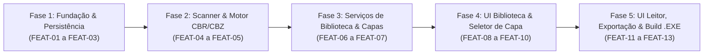

# PLANO_DESENVOLVIMENTO.md — Backlog e Roteiro de Desenvolvimento (HqFriend)

## 1. Visão Geral e Estratégia de Execução
O desenvolvimento do **HqFriend** está organizado em **5 Fases (Épicos)** e **13 Features (`FEAT-01` a `FEAT-13`)**. A sequência respeita a dependência entre as 3 camadas definidas no `PLANO_ARQUITETURA.md`, garantindo que nenhuma tela seja construída antes que seus serviços e adaptadores de infraestrutura estejam testados e operacionais.

### 1.1. Estratégia de Testes
* Toda feature das camadas de **Domínio, Aplicação e Infraestrutura** (FEAT-01 a FEAT-07, e a parte de serviço das FEAT-11 e FEAT-12) deve ser entregue com testes unitários **pytest** em `tests/`, cobrindo seus critérios de aceite.
* Fixtures de arquivos compactados ficam em `tests/fixtures/` e devem incluir: `.cbz` simples, `.cbr` RAR4, `.cbr` RAR5, `.cbr` *solid*, ZIP renomeado para `.cbr`, arquivo sem imagens, arquivo corrompido e arquivo com páginas `1.jpg ... 10.jpg`.
* Testes que dependem de caminhos do usuário devem redirecionar `APP_DATA_DIR` e `EXPORT_PICTURES_DIR` para pastas temporárias (`tmp_path`), nunca gravando nas pastas reais.
* Features de UI (FEAT-08 a FEAT-11) são validadas por roteiro de teste manual baseado nos critérios de aceite.

> **Decisão QA-01** (`REQUISITOS.md`, seção 6): opção C — estado único chaveado por nome de série/arquivo, sem reset ao trocar de diretório raiz. Aplica-se ao modelo de dados da `FEAT-02` e à sincronização da `FEAT-06`.

---

## 2. Mapa de Fases (Roadmap)

---

## 3. Detalhamento do Backlog de Features

### FASE 1: Fundação, Domínio e Persistência Local

#### `FEAT-01` — Setup do Projeto, Configuração de Caminhos, Logs e Bootstrap de Pastas
* **Requisitos Atendidos:** RNF01, RNF02, RNF03, RNF06
* **Arquivos Envolvidos:** `requirements.txt`, `requirements-dev.txt`, `src/config.py`, `src/infrastructure/fs_scanner.py` (método de bootstrap), `src/infrastructure/logging_setup.py`, `tests/`, `bin/UnRAR.exe`
* **Descrição Técnica:** Configurar a árvore de diretórios do projeto (incluindo `tests/`), instalar as dependências (`PySide6`, `Pillow`, `pydantic`, `rarfile`, `pyinstaller`, `pytest`), implementar o resolvedor de caminhos compatível com PyInstaller (`_MEIPASS`), a resolução das pastas conhecidas do Windows (`%DOCUMENTOS%` e `%IMAGENS%` via `SHGetKnownFolderPath`), a rotina que garante a existência automática das pastas `%DOCUMENTOS%\HqFriend`, `covers\`, `logs\` e `%IMAGENS%\HQs`, e a configuração de log rotativo com `sys.excepthook` / `threading.excepthook`.
* **Critérios de Aceite:**
    1. Ao executar a rotina de inicialização, as 4 pastas de sistema devem ser criadas automaticamente caso não existam.
    2. `%DOCUMENTOS%` e `%IMAGENS%` devem corresponder às pastas reais do usuário, inclusive quando redirecionadas para o OneDrive (nenhum caminho com nome de usuário fixo no código).
    3. O caminho do binário `bin/UnRAR.exe` deve ser resolvido corretamente via `get_resource_path()`.
    4. Uma exceção não tratada deve ser registrada em `%DOCUMENTOS%\HqFriend\logs\hqfriend.log`.

#### `FEAT-02` — Modelagem de Domínio e Schemas com Pydantic v2
* **Requisitos Atendidos:** RNF02, RF18, US12
* **Arquivos Envolvidos:** `src/domain/enums.py`, `src/domain/models.py`, `src/domain/errors.py`, `src/domain/sorting.py`
* **Descrição Técnica:** Implementar o enum `SeriesStatus` (`UNREAD`, `IN_PROGRESS`, `READ`), os modelos Pydantic `CoverSource`, `ComicState`, `SeriesState`, `ReaderPreferences` e `AppState`, os DTOs de transferência para a camada de UI, as exceções de domínio (`InvalidComicError`, `StateRecoveredWarning`) e a função `natural_sort_key`.
* **Critérios de Aceite:**
    1. Instanciar um `AppState` vazio deve gerar um JSON válido na versão `"1.0"` com valores padrão seguros.
    2. A desserialização de um JSON existente deve validar tipos, datas e enums automaticamente.
    3. `natural_sort_key` deve ordenar `["Edição 10", "edição 2", "Edição 1"]` como `["Edição 1", "edição 2", "Edição 10"]`.

#### `FEAT-03` — Repositório de Estado JSON com Escrita Atômica, Backup e Recuperação
* **Requisitos Atendidos:** RNF02, US12
* **Arquivos Envolvidos:** `src/infrastructure/json_repository.py`
* **Descrição Técnica:** Implementar a classe `JsonStateRepository` responsável por carregar e salvar `%DOCUMENTOS%\HqFriend\state.json`. A gravação deve escrever primeiro em `state.json.tmp` e substituir o arquivo final via `os.replace()`, com novas tentativas em caso de `PermissionError`. O carregamento deve gerar o snapshot `state.json.bak` e recuperar automaticamente de um `state.json` corrompido.
* **Critérios de Aceite:**
    1. Se `state.json` não existir na primeira abertura, o repositório deve criar e retornar um `AppState` limpo.
    2. A escrita deve ocorrer via arquivo temporário atômico (`state.json.tmp` $\rightarrow$ `state.json`) sem deixar arquivos órfãos.
    3. Um `state.json` com JSON malformado deve ser renomeado para `state.corrupt-<timestamp>.json`, e o estado deve ser restaurado do `state.json.bak`, sinalizando `StateRecoveredWarning`.
    4. Se o `.bak` também for inválido, o repositório deve retornar um `AppState` limpo sem lançar exceção.
    5. Um `PermissionError` transitório em `os.replace` deve ser superado pelas novas tentativas.

---

### FASE 2: Infraestrutura de Arquivos e Motor de Descompactação em RAM

#### `FEAT-04` — Scanner de Diretórios de Nível Único
* **Requisitos Atendidos:** RF01, RF03
* **Arquivos Envolvidos:** `src/infrastructure/fs_scanner.py`
* **Descrição Técnica:** Implementar a varredura do diretório raiz selecionado pelo usuário, mapeando apenas subpastas imediatas (1º nível) como Séries e listando apenas arquivos com extensão `.cbr` e `.cbz` contidos diretamente dentro de cada subpasta. O scanner retorna um `ScanResult` puro, sem alterar o estado.
* **Critérios de Aceite:**
    1. Subpastas sem nenhum arquivo `.cbr` ou `.cbz` devem ser ignoradas.
    2. Arquivos soltos na raiz, arquivos de outras extensões ou arquivos em subpastas de 2º nível não devem ser contabilizados (respeitando o RF03).
    3. Um diretório raiz inexistente deve resultar em `ScanResult` vazio, sem exceção não tratada.

#### `FEAT-05` — Motor de Leitura `.cbz` e `.cbr` em Memória RAM e Ordenação Natural
* **Requisitos Atendidos:** RNF04, RNF05, RF20, ADR-01, ADR-06
* **Arquivos Envolvidos:** `src/infrastructure/archive_reader.py`
* **Descrição Técnica:** Implementar `ArchiveReaderAdapter` com detecção por *Magic Bytes* (ZIP vs RAR), extração de páginas em RAM (`zipfile` sob demanda para ZIP; passada única do `UnRAR.exe` via *stdout* para RAR), ordenação natural (`natural_sort_key`), filtragem de extensões de imagem (`.jpg`, `.jpeg`, `.png`, `.webp`), supressão de janela de console (`subprocess.CREATE_NO_WINDOW`) e lançamento de `InvalidComicError` para arquivos inválidos.
* **Critérios de Aceite:**
    1. Arquivos `.cbz` e `.cbr` (RAR4, RAR5 e *solid*) devem listar suas páginas em ordem numérica humana (`1.jpg`, `2.jpg`, ..., `10.jpg`).
    2. A extração de uma página deve retornar `bytes` diretamente em memória sem criar arquivos temporários no disco.
    3. A abertura de um `.cbr` deve executar **um único** processo `UnRAR.exe`, e os bytes de cada página devem ser idênticos aos obtidos por `rarfile.RarFile.read()`.
    4. Um arquivo ZIP com extensão `.cbr` deve ser aberto corretamente.
    5. Arquivos corrompidos, protegidos por senha ou sem imagens devem lançar `InvalidComicError`.
    6. Nenhuma janela preta de terminal (`cmd.exe`) deve piscar ao abrir um arquivo `.cbr` a partir do executável.

---

### FASE 3: Serviços de Aplicação (Biblioteca e Capas)

#### `FEAT-06` — Serviço de Biblioteca, Contadores `X / Y`, Recálculo Dinâmico de Status e Marcações
* **Requisitos Atendidos:** RF04, RF05, RF08, RF09, RF10, RF18, RF19, US02, US03, US05, US06, US13, ADR-03
* **Arquivos Envolvidos:** `src/services/library_service.py`
* **Descrição Técnica:** Implementar `LibraryService` para mesclar o `ScanResult` com o `state.json` (`apply_scan`). Calcular o contador `X / Y obras` de cada série, aplicar a regra de transição automática de status (`UNREAD`, `IN_PROGRESS`, `READ` — regredindo de `"Lida"` para `"Em andamento"` quando um novo arquivo for adicionado à pasta), ordenar séries e HQs naturalmente, e prover a marcação em lote de série como lida/não lida (RF10) e a alternância manual de HQ como lida/não lida (RF08), zerando o bookmark ao marcar como não lida.
* **Critérios de Aceite:**
    1. Uma série com `11 / 11 obras` lidas deve ter status `READ`. Ao adicionar um 12º arquivo na pasta e sincronizar, o contador deve passar para `11 / 12 obras` e o status deve mudar automaticamente para `IN_PROGRESS`.
    2. Acionar `mark_series_read(series_name)` deve marcar todas as HQs da série como `is_read = True` e atualizar o contador para `Y / Y obras`.
    3. Acionar `mark_series_unread(series_name)` deve marcar todas as HQs como não lidas, zerar seus bookmarks e resultar em `0 / Y obras` com status `UNREAD`.
    4. Marcar como não lida a única HQ lida de uma série (sem outras HQs em andamento) deve resultar em status `UNREAD` (bookmark zerado).
    5. Uma série sem nenhuma HQ lida deve exibir o contador `0 / Y obras`.
    6. Arquivos removidos do disco não devem inflar o contador `X / Y`, e suas entradas devem permanecer no `state.json`.
    7. Trocar o diretório raiz não deve apagar o progresso existente: séries e arquivos com o mesmo nome na nova raiz exibem o progresso já registrado (QA-01).

#### `FEAT-07` — Serviço de Gerenciamento e Cache de Capas das Séries
* **Requisitos Atendidos:** RF11, RF12, RNF02, RNF05
* **Arquivos Envolvidos:** `src/services/cover_service.py`
* **Descrição Técnica:** Implementar, sem dependência de PySide6, a geração da capa padrão (página 0 da primeira HQ da série em ordem natural, pulando HQs inválidas) caso a série ainda não possua capa no cache `%DOCUMENTOS%\HqFriend\covers\{Serie}.png`; o método `set_custom_cover(series_name, comic_filename, page_index)` para sobrescrever a capa no cache e atualizar o `state.json`; o método `restore_default_cover(series_name)`; e `build_thumbnail(comic_path, page_index)` para uso pelo `ThumbnailWorker`.
* **Critérios de Aceite:**
    1. Toda série sincronizada que possua ao menos uma HQ válida deve possuir uma imagem `.png` otimizada salva em `covers\`.
    2. Ao definir uma capa customizada a partir de qualquer página de uma HQ da série, o arquivo em `covers\` e o `state.json` devem ser atualizados imediatamente, com `custom_cover_image` relativo a `%DOCUMENTOS%\HqFriend`.
    3. `restore_default_cover` deve regerar a capa padrão e limpar `custom_cover_image` e `cover_source`.
    4. O módulo `cover_service.py` não deve importar PySide6.

---

### FASE 4: Interface Gráfica — Biblioteca e Customização (PySide6)

#### `FEAT-08` — Janela Principal (`MainWindow`), Instância Única, Tema Dark Mode e Tela Inicial de Séries (`HomeView`)
* **Requisitos Atendidos:** RF01, RF02, RF04, RF10, RF11, RF18, RF19, RNF02, RNF05, RNF06, RNF07, US01, US02, US05, US13
* **Arquivos Envolvidos:** `src/main.py`, `src/ui/main_window.py`, `src/ui/views/home_view.py`, `src/ui/workers/library_scan_worker.py`, `src/ui/workers/cover_worker.py`, `assets/styles/dark_theme.qss`
* **Descrição Técnica:** Construir a sequência de inicialização (logs, `QLockFile` de instância única, carga do estado com aviso de recuperação), a `MainWindow` com `QStackedWidget` e estilização Dark Mode (`#121212`). Implementar a `HomeView` como tela inicial obrigatória (RF02), contendo o botão de selecionar pasta raiz (`QFileDialog`), o botão **"Atualizar"** / tecla `F5`, o grid responsivo de cards de séries em ordem natural (exibindo capa ou *placeholder*, título, badge de status e contador `X / Y obras`) e o menu de contexto de botão direito no card (*"Selecionar imagem de capa"*, *"Restaurar capa padrão"*, *"Marcar como lida"* e *"Marcar como não lida"*). A varredura roda no `LibraryScanWorker` e as capas padrão são geradas progressivamente pelo `CoverWorker`.
* **Critérios de Aceite:**
    1. Abrir o aplicativo sempre exibe a `HomeView` carregando as séries do `root_directory` salvo no JSON; se a pasta não existir, exibe o convite para selecionar pasta sem apagar o estado.
    2. Clicar com o botão direito em uma série e escolher *"Marcar como lida"* atualiza imediatamente o card para `"Lida"` e o contador para `Y / Y obras`; *"Marcar como não lida"* atualiza para `"Não lida"` e `0 / Y obras`.
    3. Adicionar um arquivo `.cbz` a uma série com o aplicativo aberto e pressionar `F5` atualiza o contador sem reiniciar.
    4. A interface permanece responsiva durante a varredura e a geração de capas de uma biblioteca com 100+ séries.
    5. Tentar abrir uma segunda instância exibe aviso e encerra a nova instância.

#### `FEAT-09` — Modal de Seleção de Capa em 2 Etapas com Worker Assíncrono (`CoverPickerDialog`)
* **Requisitos Atendidos:** RF11, RF12, RNF05, US04
* **Arquivos Envolvidos:** `src/ui/dialogs/cover_picker_dialog.py`, `src/ui/workers/thumbnail_worker.py`
* **Descrição Técnica:** Implementar o diálogo modal acionado pelo menu de contexto da série:
    * **Passo 1:** `QComboBox` (ou lista seletora) onde o usuário escolhe qual arquivo `.cbr`/`.cbz` daquela série deseja pré-visualizar.
    * **Passo 2:** `ThumbnailWorker` (subclasse de `QThread`) que chama `CoverService.build_thumbnail` para cada página apenas da HQ selecionada, emitindo `page_thumbnail_ready(page_index, QImage)` e preenchendo um grid visual de *thumbnails* de 250px para seleção da nova capa.
* **Critérios de Aceite:**
    1. O sistema não deve extrair todas as HQs da série de uma vez; deve carregar apenas as páginas da HQ selecionada no Passo 1.
    2. A interface não deve travar durante o carregamento das miniaturas, e fechar o modal (ou trocar de HQ) antes do fim deve interromper a thread (`requestInterruption()` + `wait()`) sem vazamento de memória.
    3. Ao confirmar a página escolhida, a capa da série na `HomeView` deve ser atualizada instantaneamente.

#### `FEAT-10` — Tela de Detalhes da Série e Listagem de HQs (`SeriesView`)
* **Requisitos Atendidos:** RF05, RF08, RF13, RF18, RF19, RF20, US06
* **Arquivos Envolvidos:** `src/ui/views/series_view.py`
* **Descrição Técnica:** Implementar a tela de listagem das HQs (`.cbr`/`.cbz`) pertencentes à série clicada na `HomeView`, em ordem natural. Exibir nome da obra, status visual (`Não lida`, `Em andamento - Pág X/Y`, `Lida`), botão de voltar para a `HomeView` (que dispara nova sincronização), evento de duplo clique para abrir a leitura (RF13) com tratamento de arquivo inválido (RF20) e menu de contexto com botão direito para alternar manualmente entre *"Lida"* e *"Não lida"* (RF08).
* **Critérios de Aceite:**
    1. Clicar com o botão direito em uma HQ permite marcá-la como `"Lida"` ou `"Não lida"`, recalculando o status da série em tempo real; marcar como `"Não lida"` remove a indicação de página em andamento.
    2. Dar duplo clique em uma HQ válida transiciona o `QStackedWidget` para o leitor carregando o arquivo selecionado.
    3. Dar duplo clique em uma HQ inválida exibe mensagem de erro, permanece na `SeriesView` e não altera o status da HQ.

---

### FASE 5: Motor Visual de Leitura, Exportação (`Ctrl+P`) e Build Executável

#### `FEAT-11` — Serviço e Canvas de Leitura Integrada (`ReaderService` + `ReaderView`)
* **Requisitos Atendidos:** RF06, RF07, RF13, RF14, RF15, RF16, RF20, RNF05, US07, US08, US09, US10, ADR-02, ADR-04
* **Arquivos Envolvidos:** `src/services/reader_service.py`, `src/ui/views/reader_view.py`
* **Descrição Técnica:** Implementar a lógica e o canvas gráfico (`QGraphicsView` / `QGraphicsScene` com fundo `#000000`):
    * Validação do arquivo na abertura (RF20) e retomada automática da página salva no *Bookmark*, com HQs já lidas reabrindo na página 1 (RF06);
    * Navegação por `Seta Direita`, `Seta Esquerda` e `Barra de Espaço` (via `keyPressEvent` sobrescrito), com saída via `ESC` voltando para a `SeriesView` (RF14);
    * Controle de zoom ancorado no cursor via `Ctrl + Scroll` (RF15), arraste da página ampliada com o mouse (*ScrollHandDrag*) e reset automático do zoom (*Fit-to-View*) a cada virada de página;
    * Alternância entre Página Única e Página Dupla via `Ctrl + S` com pareamento iniciando na Página 1 (`[1,2]`, `[3,4]`) e tratamento de última página ímpar centralizada (RF16);
    * Evento único `on_visible_pages_changed()` (abertura, navegação e `Ctrl + S`) que grava o bookmark com *debounce* e marca a HQ como `"Lida"` (e a série, se for a última HQ pendente) quando a última página estiver visível (RF07);
    * Cache LRU / *prefetching* das próximas páginas em memória RAM, seguro entre threads.
* **Critérios de Aceite:**
    1. Fechar uma HQ na metade via `ESC` e abri-la novamente deve retomar exatamente da página onde parou.
    2. Chegar à última página deve marcar a HQ como `"Lida"` automaticamente e atualizar o contador `X / Y` na tela da série.
    3. Concluir uma HQ com número par de páginas em modo duplo e reabri-la deve iniciar na página 1.
    4. Estando em modo único na penúltima página de uma HQ de páginas pares, pressionar `Ctrl + S` (exibindo o último par) deve marcar a HQ como `"Lida"`.
    5. `Ctrl + S` deve alternar instantaneamente entre 1 página e 2 páginas lado a lado (iniciando o par na página 1).
    6. `Ctrl + Scroll` deve aplicar zoom suave, permitindo arrastar a imagem com o mouse, e virar a página deve resetar o zoom para caber na tela.

#### `FEAT-12` — Serviço de Captura e Exportação de Página `Ctrl + P` (`ExportService`)
* **Requisitos Atendidos:** RF17, RNF03, US11
* **Arquivos Envolvidos:** `src/services/export_service.py`, integração em `src/ui/views/reader_view.py`
* **Descrição Técnica:** Implementar a captura da visualização atual ao pressionar `Ctrl + P` no leitor, sempre a partir dos bytes originais das páginas (ignorando o zoom):
    * Sanitizar `NomeDaSerie` e `NomeDoArquivo` (sem extensão `.cbr`/`.cbz`);
    * Nomear o arquivo como `NomeDaSerie_NomeDoArquivo_PagXX.png` (usando sempre o número da primeira página visível no par), acrescentando sufixo `_2`, `_3`, ... se o arquivo já existir;
    * Em Página Única: converter para RGB e exportar a página atual como PNG;
    * Em Página Dupla: unir as duas páginas lado a lado com `Pillow`, sem redimensioná-las, centralizando verticalmente em fundo preto (`#000000`) caso tenham alturas distintas;
    * Salvar em `%IMAGENS%\HQs` e exibir notificação visual discreta (*Toast*) no leitor.
* **Critérios de Aceite:**
    1. Pressionar `Ctrl + P` em página simples gera 1 arquivo `.png` válido em `%IMAGENS%\HQs`, inclusive para páginas JPEG em CMYK.
    2. Pressionar `Ctrl + P` em página dupla gera 1 único arquivo `.png` contendo as duas páginas unidas lado a lado em seu tamanho original e centralizadas verticalmente sobre fundo preto, nomeado com o número da primeira página do par.
    3. Pressionar `Ctrl + P` duas vezes na mesma página gera `..._PagXX.png` e `..._PagXX_2.png`, sem sobrescrever o primeiro.

#### `FEAT-13` — Empacotamento e Build do Executável Windows (`HqFriend.exe`)
* **Requisitos Atendidos:** RNF01, RNF04
* **Arquivos Envolvidos:** `HqFriend.spec`
* **Descrição Técnica:** Configurar o arquivo `HqFriend.spec` do PyInstaller 6 (modo onedir) para embutir o binário `bin/UnRAR.exe`, o ícone `assets/icon.ico` e a folha de estilos `assets/styles/dark_theme.qss`, ocultando o console (`console=False`), sem UPX, gerando a pasta distribuível `dist/HqFriend/`.
* **Critérios de Aceite:**
    1. O executável gerado (`dist/HqFriend/HqFriend.exe`) deve iniciar em modo gráfico puro (sem tela preta de terminal) e exibir o ícone do aplicativo.
    2. Todas as operações de leitura de `.cbz`/`.cbr`, persistência em `%DOCUMENTOS%\HqFriend`, logs e exportação `Ctrl + P` em `%IMAGENS%\HQs` devem funcionar a partir do `.exe`.
