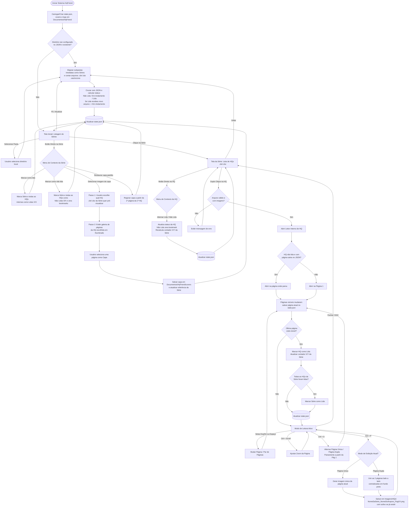

# REQUISITOS.md — Especificação de Requisitos do Sistema (HqFriend)

## 1. Visão Geral do Sistema
O **HqFriend** é uma aplicação desktop local voltada para o gerenciamento de acervo e leitura de histórias em quadrinhos nos formatos `.cbr` e `.cbz`. O sistema opera diretamente sobre o sistema de arquivos local do usuário, organizando pastas como "Séries" e mantendo o estado de progresso, capas customizadas e preferências persistidos localmente em formato estruturado (`JSON`).

### 1.1. Convenção de Caminhos do Sistema
Os caminhos de sistema são expressos por variáveis resolvidas em tempo de execução a partir das **pastas conhecidas do Windows** (*Known Folders*), respeitando redirecionamentos (ex: OneDrive):
* **`%DOCUMENTOS%`** — Pasta "Documentos" do usuário (ex: `C:\Users\Computador\Documents` ou `C:\Users\Computador\OneDrive\Documentos`).
* **`%IMAGENS%`** — Pasta "Imagens" do usuário (ex: `C:\Users\Computador\Pictures` ou `C:\Users\Computador\OneDrive\Imagens`).

---

## 2. Requisitos Funcionais (RF)

### 2.1. Gerenciamento de Diretório e Acervo
* **RF01 — Seleção de Diretório Raiz:** O sistema deve permitir ao usuário selecionar uma pasta local do computador para carregar o acervo de HQs. Ao trocar de diretório raiz, o estado de progresso existente é **mantido** (não há reset); o progresso é associado ao nome da pasta da série e ao nome do arquivo, independentemente do caminho da raiz (ver decisão **QA-01** na seção 6).
* **RF02 — Inicialização na Tela Principal:** Sempre que o sistema for aberto, ele deve exibir diretamente a "Tela Inicial" (Listagem de Séries), carregando automaticamente o diretório raiz previamente configurado no arquivo de memória. Caso o diretório configurado não exista mais (ex: unidade externa desconectada), o sistema deve exibir a Tela Inicial convidando a selecionar uma pasta, **sem apagar** o estado salvo.
* **RF03 — Reconhecimento de Séries (Nível Único):** O sistema deve interpretar cada subpasta imediata dentro do diretório selecionado como uma "Série". Apenas arquivos `.cbr` e `.cbz` no primeiro nível da pasta da série são considerados; demais arquivos e subpastas aninhadas são ignorados. Subpastas sem nenhum arquivo `.cbr`/`.cbz` não são exibidas como Série.
* **RF04 — Contagem e Proporção de Obras:** Para cada série listada, o sistema deve contabilizar o total de arquivos `.cbr` e `.cbz` válidos e exibir um contador de progresso no formato `X / Y obras` (onde `X` é o número de obras lidas e `Y` é o total de obras na pasta). Caso nenhuma tenha sido lida, deve exibir `0 / Y obras`.
* **RF05 — Listagem de Obras da Série:** Ao acessar uma série, o sistema deve listar todos os arquivos `.cbr` e `.cbz` pertencentes a ela, exibindo o status individual de leitura (Não lida, Em andamento com página atual, ou Lida).
* **RF18 — Ordenação Natural de Séries e Obras:** Séries (Tela Inicial) e obras (Tela da Série) devem ser exibidas em ordem alfanumérica natural, sem distinção de maiúsculas/minúsculas (ex: `Edição 2` antes de `Edição 10`).
* **RF19 — Atualização da Biblioteca:** O sistema deve reescanear o diretório raiz: (a) na inicialização; (b) ao trocar de diretório raiz; (c) ao retornar da Tela da Série para a Tela Inicial; (d) sob demanda, pela tecla `F5` ou pelo botão **"Atualizar"** na Tela Inicial. A varredura deve refletir arquivos adicionados ou removidos sem necessidade de reiniciar o sistema.

### 2.2. Gerenciamento de Status e Progresso de Leitura
* **RF06 — Persistência de Página Atual (Bookmark):** Caso o usuário feche uma HQ antes de finalizá-la, o sistema deve salvar a última página visualizada e retomar a leitura exatamente dessa página quando o arquivo for reaberto. Ao reabrir uma HQ com status "Lida", a leitura deve iniciar na **primeira página** (releitura).
* **RF07 — Marcação Automática de Obra Lida:** O sistema deve marcar automaticamente uma HQ como "Lida" assim que a última página do arquivo estiver visível na tela — seja por navegação, por alternância de modo de página (`Ctrl + S`) ou na própria abertura da HQ —, atualizando imediatamente o contador da série (`X / Y obras`).
* **RF08 — Marcação Manual de Obra (Menu de Contexto):** Na listagem de obras de uma série, ao clicar com o botão direito sobre uma HQ (`.cbr`/`.cbz`), o sistema deve exibir uma opção para alternar manualmente seu status entre "Lida" e "Não lida". Marcar como "Não lida" deve também **zerar o bookmark** da HQ (a leitura recomeça na primeira página).
* **RF09 — Status Automático da Série e Recálculo Dinâmico:**
  * Quando nenhuma HQ da série estiver lida nem em andamento, a série deve ser marcada como **"Não lida"**.
  * Quando todas as HQs de uma série estiverem com status "Lida" (`X == Y`), a série deve ser marcada como **"Lida"**.
  * Nos demais casos, a série deve ser marcada como **"Em andamento"**.
  * Se uma série marcada como "Lida" (ex: `11 / 11 obras`) receber um novo arquivo na pasta (passando a `11 / 12 obras`), seu status deve ser atualizado automaticamente para **"Em andamento"** na próxima atualização da biblioteca (RF19).
* **RF10 — Marcação Manual de Série em Lote (Menu de Contexto):** Na Tela Inicial, ao clicar com o botão direito sobre uma Série, o sistema deve exibir as opções:
  * **"Marcar como lida"**: a série e todas as HQs (`.cbr`/`.cbz`) dentro dela são marcadas como "Lidas" simultaneamente (desabilitada se a série já estiver "Lida").
  * **"Marcar como não lida"**: a série e todas as HQs dentro dela são marcadas como "Não lidas" e têm seus bookmarks zerados (desabilitada se a série já estiver "Não lida").

### 2.3. Customização de Capa da Série
* **RF11 — Ação de Seleção de Capa (Menu de Contexto):** Na Tela Inicial, ao clicar com o botão direito sobre uma Série, o sistema deve exibir a opção **"Selecionar imagem de capa"**. Enquanto o usuário não definir uma capa customizada, o sistema utilizará por padrão a primeira página da primeira HQ da série (segundo a ordenação do RF18). Quando houver capa customizada, o menu deve exibir também a opção **"Restaurar capa padrão"**.
* **RF12 — Fluxo de Escolha de Capa em 2 Etapas (Seletor de HQ + Galeria de Páginas):** Ao acionar "Selecionar imagem de capa", o sistema deve:
  1. Perguntar ao usuário **qual HQ (`.cbr`/`.cbz`)** daquela série ele deseja pré-visualizar;
  2. Exibir as miniaturas (*thumbnails*) de todas as páginas da HQ escolhida, permitindo ao usuário clicar em qualquer página para defini-la como a imagem de capa oficial da série.

### 2.4. Leitor Integrado de HQs e Atalhos
* **RF13 — Abertura por Duplo Clique:** Ao dar um duplo clique sobre um arquivo `.cbr` ou `.cbz`, o sistema deve abrir o leitor interno carregando a HQ selecionada.
* **RF20 — Tratamento de Arquivo Inválido:** Caso a HQ esteja corrompida, protegida por senha ou não contenha nenhuma imagem válida, o sistema **não deve abrir o leitor** nem alterar o status da HQ; deve exibir uma mensagem de erro amigável e permanecer na Tela da Série.
* **RF14 — Navegação de Páginas:** Durante a leitura, o sistema deve permitir:
  * **Seta Direita (`→`) ou `Barra de Espaço`:** Avançar para a próxima página (ou próximo par de páginas). Na última página, não faz nada.
  * **Seta Esquerda (`←`):** Voltar para a página anterior (ou par de páginas anterior). Na primeira página, não faz nada.
  * **Tecla `ESC` (ou botão de fechar):** Encerrar a visualização da HQ e retornar à listagem da série.
* **RF15 — Controle de Zoom (`Ctrl + Scroll`):** O usuário deve poder ampliar (zoom in) ou reduzir (zoom out) o tamanho da página atual utilizando o atalho `Ctrl + Scroll do mouse`.
* **RF16 — Alternância de Modo de Página (`Ctrl + S`):** O atalho `Ctrl + S` deve alternar a visualização entre **"Página Única"** e **"Página Dupla"**. A preferência é persistida e reaplicada nas próximas leituras.
  * *Regra de Pareamento:* No modo Página Dupla, o pareamento deve iniciar imediatamente na primeira página (ex: `[Pág 1 + Pág 2]`, `[Pág 3 + Pág 4]`, etc.).
* **RF17 — Captura e Exportação de Página (`Ctrl + P`):** O atalho `Ctrl + P` deve salvar a(s) página(s) exibida(s) como arquivo de imagem `.png` no diretório `%IMAGENS%\HQs`, na **resolução original** da página (o zoom aplicado na tela é ignorado).
  * *Comportamento em Página Única:* Salva a página atual como imagem única (`NomeDaSerie_NomeDoArquivo_PagXX.png`).
  * *Comportamento em Página Dupla:* Une as duas páginas exibidas lado a lado em uma única imagem combinada, **sem redimensioná-las**, centralizando verticalmente a página de menor altura sobre **fundo preto**, e salva seguindo a nomenclatura padrão (`NomeDaSerie_NomeDoArquivo_PagXX.png`, onde `XX` é o número da primeira página do par).
  * *Arquivo Existente:* Se já existir um arquivo com o mesmo nome, o sistema **não sobrescreve**; acrescenta um sufixo numérico (`..._PagXX_2.png`, `..._PagXX_3.png`, ...).

---

## 3. Requisitos Não Funcionais (RNF)

* **RNF01 — Execução Local (Offline-First):** O sistema deve rodar de forma 100% local no computador do usuário (ambiente Windows 11), sem dependência de conexão com a internet ou servidores externos.
* **RNF02 — Armazenamento de Memória e Estado:** Toda a memória do sistema (diretório raiz configurado, progresso de leitura por arquivo, página atual/bookmark, status das séries e cache de capas selecionadas) deve ser armazenada no diretório `%DOCUMENTOS%\HqFriend`, utilizando arquivo estruturado em formato **JSON** (`state.json`) e subpasta de cache de capas (`covers\`).
  * *Integridade:* A gravação deve ser atômica. O sistema deve manter uma cópia de segurança (`state.json.bak`) da última versão válida carregada. Se o `state.json` estiver corrompido, o sistema deve preservá-lo para análise, restaurar a partir do `.bak` (ou iniciar com estado limpo, caso o backup também seja inválido) e avisar o usuário.
* **RNF03 — Criação Automática de Diretórios de Sistema:** Caso os diretórios `%DOCUMENTOS%\HqFriend` (e subpastas `covers\` e `logs\`) ou `%IMAGENS%\HQs` não existam no momento da operação, o sistema deve criá-los automaticamente de forma transparente.
* **RNF04 — Suporte a Formatos de Compactação em Memória:** O motor de leitura deve descompactar diretamente em memória RAM (sem arquivos temporários em disco) arquivos compactados tanto em formato ZIP (`.cbz`) quanto RAR (`.cbr`), utilizando binário embarcado para RAR, identificando o formato real pelo conteúdo do arquivo (e não apenas pela extensão) e filtrando apenas extensões de imagem válidas (`.jpg`, `.jpeg`, `.png`, `.webp`) em ordem alfanumérica natural.
* **RNF05 — Desempenho de Renderização:** A transição entre páginas no leitor deve ocorrer de maneira fluida (tempo de resposta inferior a 200ms após o carregamento do arquivo). A varredura da biblioteca, a geração de capas padrão e o carregamento da galeria de seleção de capas (RF12) devem ocorrer de forma assíncrona, mantendo a interface responsiva.
* **RNF06 — Registro de Erros (Logs):** Erros e exceções não tratadas devem ser registrados em arquivo de log rotativo em `%DOCUMENTOS%\HqFriend\logs\`, e exceções inesperadas devem ser comunicadas ao usuário por mensagem amigável em vez de encerrar o sistema silenciosamente.
* **RNF07 — Instância Única:** Apenas uma instância do sistema pode estar em execução por vez, evitando gravações concorrentes no `state.json`. Ao tentar abrir uma segunda instância, o sistema deve avisar o usuário e encerrar a nova instância.

---

## 4. Histórias de Usuário (US)

* **US01 — Seleção do Diretório de HQs:** Como leitor, quero selecionar uma pasta do meu computador para que o sistema identifique minhas séries de HQs e salve esse caminho para os próximos acessos.
* **US02 — Visualização da Tela Inicial de Séries:** Como leitor, quero que o sistema sempre inicie na tela de listagem de séries, mostrando a capa de cada série, seu status ("Não lida", "Em andamento", "Lida") e o contador no formato `X / Y obras`.
* **US03 — Atualização Dinâmica de Série com Novos Arquivos:** Como leitor, quero que uma série anteriormente "Lida" passe automaticamente para "Em andamento" caso eu adicione novos arquivos `.cbr`/`.cbz` na pasta dela, sem precisar reiniciar o sistema.
* **US04 — Seleção de Capa da Série por HQ:** Como leitor, quero clicar com o botão direito em uma série e escolher "Selecionar imagem de capa", escolhendo primeiro qual HQ daquela série desejo abrir em pré-visualização e, em seguida, selecionando uma de suas páginas para ser a capa da série. Quero também poder restaurar a capa padrão.
* **US05 — Marcação de Série em Lote:** Como leitor, quero clicar com o botão direito em uma série e escolher "Marcar como lida" ou "Marcar como não lida" para que a série e todas as suas HQs internas sejam atualizadas de uma só vez.
* **US06 — Listagem e Marcação Manual de HQ:** Como leitor, quero abrir uma série para ver seus arquivos `.cbr`/`.cbz` em ordem natural e poder clicar com o botão direito em uma HQ específica para marcá-la manualmente como "Lida" ou "Não lida".
* **US07 — Leitura e Retomada de Progresso (Bookmark):** Como leitor, quero dar duplo clique em uma HQ para lê-la usando as `Setas (Esquerda/Direita)` ou `Espaço`, e quero que o sistema lembre em qual página parei caso eu feche antes do fim.
* **US08 — Conclusão Automática ao Atingir a Última Página:** Como leitor, quero que a HQ seja marcada automaticamente como "Lida" quando a última página aparecer na tela, atualizando o contador da série e marcando a série como "Lida" caso seja a última obra pendente.
* **US09 — Controle de Zoom na Leitura:** Como leitor, quero usar `Ctrl + Scroll do mouse` para ajustar o zoom da página durante a leitura.
* **US10 — Alternância entre Página Única e Dupla:** Como leitor, quero usar `Ctrl + S` para alternar entre página única e página dupla (com pareamento iniciando na página 1).
* **US11 — Captura de Página Unificada ou Simples:** Como leitor, quero usar `Ctrl + P` para salvar a visualização atual em `%IMAGENS%\HQs` com o nome `NomeDaSerie_NomeDoArquivo_PagXX.png`, unindo as duas páginas lado a lado (centralizadas sobre fundo preto) em uma única imagem quando eu estiver no modo de página dupla, sem sobrescrever capturas anteriores.
* **US12 — Persistência Local Transparente:** Como leitor, quero que todo o meu histórico de leitura, diretório configurado, páginas atuais e capas escolhidas fiquem salvos em estrutura JSON dentro de `%DOCUMENTOS%\HqFriend`, protegidos contra corrupção.
* **US13 — Atualização Manual da Biblioteca:** Como leitor, quero pressionar `F5` (ou o botão "Atualizar") para que o sistema reconheça imediatamente arquivos e séries que adicionei ou removi.

---

## 5. Diagrama de Fluxo do Sistema (Grafo)

---

## 6. Questões Decididas

| ID | Questão | Decisão | Alternativas Descartadas |
| :--- | :--- | :--- | :--- |
| **QA-01** | **Identificação do progresso ao trocar de diretório raiz.** | **Opção C (decidida em 2026-10-24):** estado único, chaveado apenas por *nome da pasta da série* + *nome do arquivo*, sem reset ao trocar de raiz. Mover a pasta raiz preserva o progresso. Entradas de arquivos ausentes no disco são mantidas no JSON, mas ignoradas nos contadores. | **A.** Estado separado por diretório raiz (mover a pasta perderia o progresso). **B.** Zerar o estado ao trocar de raiz (perderia o histórico). |

> **Limitações conhecidas (aceitas com a QA-01):**
> * Uma segunda biblioteca com séries e arquivos de mesmo nome herda o progresso já registrado para esses nomes.
> * Renomear uma pasta de série ou um arquivo `.cbr`/`.cbz` faz o sistema tratá-lo como novo, perdendo o progresso associado ao nome anterior.
