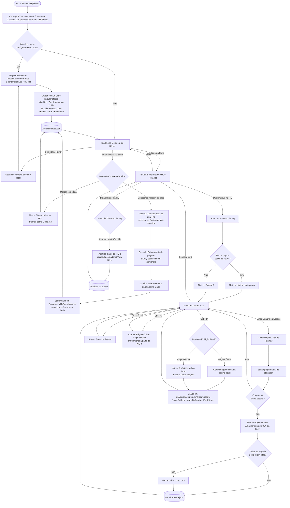

# REQUISITOS.md — Especificação de Requisitos do Sistema (HqFriend)

## 1. Visão Geral do Sistema
O **HqFriend** é uma aplicação desktop local voltada para o gerenciamento de acervo e leitura de histórias em quadrinhos nos formatos `.cbr` e `.cbz`. O sistema opera diretamente sobre o sistema de arquivos local do usuário, organizando pastas como "Séries" e mantendo o estado de progresso, capas customizadas e preferências persistidos localmente em formato estruturado (`JSON`).

---

## 2. Requisitos Funcionais (RF)

### 2.1. Gerenciamento de Diretório e Acervo
* **RF01 — Seleção de Diretório Raiz:** O sistema deve permitir ao usuário selecionar uma pasta local do computador para carregar o acervo de HQs.
* **RF02 — Inicialização na Tela Principal:** Sempre que o sistema for aberto, ele deve exibir diretamente a "Tela Inicial" (Listagem de Séries), carregando automaticamente o diretório raiz previamente configurado no arquivo de memória.
* **RF03 — Reconhecimento de Séries (Nível Único):** O sistema deve interpretar cada subpasta imediata dentro do diretório selecionado como uma "Série". Cada pasta de série conterá exclusivamente arquivos `.cbr` e `.cbz` no primeiro nível (sem suporte ou varredura de subpastas aninhadas).
* **RF04 — Contagem e Proporção de Obras:** Para cada série listada, o sistema deve contabilizar o total de arquivos `.cbr` e `.cbz` válidos e exibir um contador de progresso no formato `X / Y obras` (onde `X` é o número de obras lidas e `Y` é o total de obras na pasta; caso nenhuma tenha sido lida, pode exibir `0 / Y obras` ou `Y obras`).
* **RF05 — Listagem de Obras da Série:** Ao acessar uma série, o sistema deve listar todos os arquivos `.cbr` e `.cbz` pertencentes a ela, exibindo o status individual de leitura (Não lida, Em andamento com página atual, ou Lida).

### 2.2. Gerenciamento de Status e Progresso de Leitura
* **RF06 — Persistência de Página Atual (Bookmark):** Caso o usuário feche uma HQ antes de finalizá-la, o sistema deve salvar a última página visualizada e retomar a leitura exatamente dessa página quando o arquivo for reaberto.
* **RF07 — Marcação Automática de Obra Lida:** O sistema deve marcar automaticamente uma HQ como "Lida" assim que o usuário atingir a última página do arquivo, atualizando imediatamente o contador da série (`X / Y obras`).
* **RF08 — Marcação Manual de Obra (Menu de Contexto):** Na listagem de obras de uma série, ao clicar com o botão direito sobre uma HQ (`.cbr`/`.cbz`), o sistema deve exibir uma opção para alternar manualmente seu status entre "Lida" e "Não lida".
* **RF09 — Status Automático da Série e Recálculo Dinâmico:**
  * Quando todas as HQs de uma série estiverem com status "Lida" (`X == Y`), a série deve ser marcada como **"Lida"**.
  * Se uma série marcada como "Lida" (ex: `11 / 11 obras`) receber um novo arquivo na pasta (passando a `11 / 12 obras`), seu status deve ser atualizado automaticamente para **"Em andamento"**.
* **RF10 — Marcação Manual de Série em Lote (Menu de Contexto):** Na Tela Inicial, ao clicar com o botão direito sobre uma Série, o sistema deve exibir a opção **"Marcar como lida"**. Ao acionar essa opção, a série e todas as HQs (`.cbr`/`.cbz`) dentro dela devem ser marcadas como "Lidas" simultaneamente.

### 2.3. Customização de Capa da Série
* **RF11 — Ação de Seleção de Capa (Menu de Contexto):** Na Tela Inicial, ao clicar com o botão direito sobre uma Série, o sistema deve exibir a opção **"Selecionar imagem de capa"**. Enquanto o usuário não definir uma capa customizada, o sistema utilizará por padrão a primeira página da primeira HQ da série.
* **RF12 — Fluxo de Escolha de Capa em 2 Etapas (Seletor de HQ + Galeria de Páginas):** Ao acionar "Selecionar imagem de capa", o sistema deve:
  1. Perguntar ao usuário **qual HQ (`.cbr`/`.cbz`)** daquela série ele deseja pré-visualizar;
  2. Exibir as miniaturas (*thumbnails*) de todas as páginas da HQ escolhida, permitindo ao usuário clicar em qualquer página para defini-la como a imagem de capa oficial da série.

### 2.4. Leitor Integrado de HQs e Atalhos
* **RF13 — Abertura por Duplo Clique:** Ao dar um duplo clique sobre um arquivo `.cbr` ou `.cbz`, o sistema deve abrir o leitor interno carregando a HQ selecionada.
* **RF14 — Navegação de Páginas:** Durante a leitura, o sistema deve permitir:
  * **Seta Direita (`→`) ou `Barra de Espaço`:** Avançar para a próxima página (ou próximo par de páginas).
  * **Seta Esquerda (`←`):** Voltar para a página anterior (ou par de páginas anterior).
  * **Tecla `ESC` (ou botão de fechar):** Encerrar a visualização da HQ e retornar à listagem da série.
* **RF15 — Controle de Zoom (`Ctrl + Scroll`):** O usuário deve poder ampliar (zoom in) ou reduzir (zoom out) o tamanho da página atual utilizando o atalho `Ctrl + Scroll do mouse`.
* **RF16 — Alternância de Modo de Página (`Ctrl + S`):** O atalho `Ctrl + S` deve alternar a visualização entre **"Página Única"** e **"Página Dupla"**.
  * *Regra de Pareamento:* No modo Página Dupla, o pareamento deve iniciar imediatamente na primeira página (ex: `[Pág 1 + Pág 2]`, `[Pág 3 + Pág 4]`, etc.).
* **RF17 — Captura e Exportação de Página (`Ctrl + P`):** O atalho `Ctrl + P` deve salvar a visualização da página atual como arquivo de imagem `.png` no diretório `C:\Users\Computador\Pictures\HQs`.
  * *Comportamento em Página Única:* Salva a página atual como imagem única (`NomeDaSerie_NomeDoArquivo_PagXX.png`).
  * *Comportamento em Página Dupla:* Une as duas páginas exibidas lado a lado em uma única imagem combinada e salva seguindo a nomenclatura padrão (`NomeDaSerie_NomeDoArquivo_PagXX.png`).

---

## 3. Requisitos Não Funcionais (RNF)

* **RNF01 — Execução Local (Offline-First):** O sistema deve rodar de forma 100% local no computador do usuário (ambiente Windows 11), sem dependência de conexão com a internet ou servidores externos.
* **RNF02 — Armazenamento de Memória e Estado:** Toda a memória do sistema (diretório raiz configurado, progresso de leitura por arquivo, página atual/bookmark, status das séries e cache de capas selecionadas) deve ser armazenada no diretório `C:\Users\Computador\Documents\HqFriend`, utilizando arquivo estruturado em formato **JSON** (`state.json`) e subpasta de cache de capas (`covers\`).
* **RNF03 — Criação Automática de Diretórios de Sistema:** Caso os diretórios `C:\Users\Computador\Documents\HqFriend` (e subpasta `covers\`) ou `C:\Users\Computador\Pictures\HQs` não existam no momento da operação, o sistema deve criá-los automaticamente de forma transparente.
* **RNF04 — Suporte a Formatos de Compactação em Memória:** O motor de leitura deve descompactar sob demanda diretamente em memória RAM arquivos compactados tanto em formato ZIP (`.cbz`) quanto RAR (`.cbr`), utilizando binário embarcado para `.cbr` e filtrando apenas extensões de imagem válidas (`.jpg`, `.jpeg`, `.png`, `.webp`) em ordem alfanumérica natural.
* **RNF05 — Desempenho de Renderização:** A transição entre páginas no leitor deve ocorrer de maneira fluida (tempo de resposta inferior a 200ms após o carregamento do arquivo), e o carregamento da galeria de seleção de capas (RF12) deve utilizar carregamento assíncrono de *thumbnails* da HQ selecionada para manter a interface responsiva.

---

## 4. Histórias de Usuário (US)

* **US01 — Seleção do Diretório de HQs:** Como leitor, quero selecionar uma pasta do meu computador para que o sistema identifique minhas séries de HQs e salve esse caminho para os próximos acessos.
* **US02 — Visualização da Tela Inicial de Séries:** Como leitor, quero que o sistema sempre inicie na tela de listagem de séries, mostrando a capa de cada série, seu status ("Não lida", "Em andamento", "Lida") e o contador no formato `X / Y obras`.
* **US03 — Atualização Dinâmica de Série com Novos Arquivos:** Como leitor, quero que uma série anteriormente "Lida" passe automaticamente para "Em andamento" caso eu adicione novos arquivos `.cbr`/`.cbz` na pasta dela.
* **US04 — Seleção de Capa da Série por HQ:** Como leitor, quero clicar com o botão direito em uma série e escolher "Selecionar imagem de capa", escolhendo primeiro qual HQ daquela série desejo abrir em pré-visualização e, em seguida, selecionando uma de suas páginas para ser a capa da série.
* **US05 — Marcação de Série Lida em Lote:** Como leitor, quero clicar com o botão direito em uma série e escolher "Marcar como lida" para que a série e todas as suas HQs internas sejam marcadas como lidas de uma só vez.
* **US06 — Listagem e Marcação Manual de HQ:** Como leitor, quero abrir uma série para ver seus arquivos `.cbr`/`.cbz` e poder clicar com o botão direito em uma HQ específica para marcá-la manualmente como "Lida" ou "Não lida".
* **US07 — Leitura e Retomada de Progresso (Bookmark):** Como leitor, quero dar duplo clique em uma HQ para lê-la usando as `Setas (Esquerda/Direita)` ou `Espaço`, e quero que o sistema lembre em qual página parei caso eu feche antes do fim.
* **US08 — Conclusão Automática ao Atingir a Última Página:** Como leitor, quero que a HQ seja marcada automaticamente como "Lida" quando eu chegar à última página, atualizando o contador da série e marcando a série como "Lida" caso seja a última obra pendente.
* **US09 — Controle de Zoom na Leitura:** Como leitor, quero usar `Ctrl + Scroll do mouse` para ajustar o zoom da página durante a leitura.
* **US10 — Alternância entre Página Única e Dupla:** Como leitor, quero usar `Ctrl + S` para alternar entre página única e página dupla (com pareamento iniciando na página 1).
* **US11 — Captura de Página Unificada ou Simples:** Como leitor, quero usar `Ctrl + P` para salvar a visualização atual em `C:\Users\Computador\Pictures\HQs` com o nome `NomeDaSerie_NomeDoArquivo_PagXX.png`, unindo as duas páginas lado a lado em uma única imagem quando eu estiver no modo de página dupla.
* **US12 — Persistência Local Transparente:** Como leitor, quero que todo o meu histórico de leitura, diretório configurado, páginas atuais e capas escolhidas fiquem salvos em estrutura JSON dentro de `C:\Users\Computador\Documents\HqFriend`.

---

## 5. Diagrama de Fluxo do Sistema (Grafo)

