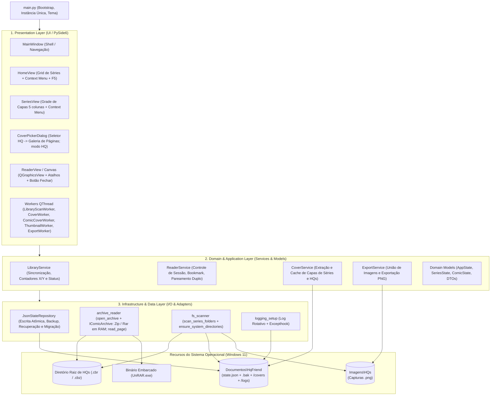
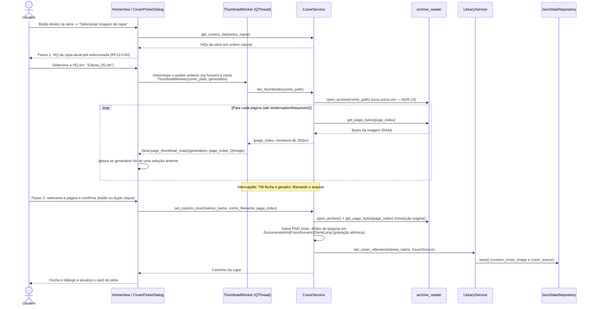
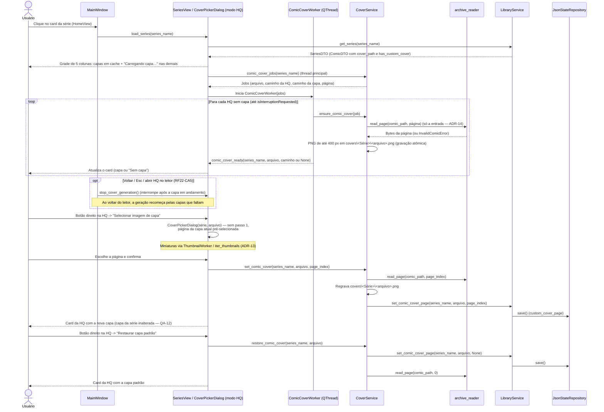

# ARQUITETURA.md — Arquitetura de Software (HqFriend)

> **Spec vigente.** Descreve a arquitetura **atual** da branch `main`. Mudanças entram por um pacote em `docs/changes/` e são aplicadas aqui na etapa de **Sincronização** (ver `docs/README.md`).

## 1. Visão Arquitetural e Diretrizes de Design
O **HqFriend** segue uma arquitetura **Monolítica Modular em Camadas (Layered Architecture)** orientada a eventos para Desktop (Windows 11), desenvolvida em **Python** com interface gráfica nativa baseada em **Qt (PySide6)**.

> **Convenção de caminhos:** `%DOCUMENTOS%` e `%IMAGENS%` são as pastas conhecidas do Windows do usuário, resolvidas em tempo de execução (ver `REQUISITOS.md`, seção 1.1, e ADR-05).

### Princípios Arquiteturais Adotados:
* **Offline-First & Zero-Install Dependencies:** O sistema opera 100% localmente, embarcando binários auxiliares de descompactação na própria estrutura do projeto para não exigir instalações externas no sistema operacional.
* **In-Memory Streaming (Zero Temp-Files na Leitura):** As páginas das HQs (`.cbr` e `.cbz`) são descompactadas diretamente em buffers de memória RAM (`bytes` / `BytesIO`), evitando escrita e fragmentação desnecessária no disco (SSD) durante a leitura.
* **Separação de Responsabilidades (SoC):** A interface gráfica (UI) é estritamente desacoplada das regras de negócio e do mecanismo de persistência em JSON, permitindo manutenção isolada e evolução futura (ex: migração de JSON para SQLite sem impacto nas telas). As camadas de Domínio/Aplicação e Infraestrutura **não importam PySide6**; toda integração com sinais Qt e threads Qt ocorre na camada de Apresentação (Workers).
* **Execução Não-Bloqueante (UI Responsiva):** Operações de I/O pesado (varredura de diretórios, geração de capas padrão das séries e das HQs e extração de miniaturas para seleção de capa) rodam em *Worker Threads* (`QThread`) da camada de Apresentação, que invocam os serviços puros em Python e devolvem resultados via sinais (RNF05).
* **Estado Mutado em Thread Única:** O `AppState` em memória só é alterado na thread principal (UI). Workers apenas produzem dados (listagens de disco, imagens) e os entregam via sinais; a mesclagem com o estado e a persistência acontecem na thread principal, eliminando condições de corrida.

---

## 2. Arquitetura em 3 Camadas (Layered Architecture)



### 2.1. Camada de Apresentação (`Presentation Layer`)
Responsável exclusivamente pela renderização visual, captura de eventos de mouse/teclado, orquestração de threads e delegação de ações para a camada de aplicação.
* **`main.py` (ponto de entrada):** cria as pastas do sistema, configura o log, cria a `QApplication` (estilo `Fusion`, ícone e `dark_theme.qss` — RNF08), garante a **instância única** antes de criar qualquer janela (RNF07, ADR-08), carrega o estado e exibe o aviso de recuperação do `state.json` quando houver (RNF02). Liga o `UnhandledErrorReporter` (`src/ui/error_dialog.py`) ao log, para que exceções não tratadas de qualquer thread sejam mostradas ao usuário (RNF06).
* **`MainWindow`:** Shell de navegação com `QStackedWidget` (Tela Inicial → Tela da Série → Leitor). Ajusta o título da janela durante a leitura (RF13-CA2) e, ao fechar, grava o bookmark pendente e encerra o leitor e os workers.
* **`HomeView` (Tela Inicial):** Exibe o botão de seleção de diretório raiz (RF01), o botão **"Atualizar"** / tecla `F5` (RF19) e o grid de cards das Séries em ordem natural (RF18) com capa, título, badge de status (`Não lida`, `Em andamento`, `Lida`) e contador `X / Y obras` (RF04, sempre no formato `0 / Y` quando nada foi lido). Captura o clique direito na série para acionar *"Marcar como lida"*, *"Marcar como não lida"* (RF10), *"Selecionar imagem de capa"* e *"Restaurar capa padrão"* (RF11). Enquanto a capa padrão de uma série ainda está sendo gerada, o card exibe um *placeholder*.
* **`CoverPickerDialog` (Fluxo em 2 Etapas - RF12):**
    1. Exibe um seletor (lista/dropdown) perguntando **qual HQ (`.cbr`/`.cbz`)** daquela série o usuário deseja inspecionar.
    2. Após escolhida a HQ, dispara o `ThumbnailWorker`, que carrega em background as miniaturas apenas das páginas daquele arquivo específico para que o usuário selecione a nova capa da série.
    * **Modo HQ (RF23):** aberto pela `SeriesView` com uma HQ definida, o diálogo omite o passo 1, exibe a galeria só daquela HQ com a página da capa atual pré-selecionada e grava a escolha como capa **da HQ** (não da série — QA-12). Enquanto ele está aberto, a `MainWindow` mantém parada a geração das capas das HQs.
* **`SeriesView` (Tela da Série):** Exibe os arquivos `.cbr`/`.cbz` da série selecionada em uma **grade de capas com 5 colunas** (QA-11), em ordem natural (RF05, RF18), cada card com capa, nome e status. Ao carregar a série, inicia o `ComicCoverWorker` para as HQs sem capa em cache (RF22) e o interrompe ao sair da tela. Captura o duplo clique para abrir o leitor (RF13) — exibindo mensagem de erro se o arquivo for inválido (RF20) — e o clique direito para alternar manualmente entre *"Lida"* e *"Não lida"* (RF08) e para selecionar ou restaurar a capa da HQ (RF23).
* **`ReaderView` (Motor Visual de Leitura):** Baseado em `QGraphicsView` + `QGraphicsScene` (acelerado por hardware). Gerencia:
    * Navegação por `Seta Esquerda`, `Seta Direita`, `Espaço` e `ESC`, botão "Fechar" (`✕`) sobreposto e indicador de página (RF14);
    * Zoom matricial suave no cursor via `Ctrl + Scroll`, mantido ao virar a página, e retorno ao ajuste à tela via `Ctrl + 0` (RF15);
    * Alternância de layout entre 1 ou 2 páginas lado a lado via `Ctrl + S` (RF16);
    * Disparo da exportação de página via `Ctrl + P` (RF17).
* **Workers (`QThread`):**
    * `LibraryScanWorker`: executa a varredura do disco (`fs_scanner.scan_series_folders`) fora da thread principal e emite `scan_finished(raiz_varrida, ScanResult)`; o `LibraryService` mescla o resultado na thread principal, descartando-o se a raiz mudou durante a varredura.
    * `CoverWorker`: gera progressivamente as capas padrão ausentes via `CoverService` e emite `cover_ready(series_name, cover_path)` para atualizar cada card (`cover_path` é `None` quando a série não tem HQ válida).
    * `ComicCoverWorker`: gera as capas padrão das HQs da série aberta, na ordem da grade, a partir de *jobs* montados na thread principal (`CoverService.comic_cover_jobs`), e emite `comic_cover_ready(series_name, comic_filename, cover_path)` (`cover_path` é `None` para HQ inválida). Verifica `isInterruptionRequested()` entre HQs; a `SeriesView` ignora sinais de outra série.
    * `ThumbnailWorker`: extrai e redimensiona as páginas da HQ escolhida no `CoverPickerDialog`, emitindo `page_thumbnail_ready(generation, page_index, QImage)`; `generation` identifica a seleção que originou o sinal, e o diálogo descarta miniaturas de uma seleção anterior. Verifica `isInterruptionRequested()` entre páginas.
    * `ExportWorker`: grava o PNG do `Ctrl + P` fora da thread principal (a gravação de uma página dupla em resolução original leva alguns segundos).

### 2.2. Camada de Domínio e Aplicação (`Domain & Application Layer`)
Contém toda a inteligência e regras de negócio do **HqFriend**, sem qualquer dependência de interface gráfica (não importa PySide6).
* **`LibraryService`:** Orquestra o cruzamento entre os arquivos físicos encontrados no disco e os dados salvos no JSON. Calcula os contadores `X / Y`, aplica a regra de status (`UNREAD`, `IN_PROGRESS`, `READ`), incluindo a regressão automática (se uma série `"Lida"` `11/11` recebe um 12º arquivo no disco, seu status passa automaticamente para `"Em andamento"` `11/12` — RF09), executa a marcação em lote da série como lida ou não lida (RF10) e a alternância manual de HQ (RF08). Marcar como "Não lida" (individual ou em lote) zera o bookmark (`current_page = 0`).
* **`ReaderService`:** Controla o estado da leitura aberta. Valida o arquivo antes da abertura (RF20), recupera a página inicial via *Bookmark* (RF06 — HQs já lidas reabrem na página 1), calcula os índices das páginas exibidas (considerando o pareamento a partir da página 1 no modo Página Dupla — RF16) e verifica, **a cada mudança no conjunto de páginas visíveis** (abertura, navegação ou `Ctrl + S`), se a última página está visível para disparar a marcação automática de conclusão (RF07) via `LibraryService`.
* **`CoverService`:** Gerencia as capas das séries e das HQs. Se a série ainda não possui capa no cache, extrai a primeira página da primeira HQ da pasta (em ordem natural) e salva no cache local. Para cada HQ sem capa no cache, extrai a primeira página do próprio arquivo (RF22) ou a página customizada registrada no estado. Quando o usuário define uma nova capa via `CoverPickerDialog`, renderiza e persiste a imagem otimizada em `%DOCUMENTOS%\HqFriend\covers\` (série) ou `covers\<Série>\` (HQ). Também restaura a capa padrão sob demanda. Para obter uma única página, usa `archive_reader.read_page()` (ADR-14), sem abrir a HQ inteira. Expõe apenas funções Python puras (retornando `bytes`/`PIL.Image`); a emissão de sinais Qt é responsabilidade dos Workers, que recebem *jobs* prontos e não acessam o estado.
* **`ExportService`:** Processa a ação do `Ctrl + P` (RF17). Recebe o(s) buffer(s) original(is) da(s) página(s) ativa(s), ignorando o zoom da tela:
    * Em **Página Única**: Converte o buffer para RGB e salva como `.png`.
    * Em **Página Dupla**: Cria um canvas em memória com **fundo preto**, largura igual à soma das larguras e altura igual à maior altura, colando as duas páginas lado a lado **sem redimensioná-las** e centralizando verticalmente a de menor altura. Exporta um único arquivo `NomeDaSerie_NomeDoArquivo_PagXX.png` em `%IMAGENS%\HQs`.
    * Nunca sobrescreve capturas existentes: em caso de colisão de nome, acrescenta sufixo `_2`, `_3`, ...

### 2.3. Camada de Infraestrutura e Dados (`Infrastructure & Data Layer`)
Isola o acesso ao sistema operacional, arquivos compactados e persistência.
* **`JsonStateRepository`:** Gerencia a leitura e gravação do arquivo `%DOCUMENTOS%\HqFriend\state.json` (RNF02):
    * **Escrita atômica:** grava em `state.json.tmp` e aplica `os.replace` para `state.json`, com novas tentativas curtas em caso de `PermissionError` (arquivo bloqueado momentaneamente por OneDrive/antivírus).
    * **Primeira abertura:** sem `state.json`, cria o arquivo com um `AppState` limpo e o retorna.
    * **Backup:** após carregar com sucesso um `state.json` válido, copia-o para `state.json.bak` (um snapshot por sessão).
    * **Recuperação:** se o `state.json` for inválido (JSON malformado ou schema inválido), renomeia-o para `state.corrupt-<timestamp>.json`, tenta carregar o `.bak` e, se este também falhar, inicia com `AppState` limpo — sinalizando à UI para avisar o usuário.
    * **Migração de schema (§3.3):** antes de validar, aplica as migrações de `state_migrations` a partir da versão do arquivo; se migrou, guarda o original como `state.v<versão>.json`. Um arquivo de versão futura lança `FutureStateVersionError`, sem quarentena nem gravação.
* **`archive_reader` (Padrão Strategy):** a função `open_archive(path)` detecta o formato real pelos *Magic Bytes* do arquivo (não pela extensão) e devolve uma implementação da interface `IComicArchive` (`page_count`, `list_sorted_pages()`, `get_page_bytes()`, `close()`), que abstrai a diferença entre `.cbz` e `.cbr` (RNF04):
    * `ZipArchiveStrategy`: Usa a biblioteca nativa `zipfile` para listar entradas de imagem ordenadas de forma natural (*natural sort*, garantindo que `pag_2.jpg` venha antes de `pag_10.jpg`) e extrair bytes sob demanda direto para a RAM, com um *handle* de `ZipFile` por thread.
    * `RarArchiveStrategy`: Lista as entradas via `rarfile` e, na abertura, extrai **todo o arquivo para a RAM em uma única passada** do binário `UnRAR.exe` embarcado (via *stdout pipe*), evitando um processo por página e a re-descompactação O(n²) de arquivos RAR *solid*.
    * Arquivos corrompidos, protegidos por senha ou sem imagens válidas lançam `InvalidComicError` (RF20).
    * **`read_page(path, page_index)` (ADR-14):** leitura pontual de **uma** página, usada para gerar capas. Mesmo filtro e ordenação de `open_archive()`; no ZIP lê uma entrada, no RAR executa um único `UnRAR.exe p` com o nome da entrada, sem extrair o arquivo inteiro (RNF04-CA6).
* **`fs_scanner`:** funções `ensure_system_directories()`, que cria as pastas obrigatórias do sistema (`%DOCUMENTOS%\HqFriend`, `covers\`, `logs\`, `%IMAGENS%\HQs` — RNF03), e `scan_series_folders(root)`, que varre o primeiro nível de subpastas do diretório raiz (RF03) e devolve um `ScanResult` sem tocar no estado.
* **`logging_setup`:** `configure(logs_dir, on_unhandled)` configura o log rotativo em `%DOCUMENTOS%\HqFriend\logs\hqfriend.log` e instala `sys.excepthook` / `threading.excepthook` para registrar exceções não tratadas e repassá-las à UI (RNF06).

---

## 3. Arquitetura de Dados e Persistência (`JSON` + Cache)

### 3.1. Estrutura de Diretórios do Sistema
```text
%DOCUMENTOS%\
└── HqFriend\
    ├── state.json                 # Banco de dados em arquivo estruturado (Memória do Sistema)
    ├── state.json.bak             # Snapshot da última versão válida carregada
    ├── state.v1.0.json            # Cópia do original antes da 1ª migração de schema (§3.3)
    ├── hqfriend.lock              # Trava de instância única (RNF07)
    ├── covers\                    # Cache de capas otimizadas (carregamento instantâneo)
    │   ├── Batman.png             # Capa da série (RF11)
    │   ├── Batman\                # Capas das HQs da série (RF22): <arquivo>.png
    │   │   ├── Batman_01.cbz.png
    │   │   └── Batman_02.cbr.png
    │   └── Homem-Aranha.png
    └── logs\
        └── hqfriend.log           # Log rotativo de erros (RNF06)

%IMAGENS%\
└── HQs\                           # Destino de exportação do atalho Ctrl+P
    ├── Batman_Edicao01_Pag01.png
    └── Batman_Edicao01_Pag01_2.png
```

### 3.2. Contrato do Arquivo de Estado (`state.json`)
A modelagem utiliza o **nome da pasta** como chave da Série e o **nome do arquivo** como chave da HQ. Dessa forma, os metadados permanecem íntegros caso o usuário mova a pasta raiz de lugar no futuro.

> **Decisão QA-01 (`REQUISITOS.md`, opção C):** estado único, sem reset ao trocar de diretório raiz. Como as chaves independem do caminho da raiz, uma segunda biblioteca com séries/arquivos de mesmo nome herda o progresso existente — limitação aceita.

```json
{
  "version": "1.1",
  "root_directory": "C:\\Users\\Computador\\Desktop\\Pedro\\Leitura\\HQ",
  "reader_preferences": {
    "double_page_mode": false
  },
  "series": {
    "Batman": {
      "status": "IN_PROGRESS",
      "custom_cover_image": "covers\\Batman.png",
      "cover_source": {
        "comic_filename": "Batman_01.cbz",
        "page_index": 0
      },
      "comics": {
        "Batman_01.cbz": {
          "is_read": true,
          "current_page": 23,
          "total_pages": 24,
          "last_read_at": "2026-10-24T16:00:00",
          "custom_cover_page": null
        },
        "Batman_02.cbr": {
          "is_read": false,
          "current_page": 11,
          "total_pages": 32,
          "last_read_at": "2026-10-24T16:15:00",
          "custom_cover_page": 4
        }
      }
    }
  }
}
```
> **Notas do contrato:**
> * `current_page` é um índice **base-0** (a última página de uma HQ de 24 páginas é `23`).
> * `custom_cover_image` é armazenado **relativo** a `%DOCUMENTOS%\HqFriend`, para não quebrar caso a pasta Documentos seja redirecionada. É `null` quando a série usa a capa padrão.
> * `total_pages` é preenchido/atualizado sempre que a HQ é aberta (a varredura não abre os arquivos compactados).
> * `custom_cover_page` *(desde `1.1`, FEAT-15)* é o índice **base-0** da página escolhida como capa da HQ (RF23); `null` quando a HQ usa a capa padrão (primeira página — RF22). O arquivo da capa não é referenciado no JSON: o caminho é derivado das chaves, `covers\<Série>\<arquivo>.png`.

> **Nota Arquitetural sobre o Status da Série:** Embora o campo `"status"` (`UNREAD`, `IN_PROGRESS`, `READ`) seja persistido no JSON, ele é **sempre revalidado em tempo de execução** pelo `LibraryService` ao escanear a pasta física. Se `Batman` tinha 2 arquivos lidos (`2/2` = `READ`) e a varredura (`fs_scanner.scan_series_folders`) detectar um 3º arquivo (`Batman_03.cbz`), o `LibraryService` recalcula imediatamente o contador para `2 / 3 obras` e atualiza o status para `IN_PROGRESS` (atendendo integralmente ao **RF09**).

### 3.3. Versionamento e Migração do `state.json`
O campo `version` identifica a versão do **schema** do arquivo de estado (atual: `"1.1"`). Ele é independente da versão do aplicativo e só muda quando o contrato da seção 3.2 muda.

**Regras para qualquer FEAT ou FIX que altere o schema:**
1. **Classificar a mudança:**
    * *Compatível* (novo campo opcional com valor padrão): sobe a versão menor (`1.0` → `1.1`). Arquivos antigos continuam válidos pelo Pydantic, mas a versão é regravada na próxima escrita.
    * *Incompatível* (renomear, remover ou mudar o tipo ou o significado de um campo): sobe a versão maior (`1.x` → `2.0`) e **exige uma função de migração**.
2. **Migrar antes de validar:** as migrações são funções puras `dict → dict`, encadeadas por versão (`1.0 → 1.1 → 2.0`) e aplicadas pelo `JsonStateRepository.load()` antes de `AppState.model_validate`. Toda migração tem teste partindo de um JSON real da versão anterior.
3. **Preservar o original:** antes de gravar o estado migrado pela primeira vez, o repositório guarda uma cópia `state.v<versão-antiga>.json` ao lado do `state.json`.
4. **Versão futura:** um `state.json` de versão **maior** que a suportada não é sobrescrito nem tratado como corrompido; o sistema avisa o usuário e encerra (evita que uma versão antiga do app destrua dados de uma versão nova).
5. **Documentar:** o pacote da mudança registra a nova versão no `plan.md`, e esta seção 3.2 é atualizada na Sincronização.

**Histórico de versões do schema:**

| Versão | Pacote | Tipo | Mudança | Migração |
| :--- | :--- | :--- | :--- | :--- |
| `1.0` | v1.0 (FEAT-02) | — | Contrato inicial. | — |
| `1.1` | FEAT-15 | Compatível | `comics.<arquivo>.custom_cover_page` (opcional, padrão `null`). | `1.0 → 1.1`: só atualiza `version` (`src/infrastructure/state_migrations.py`). |

> A FEAT-15 é a **primeira** mudança de schema e implementa o mecanismo das regras 2 a 4 (migrações encadeadas no `JsonStateRepository.load()`, cópia `state.v1.0.json`, recusa de versão futura com `FutureStateVersionError` — RNF02-CA5/CA6).
>
> **Compatibilidade para trás (aceita):** a v1.1 do aplicativo, anterior ao mecanismo, lê um `state.json` `1.1` (o Pydantic ignora o campo desconhecido) e descarta `custom_cover_page` ao gravar — as capas das HQs voltam ao padrão, sem perda de progresso.

---

## 4. Fluxos Arquiteturais Críticos (Diagramas de Sequência)

### 4.1. Inicialização e Sincronização Dinâmica de Séries (RF02, RF04, RF09, RF19)
```mermaid
sequenceDiagram
    actor User as Usuário
    participant Main as main.py
    participant UI as HomeView (UI)
    participant W as LibraryScanWorker / CoverWorker
    participant Lib as LibraryService
    participant Repo as JsonStateRepository
    participant FS as fs_scanner

    User->>Main: Abre o aplicativo HqFriend
    Main->>FS: ensure_system_directories()
    Main->>Main: logging_setup.configure(), QApplication + tema,<br/>trava de instância única (QLockFile)
    Main->>Lib: load_state()
    Lib->>Repo: load() (cria o arquivo na 1ª abertura;<br/>recupera via .bak se corrompido)
    Repo-->>Lib: LoadResult(AppState, aviso de recuperação?)
    Main->>UI: MainWindow maximizada + refresh_library()

    Note over User,UI: refresh_library() também é chamado por F5 / "Atualizar",<br/>troca de raiz e retorno da SeriesView (RF19)

    alt root_directory definido e existente no disco
        UI-->>User: "Atualizando biblioteca…" (RF19-CA4)
        UI->>W: Inicia LibraryScanWorker(root_directory)
        W->>FS: scan_series_folders(root_directory)
        FS-->>W: ScanResult (séries e arquivos .cbr/.cbz)
        W-->>UI: Sinal scan_finished(raiz_varrida, ScanResult)
        alt raiz mudou durante a varredura
            UI->>UI: Descarta o resultado e varre de novo
        else mesma raiz
            UI->>Lib: apply_scan(ScanResult) (thread principal)
            Lib->>Lib: Cruza arquivos físicos com o estado<br/>Recalcula contadores (X/Y) e status das séries
            Lib->>Repo: save()
            Lib-->>UI: Lista de SeriesDTO em ordem natural
            UI-->>User: Grid de séries (placeholder nas capas ausentes)
            UI->>W: Inicia CoverWorker(séries sem capa em cache)
            loop Para cada série sem capa
                W->>W: CoverService.ensure_default_cover(series, comic_paths)
                W-->>UI: Sinal cover_ready(series_name, cover_path)
                UI-->>User: Atualiza o card da série
            end
        end
    else root_directory vazio ou inexistente
        UI-->>User: Estado vazio convidando a "Selecionar pasta"<br/>(estado salvo é preservado — RF02-CA2/CA3)
    end
```

### 4.2. Seleção Customizada de Capa em 2 Etapas (RF11, RF12)


### 4.3. Leitura, Pareamento Duplo, Bookmark e Exportação `Ctrl+P` (RF06, RF07, RF14, RF15, RF16, RF17, RF20)
```mermaid
sequenceDiagram
    actor User as Usuário
    participant MW as MainWindow
    participant RView as ReaderView (UI)
    participant RServ as ReaderService
    participant Lib as LibraryService
    participant Arch as archive_reader
    participant EW as ExportWorker (QThread)
    participant Exp as ExportService
    participant Repo as JsonStateRepository

    User->>MW: Duplo clique na HQ (SeriesView)
    MW->>RView: open_comic(series_name, comic_filename)
    RView->>RServ: open_comic(series_name, comic_filename)
    RServ->>Arch: open_archive(comic_path)
    alt Arquivo inválido / sem imagens
        Arch-->>RServ: InvalidComicError
        RServ-->>MW: InvalidComicError (estado da HQ inalterado)
        MW-->>User: Mensagem de erro (permanece na SeriesView — RF20)
    else Arquivo válido
        RServ->>Lib: comic_state() (is_read, current_page)
        Note over RServ: is_read ou bookmark fora do intervalo -> página 0<br/>Caso contrário -> current_page (alinhado ao par no modo duplo)
        RServ->>RServ: _on_visible_pages_changed()<br/>(progresso em memória + verificação de conclusão)
        RView-->>User: Renderiza a(s) página(s) + indicador "Pág. N / Total"
        MW->>MW: Título "<arquivo> — HqFriend"
    end

    User->>RView: Seta Direita / Espaço / Seta Esquerda / Ctrl+S
    RView->>RServ: next_page() / prev_page() / toggle_double_mode()
    Note over RServ: Modo único: ±1 · Modo duplo: ±2 (pares 1-2, 3-4)
    RServ->>Lib: update_reading_progress() (apenas em memória)
    RServ->>RServ: Prefetch das próximas páginas (cache LRU — ADR-04)
    RView->>RView: Reinicia o timer de 500 ms (debounce — RF06-CA5)
    opt Timer expira sem nova virada
        RView->>RServ: flush()
        RServ->>Lib: save()
        Lib->>Repo: save()
    end
    opt Última página da HQ está visível (RF07)
        RServ->>Lib: mark_comic_read(series, comic)
        Lib->>Lib: Recalcula X/Y e status da série
        Lib->>Repo: save() (imediato)
    end
    RView-->>User: Nova(s) página(s) com o zoom mantido (no canto superior esquerdo, se ampliada)

    User->>RView: Ctrl + P (capturar página)
    RView->>RServ: visible_page_bytes() (bytes originais, ignora o zoom)
    RView->>EW: Inicia ExportWorker(series, comic, first_page_index, page_bytes)
    EW->>Exp: export_pages(...)
    alt Página única
        Exp->>Exp: Converte para RGB
    else Página dupla
        Exp->>Exp: Une as 2 páginas lado a lado em canvas preto,<br/>centralizadas verticalmente, sem redimensionar
    end
    Exp->>Exp: Resolve nome livre (sufixo _2, _3...) e salva em<br/>Imagens\HQs\Serie_Arquivo_PagXX.png
    Exp-->>EW: Caminho do PNG
    EW-->>RView: Sinal exported(path) / failed(mensagem)
    RView-->>User: Toast de 2 s (sucesso ou falha)

    User->>RView: ESC ou botão "Fechar" (✕)
    RView->>MW: Sinal close_requested
    MW->>RServ: close() (grava o bookmark pendente e libera o arquivo)
    MW-->>User: Volta à SeriesView atualizada; título "HqFriend"
```

### 4.4. Tela da Série em Grade e Capas das HQs (RF05, RF22, RF23)


---

## 5. Decisões Arquiteturais (ADRs)

Cada decisão fica em um arquivo próprio em [`docs/adr/`](../adr/), com status, data, contexto e consequências. Uma decisão revista **não é editada para dizer outra coisa**: cria-se uma nova ADR e a anterior passa a `Substituída por ADR-NN`. Modelo: [`adr/_TEMPLATE.md`](../adr/_TEMPLATE.md).

| ID | Decisão | Status |
| :--- | :--- | :---: |
| [ADR-01](../adr/ADR-01-ordenacao-natural.md) | Ordenação natural de páginas, séries e HQs | `Aceita` |
| [ADR-02](../adr/ADR-02-pagina-impar-modo-duplo.md) | Página ímpar final isolada no modo página dupla | `Aceita` |
| [ADR-03](../adr/ADR-03-arquivos-removidos-renomeados-corrompidos.md) | Resiliência a arquivos removidos, renomeados e corrompidos | `Aceita` |
| [ADR-04](../adr/ADR-04-prefetch-cache-paginas.md) | Prefetch de páginas em cache LRU de 6 páginas | `Aceita` |
| [ADR-05](../adr/ADR-05-pastas-conhecidas-windows.md) | Caminhos de sistema via pastas conhecidas do Windows | `Aceita` |
| [ADR-06](../adr/ADR-06-extracao-rar-passada-unica.md) | Extração RAR em passada única | `Aceita` |
| [ADR-07](../adr/ADR-07-logs-excecoes.md) | Logs e exceções não tratadas | `Aceita` |
| [ADR-08](../adr/ADR-08-instancia-unica.md) | Instância única via `QLockFile` | `Aceita` |
| [ADR-09](../adr/ADR-09-interface-pyside6.md) | Interface gráfica com PySide6 (Qt 6) | `Aceita` |
| [ADR-10](../adr/ADR-10-persistencia-json-pydantic.md) | Persistência em JSON validado com Pydantic v2 | `Aceita` |
| [ADR-11](../adr/ADR-11-empacotamento-onedir.md) | Empacotamento PyInstaller onedir, sem UPX | `Aceita` |
| [ADR-12](../adr/ADR-12-unrar-embarcado.md) | `UnRAR.exe` embarcado e versionado no repositório | `Aceita` (licença pendente) |
| [ADR-13](../adr/ADR-13-miniaturas-gerador-unico.md) | Miniaturas do seletor de capa por gerador único | `Aceita` |
| [ADR-14](../adr/ADR-14-pagina-unica-para-capas.md) | Leitura de página única para gerar capas (`read_page`) | `Aceita` |
