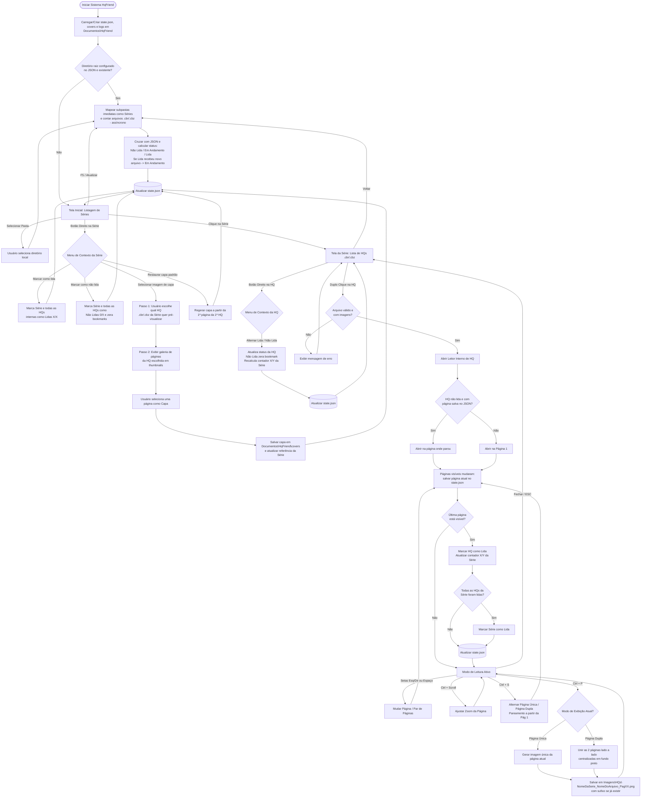

# REQUISITOS.md — Especificação de Requisitos do Sistema (HqFriend)

> **Spec vigente.** Este documento descreve o comportamento **atual** do sistema na branch `main` e deve estar sempre alinhado ao código. Mudanças entram por um pacote em `docs/changes/` (ver `docs/README.md`) e são aplicadas aqui na etapa de **Sincronização**.
>
> * **Versão da spec:** `1.0.1` (2026-10-29) — escopo entregue pelas FEAT-01 a FEAT-13 e pelo FIX-01.
> * **Convenções de ID:** `RFxx` / `RNFxx` / `USxx` nunca são reaproveitados. Cada requisito tem critérios de aceite próprios (`RFxx-CAn`), referenciados nos testes e nos pacotes de FIX. Requisitos removidos permanecem no documento com status `Obsoleto (FEAT-NN)`.
> * **Status de requisito:** `Ativo` | `Obsoleto (FEAT-NN)`. A linha **Origem** indica o pacote que criou o requisito e os que o alteraram depois.
> * **Verificação:** cada critério é verificado de forma **automática** (teste pytest) ou **manual** (roteiro no executável). A seção 7 (Matriz de Rastreabilidade) liga cada critério à sua verificação. Testes novos citam o critério (`# RF14-CA3`).

## 1. Visão Geral do Sistema
O **HqFriend** é uma aplicação desktop local voltada para o gerenciamento de acervo e leitura de histórias em quadrinhos nos formatos `.cbr` e `.cbz`. O sistema opera diretamente sobre o sistema de arquivos local do usuário, organizando pastas como "Séries" e mantendo o estado de progresso, capas customizadas e preferências persistidos localmente em formato estruturado (`JSON`).

### 1.1. Convenção de Caminhos do Sistema
Os caminhos de sistema são expressos por variáveis resolvidas em tempo de execução a partir das **pastas conhecidas do Windows** (*Known Folders*), respeitando redirecionamentos (ex: OneDrive):
* **`%DOCUMENTOS%`** — Pasta "Documentos" do usuário (ex: `C:\Users\Computador\Documents` ou `C:\Users\Computador\OneDrive\Documentos`).
* **`%IMAGENS%`** — Pasta "Imagens" do usuário (ex: `C:\Users\Computador\Pictures` ou `C:\Users\Computador\OneDrive\Imagens`).

---

## 2. Requisitos Funcionais (RF)

### 2.1. Gerenciamento de Diretório e Acervo

#### RF01 — Seleção de Diretório Raiz
`Ativo` · Origem: v1.0 (FEAT-04, FEAT-06, FEAT-08)

O sistema deve permitir ao usuário selecionar uma pasta local do computador para carregar o acervo de HQs. Ao trocar de diretório raiz, o estado de progresso existente é **mantido** (não há reset); o progresso é associado ao nome da pasta da série e ao nome do arquivo, independentemente do caminho da raiz (ver decisão **QA-01** na seção 6).
* **RF01-CA1:** Selecionar uma pasta salva o caminho em `root_directory` no `state.json` e dispara a varredura da biblioteca.
* **RF01-CA2:** Trocar o diretório raiz não apaga o progresso existente: séries e arquivos com o mesmo nome na nova raiz exibem o progresso já registrado (QA-01).

#### RF02 — Inicialização na Tela Principal
`Ativo` · Origem: v1.0 (FEAT-08), FIX-01

Sempre que o sistema for aberto, ele deve exibir diretamente a "Tela Inicial" (Listagem de Séries), carregando automaticamente o diretório raiz previamente configurado no arquivo de memória. Caso o diretório configurado não exista mais (ex: unidade externa desconectada), o sistema deve exibir a Tela Inicial convidando a selecionar uma pasta, **sem apagar** o estado salvo.
* **RF02-CA1:** Abrir o aplicativo sempre exibe a Tela Inicial carregando as séries do `root_directory` salvo.
* **RF02-CA2:** Se a pasta configurada não existir, a Tela Inicial exibe o convite para selecionar uma pasta e o `state.json` permanece intacto.
* **RF02-CA3:** Os estados vazios da Tela Inicial exibem orientação e o botão "Selecionar pasta": sem pasta configurada ("Selecione a pasta onde estão suas HQs para começar."), pasta não encontrada (exibe o caminho e "Reconecte a unidade ou selecione outra pasta.") e pasta sem séries (exibe o caminho e "Cada subpasta com arquivos .cbr ou .cbz é uma série.").
* **RF02-CA4:** O cabeçalho da Tela Inicial exibe a pasta raiz atual (caminho completo no *tooltip*, sem impor largura mínima à janela) e o aplicativo abre maximizado.

#### RF03 — Reconhecimento de Séries (Nível Único)
`Ativo` · Origem: v1.0 (FEAT-04)

O sistema deve interpretar cada subpasta imediata dentro do diretório selecionado como uma "Série". Apenas arquivos `.cbr` e `.cbz` no primeiro nível da pasta da série são considerados; demais arquivos e subpastas aninhadas são ignorados. Subpastas sem nenhum arquivo `.cbr`/`.cbz` não são exibidas como Série.
* **RF03-CA1:** Subpastas sem nenhum arquivo `.cbr` ou `.cbz` são ignoradas.
* **RF03-CA2:** Arquivos soltos na raiz, arquivos de outras extensões e arquivos em subpastas de 2º nível não são contabilizados. A extensão é comparada sem distinção de maiúsculas.
* **RF03-CA3:** Um diretório raiz inexistente, inacessível ou que seja um arquivo resulta em biblioteca vazia, sem exceção não tratada; uma pasta de série inacessível é ignorada (e registrada em log) sem afetar as demais.

#### RF04 — Contagem e Proporção de Obras
`Ativo` · Origem: v1.0 (FEAT-06, FEAT-08)

Para cada série listada, o sistema deve contabilizar o total de arquivos `.cbr` e `.cbz` válidos e exibir um contador de progresso no formato `X / Y obras` (onde `X` é o número de obras lidas e `Y` é o total de obras na pasta). Caso nenhuma tenha sido lida, deve exibir `0 / Y obras`.
* **RF04-CA1:** Uma série sem nenhuma HQ lida exibe `0 / Y obras`.
* **RF04-CA2:** Arquivos removidos do disco não entram no contador `X / Y` (nunca ocorre `12 / 11 obras`), e suas entradas permanecem no `state.json` (ADR-03).

#### RF05 — Listagem de Obras da Série
`Ativo` · Origem: v1.0 (FEAT-10)

Ao acessar uma série, o sistema deve listar todos os arquivos `.cbr` e `.cbz` pertencentes a ela, exibindo o status individual de leitura (Não lida, Em andamento com página atual, ou Lida).
* **RF05-CA1:** A Tela da Série lista as HQs em ordem natural (RF18), cada uma com o status `Não lida`, `Em andamento – Pág. X/Y` ou `Lida`.

#### RF18 — Ordenação Natural de Séries e Obras
`Ativo` · Origem: v1.0 (FEAT-02, FEAT-06)

Séries (Tela Inicial) e obras (Tela da Série) devem ser exibidas em ordem alfanumérica natural, sem distinção de maiúsculas/minúsculas (ex: `Edição 2` antes de `Edição 10`).
* **RF18-CA1:** A ordenação de `["Edição 10", "edição 2", "Edição 1"]` resulta em `["Edição 1", "edição 2", "Edição 10"]`.
* **RF18-CA2:** A mesma regra é aplicada às séries, às HQs de cada série e às páginas dentro dos arquivos (ADR-01).

#### RF19 — Atualização da Biblioteca
`Ativo` · Origem: v1.0 (FEAT-06, FEAT-08, FEAT-10), FIX-01

O sistema deve reescanear o diretório raiz: (a) na inicialização; (b) ao trocar de diretório raiz; (c) ao retornar da Tela da Série para a Tela Inicial; (d) sob demanda, pela tecla `F5` ou pelo botão **"Atualizar"** na Tela Inicial. A varredura deve refletir arquivos adicionados ou removidos sem necessidade de reiniciar o sistema.
* **RF19-CA1:** Adicionar um `.cbz` a uma série com o aplicativo aberto e pressionar `F5` (ou "Atualizar") atualiza o contador sem reiniciar.
* **RF19-CA2:** Voltar da Tela da Série para a Tela Inicial dispara uma nova varredura.
* **RF19-CA3:** Uma varredura solicitada durante outra é enfileirada uma única vez; o resultado de uma raiz antiga é descartado.
* **RF19-CA4:** Enquanto a varredura está em andamento, a Tela Inicial exibe "Atualizando biblioteca…".

### 2.2. Gerenciamento de Status e Progresso de Leitura

#### RF06 — Persistência de Página Atual (Bookmark)
`Ativo` · Origem: v1.0 (FEAT-11), FIX-01

Caso o usuário feche uma HQ antes de finalizá-la, o sistema deve salvar a última página visualizada e retomar a leitura exatamente dessa página quando o arquivo for reaberto. Ao reabrir uma HQ com status "Lida", a leitura deve iniciar na **primeira página** (releitura).
* **RF06-CA1:** Fechar uma HQ na metade (via `ESC`, ou fechando o aplicativo) e abri-la novamente retoma exatamente da página onde parou.
* **RF06-CA2:** Uma HQ "Lida" reabre na página 1, inclusive quando foi concluída em modo de página dupla.
* **RF06-CA3:** Um bookmark fora do intervalo de páginas (ex: arquivo substituído por versão menor) reabre na página 1.
* **RF06-CA4:** Durante a releitura de uma HQ "Lida", ela permanece "Lida" e o contador da série não muda; reabri-la novamente recomeça na página 1.
* **RF06-CA5:** Durante a leitura, o bookmark é gravado 500 ms após a última mudança de página e, de imediato, ao fechar a HQ, ao concluí-la e ao encerrar o aplicativo (QA-06).

#### RF07 — Marcação Automática de Obra Lida
`Ativo` · Origem: v1.0 (FEAT-11)

O sistema deve marcar automaticamente uma HQ como "Lida" assim que a última página do arquivo estiver visível na tela — seja por navegação, por alternância de modo de página (`Ctrl + S`) ou na própria abertura da HQ —, atualizando imediatamente o contador da série (`X / Y obras`).
* **RF07-CA1:** Chegar à última página marca a HQ como "Lida" e atualiza o contador `X / Y` na Tela da Série.
* **RF07-CA2:** Em modo único na penúltima página de uma HQ com número par de páginas, pressionar `Ctrl + S` (exibindo o último par) marca a HQ como "Lida".
* **RF07-CA3:** Abrir uma HQ cuja última página já fica visível na abertura (ex: HQ de 1 página) a marca como "Lida".
* **RF07-CA4:** Concluir a última HQ pendente de uma série marca a série como "Lida".

#### RF08 — Marcação Manual de Obra (Menu de Contexto)
`Ativo` · Origem: v1.0 (FEAT-06, FEAT-10)

Na listagem de obras de uma série, ao clicar com o botão direito sobre uma HQ (`.cbr`/`.cbz`), o sistema deve exibir uma opção para alternar manualmente seu status entre "Lida" e "Não lida". Marcar como "Não lida" deve também **zerar o bookmark** da HQ (a leitura recomeça na primeira página).
* **RF08-CA1:** O menu de contexto da HQ permite marcá-la como "Lida" ou "Não lida", recalculando o status da série em tempo real.
* **RF08-CA2:** Marcar como "Não lida" zera o bookmark e remove a indicação de página em andamento.
* **RF08-CA3:** Marcar como "Não lida" a única HQ lida de uma série (sem outras em andamento) resulta em série `Não lida`.

#### RF09 — Status Automático da Série e Recálculo Dinâmico
`Ativo` · Origem: v1.0 (FEAT-06)

* Quando nenhuma HQ da série estiver lida nem em andamento, a série deve ser marcada como **"Não lida"**.
* Quando todas as HQs de uma série estiverem com status "Lida" (`X == Y`), a série deve ser marcada como **"Lida"**.
* Nos demais casos, a série deve ser marcada como **"Em andamento"**.
* Se uma série marcada como "Lida" (ex: `11 / 11 obras`) receber um novo arquivo na pasta (passando a `11 / 12 obras`), seu status deve ser atualizado automaticamente para **"Em andamento"** na próxima atualização da biblioteca (RF19).

Critérios de aceite:
* **RF09-CA1:** Uma série com `11 / 11 obras` tem status "Lida"; ao adicionar um 12º arquivo e atualizar a biblioteca, passa a `11 / 12 obras` e "Em andamento".
* **RF09-CA2:** O status é calculado apenas sobre as HQs presentes no disco: `Lida` se todas lidas; `Não lida` se nenhuma lida nem com página atual > 0; `Em andamento` nos demais casos.

#### RF10 — Marcação Manual de Série em Lote (Menu de Contexto)
`Ativo` · Origem: v1.0 (FEAT-06, FEAT-08)

Na Tela Inicial, ao clicar com o botão direito sobre uma Série, o sistema deve exibir as opções:
* **"Marcar como lida"**: a série e todas as HQs (`.cbr`/`.cbz`) dentro dela são marcadas como "Lidas" simultaneamente (desabilitada se a série já estiver "Lida").
* **"Marcar como não lida"**: a série e todas as HQs dentro dela são marcadas como "Não lidas" e têm seus bookmarks zerados (desabilitada se a série já estiver "Não lida").

Critérios de aceite:
* **RF10-CA1:** "Marcar como lida" marca todas as HQs da série como lidas e atualiza imediatamente o card para "Lida" e `Y / Y obras`.
* **RF10-CA2:** "Marcar como não lida" marca todas as HQs como não lidas, zera os bookmarks e atualiza o card para "Não lida" e `0 / Y obras`.
* **RF10-CA3:** Cada opção fica desabilitada quando a série já está no status correspondente.

### 2.3. Customização de Capa da Série

#### RF11 — Ação de Seleção de Capa (Menu de Contexto)
`Ativo` · Origem: v1.0 (FEAT-07, FEAT-08)

Na Tela Inicial, ao clicar com o botão direito sobre uma Série, o sistema deve exibir a opção **"Selecionar imagem de capa"**. Enquanto o usuário não definir uma capa customizada, o sistema utilizará por padrão a primeira página da primeira HQ da série (segundo a ordenação do RF18). Quando houver capa customizada, o menu deve exibir também a opção **"Restaurar capa padrão"**.
* **RF11-CA1:** Toda série com ao menos uma HQ válida possui uma capa `.png` otimizada em `%DOCUMENTOS%\HqFriend\covers\`, gerada em segundo plano.
* **RF11-CA2:** Se a primeira HQ for inválida, a capa padrão usa a próxima HQ válida; sem nenhuma HQ válida, o card exibe um *placeholder*.
* **RF11-CA3:** "Restaurar capa padrão" só aparece quando há capa customizada; ao acioná-la, a capa padrão é regerada e a referência customizada é removida do `state.json`.

#### RF12 — Fluxo de Escolha de Capa em 2 Etapas (Seletor de HQ + Galeria de Páginas)
`Ativo` · Origem: v1.0 (FEAT-07, FEAT-09), FIX-01

Ao acionar "Selecionar imagem de capa", o sistema deve:
1. Perguntar ao usuário **qual HQ (`.cbr`/`.cbz`)** daquela série ele deseja pré-visualizar;
2. Exibir as miniaturas (*thumbnails*) de todas as páginas da HQ escolhida, permitindo ao usuário clicar em qualquer página para defini-la como a imagem de capa oficial da série.

Critérios de aceite:
* **RF12-CA1:** Apenas as páginas da HQ selecionada no passo 1 são extraídas (nunca todas as HQs da série).
* **RF12-CA2:** A interface não trava durante o carregamento das miniaturas; fechar o diálogo ou trocar de HQ antes do fim interrompe o carregamento e libera o arquivo.
* **RF12-CA3:** Ao confirmar a página, o arquivo em `covers\` e o `state.json` são atualizados imediatamente e o card da série na Tela Inicial exibe a nova capa.
* **RF12-CA4:** O passo 1 abre com a HQ da capa atual já selecionada (ou a primeira HQ, se a capa for a padrão); no passo 2, "Definir como capa" só fica habilitado com uma página selecionada, e o duplo clique numa miniatura confirma.

### 2.4. Leitor Integrado de HQs e Atalhos

#### RF13 — Abertura por Duplo Clique
`Ativo` · Origem: v1.0 (FEAT-10, FEAT-11), FIX-01

Ao dar um duplo clique sobre um arquivo `.cbr` ou `.cbz`, o sistema deve abrir o leitor interno carregando a HQ selecionada.
* **RF13-CA1:** O duplo clique em uma HQ válida abre o leitor com o arquivo selecionado (na página definida pelo RF06).
* **RF13-CA2:** Durante a leitura, o título da janela exibe `<nome do arquivo> — HqFriend`; ao fechar o leitor, volta a `HqFriend`.

#### RF20 — Tratamento de Arquivo Inválido
`Ativo` · Origem: v1.0 (FEAT-05, FEAT-10, FEAT-11)

Caso a HQ esteja corrompida, protegida por senha ou não contenha nenhuma imagem válida, o sistema **não deve abrir o leitor** nem alterar o status da HQ; deve exibir uma mensagem de erro amigável e permanecer na Tela da Série.
* **RF20-CA1:** Arquivos inexistentes, vazios, corrompidos, protegidos por senha (arquivo ou cabeçalho), sem imagens ou de formato desconhecido são rejeitados com `InvalidComicError`.
* **RF20-CA2:** O duplo clique em uma HQ inválida exibe mensagem de erro, permanece na Tela da Série e não altera o status nem o bookmark da HQ.

#### RF21 — Tratamento de Página Ilegível
`Ativo` · Origem: FIX-01 (comportamento entregue na v1.0, FEAT-11)

Se uma página de uma HQ válida não puder ser decodificada, o leitor deve exibir um quadro substituto com o texto "Página ilegível" no lugar dela, registrar o problema em log e continuar permitindo a navegação. A HQ não é considerada inválida (RF20) por causa de uma página isolada.
* **RF21-CA1:** Uma página com bytes de imagem corrompidos é exibida como o quadro "Página ilegível", e as demais páginas continuam navegáveis.
* **RF21-CA2:** A falha é registrada em `hqfriend.log` como aviso, sem mensagem modal ao usuário.
* **RF21-CA3:** Chegar à última página continua marcando a HQ como "Lida" (RF07), mesmo que alguma página tenha sido ilegível.

#### RF14 — Navegação de Páginas
`Ativo` · Origem: v1.0 (FEAT-11), FIX-01

Durante a leitura, o sistema deve permitir:
* **Seta Direita (`→`) ou `Barra de Espaço`:** Avançar para a próxima página (ou próximo par de páginas). Na última página, não faz nada.
* **Seta Esquerda (`←`):** Voltar para a página anterior (ou par de páginas anterior). Na primeira página, não faz nada.
* **Tecla `ESC` ou botão "Fechar" (`✕`) do leitor:** Encerrar a visualização da HQ e retornar à listagem da série.

Critérios de aceite:
* **RF14-CA1:** `→`/`Espaço` avançam e `←` volta uma página (ou um par, no modo duplo); nos limites, nada acontece.
* **RF14-CA2:** `ESC` grava o bookmark, fecha a HQ e volta à Tela da Série com status e contadores atualizados.
* **RF14-CA3:** O leitor exibe um botão "Fechar" (`✕`, tooltip `Fechar (Esc)`) no canto superior direito, que acompanha o redimensionamento da janela; clicar nele tem o mesmo efeito do `ESC` (RF14-CA2). O botão não recebe foco do teclado: as teclas de navegação continuam indo para o leitor.
* **RF14-CA4:** Durante a leitura, um indicador sobreposto mostra a posição atual: `Pág. N / Total` no modo único e `Págs. N–M / Total` no modo duplo.

#### RF15 — Controle de Zoom (`Ctrl + Scroll`)
`Ativo` · Origem: v1.0 (FEAT-11)

O usuário deve poder ampliar (zoom in) ou reduzir (zoom out) o tamanho da página atual utilizando o atalho `Ctrl + Scroll do mouse`.
* **RF15-CA1:** `Ctrl + Scroll` aplica zoom ancorado no cursor, limitado entre 0,5x e 5x; com zoom acima de 1x, a página pode ser arrastada com o mouse.
* **RF15-CA2:** Virar a página, alternar o modo (`Ctrl + S`) ou redimensionar a janela restaura o ajuste à tela (*Fit-to-View*).

#### RF16 — Alternância de Modo de Página (`Ctrl + S`)
`Ativo` · Origem: v1.0 (FEAT-11)

O atalho `Ctrl + S` deve alternar a visualização entre **"Página Única"** e **"Página Dupla"**. A preferência é persistida e reaplicada nas próximas leituras.
* *Regra de Pareamento:* No modo Página Dupla, o pareamento deve iniciar imediatamente na primeira página (ex: `[Pág 1 + Pág 2]`, `[Pág 3 + Pág 4]`, etc.).

Critérios de aceite:
* **RF16-CA1:** `Ctrl + S` alterna instantaneamente entre 1 página e 2 páginas lado a lado, com pares iniciando na página 1.
* **RF16-CA2:** Ativar o modo duplo numa página par (ex: Pág. 4) exibe o par que a contém (`[Pág 3 + Pág 4]`); o mesmo vale ao abrir com bookmark nessa posição.
* **RF16-CA3:** Em HQ com número ímpar de páginas, a última página é exibida isolada e centralizada (ADR-02).
* **RF16-CA4:** O modo escolhido é persistido e reaplicado na próxima leitura, inclusive após reiniciar o aplicativo.

#### RF17 — Captura e Exportação de Página (`Ctrl + P`)
`Ativo` · Origem: v1.0 (FEAT-12)

O atalho `Ctrl + P` deve salvar a(s) página(s) exibida(s) como arquivo de imagem `.png` no diretório `%IMAGENS%\HQs`, na **resolução original** da página (o zoom aplicado na tela é ignorado).
* *Comportamento em Página Única:* Salva a página atual como imagem única (`NomeDaSerie_NomeDoArquivo_PagXX.png`).
* *Comportamento em Página Dupla:* Une as duas páginas exibidas lado a lado em uma única imagem combinada, **sem redimensioná-las**, centralizando verticalmente a página de menor altura sobre **fundo preto**, e salva seguindo a nomenclatura padrão (`NomeDaSerie_NomeDoArquivo_PagXX.png`, onde `XX` é o número da primeira página do par).
* *Arquivo Existente:* Se já existir um arquivo com o mesmo nome, o sistema **não sobrescreve**; acrescenta um sufixo numérico (`..._PagXX_2.png`, `..._PagXX_3.png`, ...).

Critérios de aceite:
* **RF17-CA1:** Em página simples, `Ctrl + P` gera 1 arquivo `.png` válido em `%IMAGENS%\HQs`, inclusive para páginas JPEG em CMYK.
* **RF17-CA2:** Em página dupla, gera 1 único `.png` com as duas páginas lado a lado em tamanho original, centralizadas verticalmente sobre fundo preto, nomeado com o número da primeira página do par.
* **RF17-CA3:** Duas capturas da mesma página geram `..._PagXX.png` e `..._PagXX_2.png`, sem sobrescrever a primeira.
* **RF17-CA4:** Caracteres inválidos em nomes de arquivo do Windows são removidos de `NomeDaSerie` e `NomeDoArquivo`; o leitor exibe um aviso discreto de sucesso ou falha.

---

## 3. Requisitos Não Funcionais (RNF)

#### RNF01 — Execução Local (Offline-First)
`Ativo` · Origem: v1.0 (FEAT-01, FEAT-13)

O sistema deve rodar de forma 100% local no computador do usuário (ambiente Windows 11), sem dependência de conexão com a internet ou servidores externos.
* **RNF01-CA1:** O executável `dist\HqFriend\HqFriend.exe` inicia em modo gráfico (sem janela de console) e exibe o ícone do aplicativo.
* **RNF01-CA2:** Leitura de `.cbz`/`.cbr`, persistência, logs e exportação `Ctrl + P` funcionam a partir do executável, sem internet e sem instalações adicionais.

#### RNF02 — Armazenamento de Memória e Estado
`Ativo` · Origem: v1.0 (FEAT-02, FEAT-03)

Toda a memória do sistema (diretório raiz configurado, progresso de leitura por arquivo, página atual/bookmark, status das séries e cache de capas selecionadas) deve ser armazenada no diretório `%DOCUMENTOS%\HqFriend`, utilizando arquivo estruturado em formato **JSON** (`state.json`) e subpasta de cache de capas (`covers\`).
* *Integridade:* A gravação deve ser atômica. O sistema deve manter uma cópia de segurança (`state.json.bak`) da última versão válida carregada. Se o `state.json` estiver corrompido, o sistema deve preservá-lo para análise, restaurar a partir do `.bak` (ou iniciar com estado limpo, caso o backup também seja inválido) e avisar o usuário.

Critérios de aceite:
* **RNF02-CA1:** Na primeira abertura (sem `state.json`), o sistema cria e usa um estado limpo, válido e versionado (contrato em `ARQUITETURA.md` §3.2).
* **RNF02-CA2:** A carga valida tipos, datas e enums do JSON.
* **RNF02-CA3:** A escrita passa por arquivo temporário (`state.json.tmp` → `state.json`), sem deixar arquivos órfãos, e supera bloqueios transitórios (`PermissionError`) com novas tentativas.
* **RNF02-CA4:** Um `state.json` inválido é preservado como `state.corrupt-<timestamp>.json`, o estado é restaurado do `.bak` e o usuário é avisado; se o `.bak` também for inválido, o sistema inicia limpo sem falhar.

#### RNF03 — Criação Automática de Diretórios de Sistema
`Ativo` · Origem: v1.0 (FEAT-01, FEAT-12)

Caso os diretórios `%DOCUMENTOS%\HqFriend` (e subpastas `covers\` e `logs\`) ou `%IMAGENS%\HQs` não existam no momento da operação, o sistema deve criá-los automaticamente de forma transparente.
* **RNF03-CA1:** As 4 pastas de sistema são criadas na inicialização caso não existam; `%IMAGENS%\HQs` é recriada no momento da exportação se tiver sido apagada.
* **RNF03-CA2:** `%DOCUMENTOS%` e `%IMAGENS%` correspondem às pastas reais do usuário, inclusive quando redirecionadas ao OneDrive (nenhum caminho com nome de usuário fixo no código — ADR-05).

#### RNF04 — Suporte a Formatos de Compactação em Memória
`Ativo` · Origem: v1.0 (FEAT-05, FEAT-13)

O motor de leitura deve descompactar diretamente em memória RAM (sem arquivos temporários em disco) arquivos compactados tanto em formato ZIP (`.cbz`) quanto RAR (`.cbr`), utilizando binário embarcado para RAR, identificando o formato real pelo conteúdo do arquivo (e não apenas pela extensão) e filtrando apenas extensões de imagem válidas (`.jpg`, `.jpeg`, `.png`, `.webp`) em ordem alfanumérica natural.
* **RNF04-CA1:** `.cbz` e `.cbr` (RAR4, RAR5 e *solid*) listam as páginas em ordem natural (`1.jpg`, `2.jpg`, ..., `10.jpg`), ignorando `__MACOSX` e arquivos ocultos.
* **RNF04-CA2:** As páginas são entregues como `bytes` em memória, sem arquivos temporários em disco.
* **RNF04-CA3:** Abrir um `.cbr` executa **um único** processo `UnRAR.exe`, e os bytes de cada página são idênticos aos obtidos por `rarfile` (ADR-06).
* **RNF04-CA4:** Um ZIP com extensão `.cbr` (e um RAR com extensão `.cbz`) é aberto corretamente.
* **RNF04-CA5:** Nenhuma janela de console pisca ao abrir um `.cbr` a partir do executável; o `UnRAR.exe` embarcado é resolvido tanto no código-fonte quanto no `.exe`.

#### RNF05 — Desempenho de Renderização
`Ativo` · Origem: v1.0 (FEAT-07, FEAT-08, FEAT-09, FEAT-11)

A transição entre páginas no leitor deve ocorrer de maneira fluida (tempo de resposta inferior a 200ms após o carregamento do arquivo). A varredura da biblioteca, a geração de capas padrão e o carregamento da galeria de seleção de capas (RF12) devem ocorrer de forma assíncrona, mantendo a interface responsiva.
* **RNF05-CA1:** Virar a página leva menos de 200 ms (referência v1.0: máx. 133 ms com páginas JPEG de ~3 MB em 1920×1080).
* **RNF05-CA2:** A interface permanece responsiva durante a varredura e a geração de capas de uma biblioteca com 100+ séries.
* **RNF05-CA3:** As camadas de domínio, serviços e infraestrutura não importam PySide6 (pré-condição para executá-las fora da thread de UI).

#### RNF06 — Registro de Erros (Logs)
`Ativo` · Origem: v1.0 (FEAT-01, FEAT-08)

Erros e exceções não tratadas devem ser registrados em arquivo de log rotativo em `%DOCUMENTOS%\HqFriend\logs\`, e exceções inesperadas devem ser comunicadas ao usuário por mensagem amigável em vez de encerrar o sistema silenciosamente.
* **RNF06-CA1:** Uma exceção não tratada (de qualquer thread) é registrada em `%DOCUMENTOS%\HqFriend\logs\hqfriend.log`.
* **RNF06-CA2:** Com a interface aberta, a exceção é exibida ao usuário em mensagem amigável, uma por vez, sem encerrar o aplicativo.

#### RNF07 — Instância Única
`Ativo` · Origem: v1.0 (FEAT-08)

Apenas uma instância do sistema pode estar em execução por vez, evitando gravações concorrentes no `state.json`. Ao tentar abrir uma segunda instância, o sistema deve avisar o usuário e encerrar a nova instância.
* **RNF07-CA1:** Abrir uma segunda instância exibe aviso e encerra a nova instância; a trava de um processo encerrado de forma anormal não impede a próxima abertura.

#### RNF08 — Identidade Visual em Tema Escuro
`Ativo` · Origem: FIX-01 (comportamento entregue na v1.0, FEAT-08)

A interface deve usar um tema escuro único, definido em uma folha de estilos embarcada (`assets/styles/dark_theme.qss`) sobre o estilo Qt `Fusion`: fundo da aplicação `#121212`, fundo do leitor `#000000`, superfícies `#1e1e1e`/`#2a2a2a` e cor de destaque âmbar `#e5a00d` para ações primárias e seleção.
* **RNF08-CA1:** Telas, diálogos e menus usam o tema escuro tanto no código-fonte quanto no executável (a folha de estilos é resolvida via `get_resource_path`).
* **RNF08-CA2:** Os status usam cores consistentes em toda a interface: "Lida" em verde, "Em andamento" em âmbar e "Não lida" em cinza.

---

## 4. Histórias de Usuário (US)

* **US01 — Seleção do Diretório de HQs:** Como leitor, quero selecionar uma pasta do meu computador para que o sistema identifique minhas séries de HQs e salve esse caminho para os próximos acessos.
* **US02 — Visualização da Tela Inicial de Séries:** Como leitor, quero que o sistema sempre inicie na tela de listagem de séries, mostrando a capa de cada série, seu status ("Não lida", "Em andamento", "Lida") e o contador no formato `X / Y obras`.
* **US03 — Atualização Dinâmica de Série com Novos Arquivos:** Como leitor, quero que uma série anteriormente "Lida" passe automaticamente para "Em andamento" caso eu adicione novos arquivos `.cbr`/`.cbz` na pasta dela, sem precisar reiniciar o sistema.
* **US04 — Seleção de Capa da Série por HQ:** Como leitor, quero clicar com o botão direito em uma série e escolher "Selecionar imagem de capa", escolhendo primeiro qual HQ daquela série desejo abrir em pré-visualização e, em seguida, selecionando uma de suas páginas para ser a capa da série. Quero também poder restaurar a capa padrão.
* **US05 — Marcação de Série em Lote:** Como leitor, quero clicar com o botão direito em uma série e escolher "Marcar como lida" ou "Marcar como não lida" para que a série e todas as suas HQs internas sejam atualizadas de uma só vez.
* **US06 — Listagem e Marcação Manual de HQ:** Como leitor, quero abrir uma série para ver seus arquivos `.cbr`/`.cbz` em ordem natural e poder clicar com o botão direito em uma HQ específica para marcá-la manualmente como "Lida" ou "Não lida".
* **US07 — Leitura e Retomada de Progresso (Bookmark):** Como leitor, quero dar duplo clique em uma HQ para lê-la usando as `Setas (Esquerda/Direita)` ou `Espaço`, e quero que o sistema lembre em qual página parei caso eu feche antes do fim.
* **US08 — Conclusão Automática ao Atingir a Última Página:** Como leitor, quero que a HQ seja marcada automaticamente como "Lida" quando a última página aparecer na tela, atualizando o contador da série e marcando a série como "Lida" caso seja a última obra pendente.
* **US09 — Controle de Zoom na Leitura:** Como leitor, quero usar `Ctrl + Scroll do mouse` para ajustar o zoom da página durante a leitura.
* **US10 — Alternância entre Página Única e Dupla:** Como leitor, quero usar `Ctrl + S` para alternar entre página única e página dupla (com pareamento iniciando na página 1).
* **US11 — Captura de Página Unificada ou Simples:** Como leitor, quero usar `Ctrl + P` para salvar a visualização atual em `%IMAGENS%\HQs` com o nome `NomeDaSerie_NomeDoArquivo_PagXX.png`, unindo as duas páginas lado a lado (centralizadas sobre fundo preto) em uma única imagem quando eu estiver no modo de página dupla, sem sobrescrever capturas anteriores.
* **US12 — Persistência Local Transparente:** Como leitor, quero que todo o meu histórico de leitura, diretório configurado, páginas atuais e capas escolhidas fiquem salvos em estrutura JSON dentro de `%DOCUMENTOS%\HqFriend`, protegidos contra corrupção.
* **US13 — Atualização Manual da Biblioteca:** Como leitor, quero pressionar `F5` (ou o botão "Atualizar") para que o sistema reconheça imediatamente arquivos e séries que adicionei ou removi.

---

## 5. Diagrama de Fluxo do Sistema (Grafo)

---

## 6. Questões Decididas

| ID | Questão | Decisão | Alternativas Descartadas |
| :--- | :--- | :--- | :--- |
| **QA-01** | **Identificação do progresso ao trocar de diretório raiz.** | **Opção C (decidida em 2026-10-24):** estado único, chaveado apenas por *nome da pasta da série* + *nome do arquivo*, sem reset ao trocar de raiz. Mover a pasta raiz preserva o progresso. Entradas de arquivos ausentes no disco são mantidas no JSON, mas ignoradas nos contadores. | **A.** Estado separado por diretório raiz (mover a pasta perderia o progresso). **B.** Zerar o estado ao trocar de raiz (perderia o histórico). |
| **QA-02** | Formato do contador quando nenhuma obra foi lida. | **Decidida em 2026-10-24 (retroativa, FIX-01):** sempre `0 / Y obras` (RF04). | Não registradas na época. |
| **QA-03** | Montagem da imagem de página dupla no `Ctrl + P` quando as páginas têm alturas diferentes. | **Decidida em 2026-10-24 (retroativa, FIX-01):** unir sem redimensionar, centralizando verticalmente a menor sobre fundo preto (RF17). | Não registradas na época. |
| **QA-04** | Caminhos de dados e de exportação. | **Decidida em 2026-10-24 (retroativa, FIX-01):** pastas conhecidas do Windows `%DOCUMENTOS%` / `%IMAGENS%`, respeitando OneDrive (ADR-05). | Caminhos fixos com o nome do usuário (quebram em outra máquina e com o OneDrive). |
| **QA-05** | O leitor deve ter botão de fechar, como cita o RF14? | **Decidida em 2026-10-29 (FIX-01):** sim — botão `✕` sobreposto, com o mesmo efeito do `ESC` (RF14-CA3). | Remover o botão da spec e manter só o `ESC` (pior para quem usa só o mouse). |
| **QA-06** | Momento de gravação do bookmark durante a leitura. | **Decidida em 2026-10-29 (FIX-01):** manter o implementado — grava 500 ms após a última virada (*debounce*), e de imediato ao fechar, concluir ou sair (RF06-CA5). | Gravação periódica garantida a cada 500 ms mesmo com viradas contínuas (*throttle*): mais escritas no disco para ganhar, no pior caso, as viradas do último meio segundo antes de uma queda do app. |

> **Limitações conhecidas (aceitas com a QA-01):**
> * Uma segunda biblioteca com séries e arquivos de mesmo nome herda o progresso já registrado para esses nomes.
> * Renomear uma pasta de série ou um arquivo `.cbr`/`.cbz` faz o sistema tratá-lo como novo, perdendo o progresso associado ao nome anterior.

---

## 7. Matriz de Rastreabilidade

> Em construção no FIX-01 (Bloco 4, tarefa T11): liga cada critério `RFxx-CAn` / `RNFxx-CAn` à sua verificação (teste automatizado ou roteiro manual).
