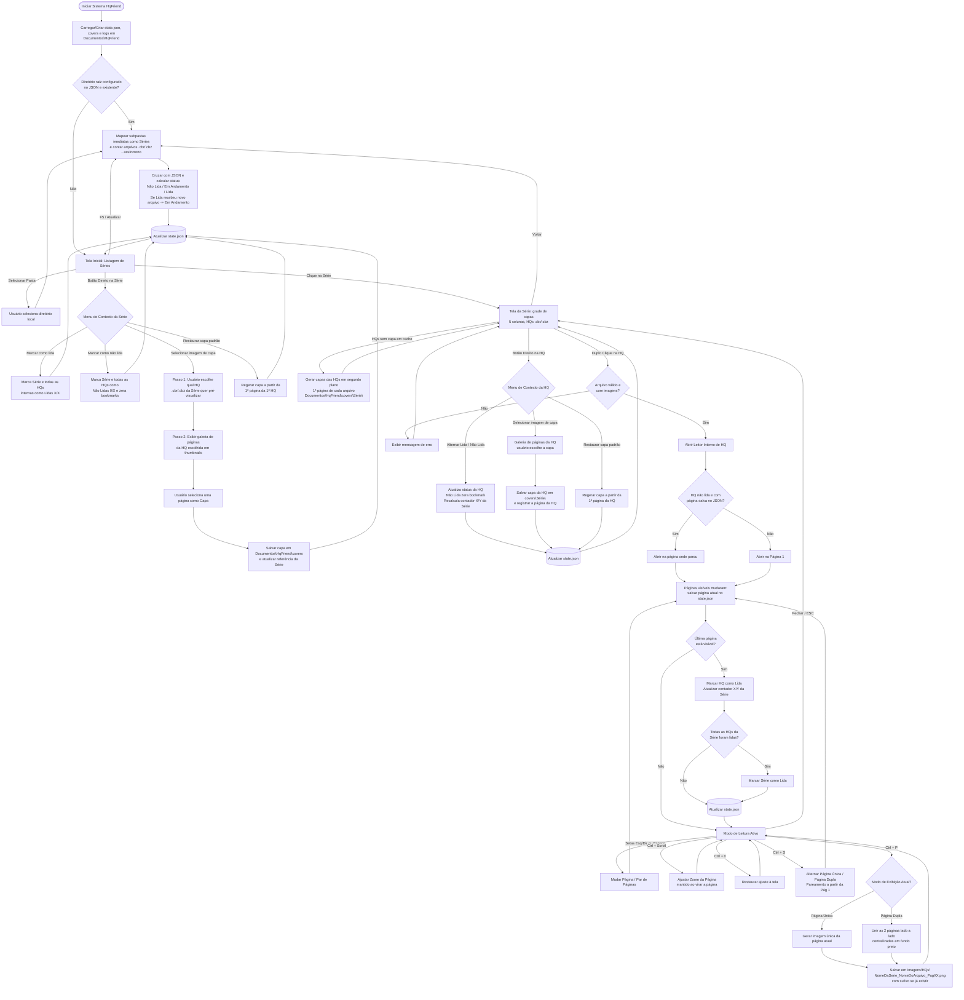

# REQUISITOS.md — Especificação de Requisitos do Sistema (HqFriend)

> **Spec vigente.** Este documento descreve o comportamento **atual** do sistema na branch `main` e deve estar sempre alinhado ao código. Mudanças entram por um pacote em `docs/changes/` (ver `docs/README.md`) e são aplicadas aqui na etapa de **Sincronização**.
>
> * **Versão da spec:** `1.2` (2026-10-30) — escopo entregue pelas FEAT-01 a FEAT-13, pelo FIX-01, pela FEAT-14 e pela FEAT-15.
> * **Convenções de ID:** `RFxx` / `RNFxx` / `USxx` nunca são reaproveitados. Cada requisito tem critérios de aceite próprios (`RFxx-CAn`), referenciados nos testes e nos pacotes de FIX. Requisitos removidos permanecem no documento com status `Obsoleto (FEAT-NN)`.
> * **Status de requisito:** `Ativo` | `Obsoleto (FEAT-NN)`. A linha **Origem** indica o pacote que criou o requisito e os que o alteraram depois.
> * **Verificação:** cada critério é verificado de forma **automática** (teste pytest) ou **manual** (roteiro no executável). A seção 7 (Matriz de Rastreabilidade) liga cada critério à sua verificação. Testes novos citam o critério (`# RF14-CA3`).

## 1. Visão Geral do Sistema
O **HqFriend** é uma aplicação desktop local voltada para o gerenciamento de acervo e leitura de histórias em quadrinhos nos formatos `.cbr` e `.cbz`. O sistema opera diretamente sobre o sistema de arquivos local do usuário, organizando pastas como "Séries" e mantendo o estado de progresso, capas customizadas e preferências persistidos localmente em formato estruturado (`JSON`).

### 1.1. Convenção de Caminhos do Sistema
Os caminhos de sistema são expressos por variáveis resolvidas em tempo de execução a partir das **pastas conhecidas do Windows** (*Known Folders*), respeitando redirecionamentos (ex: OneDrive):
* **`%DOCUMENTOS%`** — Pasta "Documentos" do usuário (ex: `C:\Users\Computador\Documents` ou `C:\Users\Computador\OneDrive\Documentos`).
* **`%IMAGENS%`** — Pasta "Imagens" do usuário (ex: `C:\Users\Computador\Pictures` ou `C:\Users\Computador\OneDrive\Imagens`).

---

## 2. Requisitos Funcionais (RF)

### 2.1. Gerenciamento de Diretório e Acervo

#### RF01 — Seleção de Diretório Raiz
`Ativo` · Origem: v1.0 (FEAT-04, FEAT-06, FEAT-08)

O sistema deve permitir ao usuário selecionar uma pasta local do computador para carregar o acervo de HQs. Ao trocar de diretório raiz, o estado de progresso existente é **mantido** (não há reset); o progresso é associado ao nome da pasta da série e ao nome do arquivo, independentemente do caminho da raiz (ver decisão **QA-01** na seção 6).
* **RF01-CA1:** Selecionar uma pasta salva o caminho em `root_directory` no `state.json` e dispara a varredura da biblioteca.
* **RF01-CA2:** Trocar o diretório raiz não apaga o progresso existente: séries e arquivos com o mesmo nome na nova raiz exibem o progresso já registrado (QA-01).

#### RF02 — Inicialização na Tela Principal
`Ativo` · Origem: v1.0 (FEAT-08), FIX-01

Sempre que o sistema for aberto, ele deve exibir diretamente a "Tela Inicial" (Listagem de Séries), carregando automaticamente o diretório raiz previamente configurado no arquivo de memória. Caso o diretório configurado não exista mais (ex: unidade externa desconectada), o sistema deve exibir a Tela Inicial convidando a selecionar uma pasta, **sem apagar** o estado salvo.
* **RF02-CA1:** Abrir o aplicativo sempre exibe a Tela Inicial carregando as séries do `root_directory` salvo.
* **RF02-CA2:** Se a pasta configurada não existir, a Tela Inicial exibe o convite para selecionar uma pasta e o `state.json` permanece intacto.
* **RF02-CA3:** Os estados vazios da Tela Inicial exibem orientação e o botão "Selecionar pasta": sem pasta configurada ("Selecione a pasta onde estão suas HQs para começar."), pasta não encontrada (exibe o caminho e "Reconecte a unidade ou selecione outra pasta.") e pasta sem séries (exibe o caminho e "Cada subpasta com arquivos .cbr ou .cbz é uma série.").
* **RF02-CA4:** O cabeçalho da Tela Inicial exibe a pasta raiz atual (caminho completo no *tooltip*, sem impor largura mínima à janela) e o aplicativo abre maximizado.

#### RF03 — Reconhecimento de Séries (Nível Único)
`Ativo` · Origem: v1.0 (FEAT-04)

O sistema deve interpretar cada subpasta imediata dentro do diretório selecionado como uma "Série". Apenas arquivos `.cbr` e `.cbz` no primeiro nível da pasta da série são considerados; demais arquivos e subpastas aninhadas são ignorados. Subpastas sem nenhum arquivo `.cbr`/`.cbz` não são exibidas como Série.
* **RF03-CA1:** Subpastas sem nenhum arquivo `.cbr` ou `.cbz` são ignoradas.
* **RF03-CA2:** Arquivos soltos na raiz, arquivos de outras extensões e arquivos em subpastas de 2º nível não são contabilizados. A extensão é comparada sem distinção de maiúsculas.
* **RF03-CA3:** Um diretório raiz inexistente, inacessível ou que seja um arquivo resulta em biblioteca vazia, sem exceção não tratada; uma pasta de série inacessível é ignorada (e registrada em log) sem afetar as demais.

#### RF04 — Contagem e Proporção de Obras
`Ativo` · Origem: v1.0 (FEAT-06, FEAT-08)

Para cada série listada, o sistema deve contabilizar o total de arquivos `.cbr` e `.cbz` válidos e exibir um contador de progresso no formato `X / Y obras` (onde `X` é o número de obras lidas e `Y` é o total de obras na pasta). Caso nenhuma tenha sido lida, deve exibir `0 / Y obras`.
* **RF04-CA1:** Uma série sem nenhuma HQ lida exibe `0 / Y obras`.
* **RF04-CA2:** Arquivos removidos do disco não entram no contador `X / Y` (nunca ocorre `12 / 11 obras`), e suas entradas permanecem no `state.json` (ADR-03).

#### RF05 — Listagem de Obras da Série em Grade de Capas
`Ativo` · Origem: v1.0 (FEAT-10), FEAT-15

Ao acessar uma série, o sistema deve exibir todos os arquivos `.cbr` e `.cbz` pertencentes a ela em uma **grade de capas com 5 colunas**, em ordem natural (RF18), da esquerda para a direita e de cima para baixo. Cada card exibe a capa da HQ (RF22), o nome do arquivo e o status individual de leitura (Não lida, Em andamento com página atual, ou Lida).
* **RF05-CA1:** A Tela da Série exibe as HQs em uma grade de capas em ordem natural (RF18); cada card mostra a capa, o nome do arquivo (abreviado com reticências quando não couber, com o nome completo no *tooltip*) e o status `Não lida`, `Em andamento – Pág. X/Y` ou `Lida`, nas cores do RNF08-CA2.
* **RF05-CA2:** A grade tem sempre 5 colunas: a largura dos cards acompanha a largura da janela, com a capa na proporção 2:3, e as linhas seguintes ficam acessíveis por rolagem vertical, sem rolagem horizontal. A largura de cada card não fica abaixo de 120 px: a Tela da Série não encolhe abaixo de 5 cards dessa largura (QA-11).

#### RF18 — Ordenação Natural de Séries e Obras
`Ativo` · Origem: v1.0 (FEAT-02, FEAT-06)

Séries (Tela Inicial) e obras (Tela da Série) devem ser exibidas em ordem alfanumérica natural, sem distinção de maiúsculas/minúsculas (ex: `Edição 2` antes de `Edição 10`).
* **RF18-CA1:** A ordenação de `["Edição 10", "edição 2", "Edição 1"]` resulta em `["Edição 1", "edição 2", "Edição 10"]`.
* **RF18-CA2:** A mesma regra é aplicada às séries, às HQs de cada série e às páginas dentro dos arquivos (ADR-01).

#### RF19 — Atualização da Biblioteca
`Ativo` · Origem: v1.0 (FEAT-06, FEAT-08, FEAT-10), FIX-01

O sistema deve reescanear o diretório raiz: (a) na inicialização; (b) ao trocar de diretório raiz; (c) ao retornar da Tela da Série para a Tela Inicial; (d) sob demanda, pela tecla `F5` ou pelo botão **"Atualizar"** na Tela Inicial. A varredura deve refletir arquivos adicionados ou removidos sem necessidade de reiniciar o sistema.
* **RF19-CA1:** Adicionar um `.cbz` a uma série com o aplicativo aberto e pressionar `F5` (ou "Atualizar") atualiza o contador sem reiniciar.
* **RF19-CA2:** Voltar da Tela da Série para a Tela Inicial dispara uma nova varredura.
* **RF19-CA3:** Uma varredura solicitada durante outra é enfileirada uma única vez; o resultado de uma raiz antiga é descartado.
* **RF19-CA4:** Enquanto a varredura está em andamento, a Tela Inicial exibe "Atualizando biblioteca…".

### 2.2. Gerenciamento de Status e Progresso de Leitura

#### RF06 — Persistência de Página Atual (Bookmark)
`Ativo` · Origem: v1.0 (FEAT-11), FIX-01

Caso o usuário feche uma HQ antes de finalizá-la, o sistema deve salvar a última página visualizada e retomar a leitura exatamente dessa página quando o arquivo for reaberto. Ao reabrir uma HQ com status "Lida", a leitura deve iniciar na **primeira página** (releitura).
* **RF06-CA1:** Fechar uma HQ na metade (via `ESC`, ou fechando o aplicativo) e abri-la novamente retoma exatamente da página onde parou.
* **RF06-CA2:** Uma HQ "Lida" reabre na página 1, inclusive quando foi concluída em modo de página dupla.
* **RF06-CA3:** Um bookmark fora do intervalo de páginas (ex: arquivo substituído por versão menor) reabre na página 1.
* **RF06-CA4:** Durante a releitura de uma HQ "Lida", ela permanece "Lida" e o contador da série não muda; reabri-la novamente recomeça na página 1.
* **RF06-CA5:** Durante a leitura, o bookmark é gravado 500 ms após a última mudança de página e, de imediato, ao fechar a HQ, ao concluí-la e ao encerrar o aplicativo (QA-06).

#### RF07 — Marcação Automática de Obra Lida
`Ativo` · Origem: v1.0 (FEAT-11)

O sistema deve marcar automaticamente uma HQ como "Lida" assim que a última página do arquivo estiver visível na tela — seja por navegação, por alternância de modo de página (`Ctrl + S`) ou na própria abertura da HQ —, atualizando imediatamente o contador da série (`X / Y obras`).
* **RF07-CA1:** Chegar à última página marca a HQ como "Lida" e atualiza o contador `X / Y` na Tela da Série.
* **RF07-CA2:** Em modo único na penúltima página de uma HQ com número par de páginas, pressionar `Ctrl + S` (exibindo o último par) marca a HQ como "Lida".
* **RF07-CA3:** Abrir uma HQ cuja última página já fica visível na abertura (ex: HQ de 1 página) a marca como "Lida".
* **RF07-CA4:** Concluir a última HQ pendente de uma série marca a série como "Lida".

#### RF08 — Marcação Manual de Obra (Menu de Contexto)
`Ativo` · Origem: v1.0 (FEAT-06, FEAT-10)

Na listagem de obras de uma série, ao clicar com o botão direito sobre uma HQ (`.cbr`/`.cbz`), o sistema deve exibir uma opção para alternar manualmente seu status entre "Lida" e "Não lida". Marcar como "Não lida" deve também **zerar o bookmark** da HQ (a leitura recomeça na primeira página).
* **RF08-CA1:** O menu de contexto da HQ permite marcá-la como "Lida" ou "Não lida", recalculando o status da série em tempo real.
* **RF08-CA2:** Marcar como "Não lida" zera o bookmark e remove a indicação de página em andamento.
* **RF08-CA3:** Marcar como "Não lida" a única HQ lida de uma série (sem outras em andamento) resulta em série `Não lida`.

#### RF09 — Status Automático da Série e Recálculo Dinâmico
`Ativo` · Origem: v1.0 (FEAT-06)

* Quando nenhuma HQ da série estiver lida nem em andamento, a série deve ser marcada como **"Não lida"**.
* Quando todas as HQs de uma série estiverem com status "Lida" (`X == Y`), a série deve ser marcada como **"Lida"**.
* Nos demais casos, a série deve ser marcada como **"Em andamento"**.
* Se uma série marcada como "Lida" (ex: `11 / 11 obras`) receber um novo arquivo na pasta (passando a `11 / 12 obras`), seu status deve ser atualizado automaticamente para **"Em andamento"** na próxima atualização da biblioteca (RF19).

Critérios de aceite:
* **RF09-CA1:** Uma série com `11 / 11 obras` tem status "Lida"; ao adicionar um 12º arquivo e atualizar a biblioteca, passa a `11 / 12 obras` e "Em andamento".
* **RF09-CA2:** O status é calculado apenas sobre as HQs presentes no disco: `Lida` se todas lidas; `Não lida` se nenhuma lida nem com página atual > 0; `Em andamento` nos demais casos.

#### RF10 — Marcação Manual de Série em Lote (Menu de Contexto)
`Ativo` · Origem: v1.0 (FEAT-06, FEAT-08)

Na Tela Inicial, ao clicar com o botão direito sobre uma Série, o sistema deve exibir as opções:
* **"Marcar como lida"**: a série e todas as HQs (`.cbr`/`.cbz`) dentro dela são marcadas como "Lidas" simultaneamente (desabilitada se a série já estiver "Lida").
* **"Marcar como não lida"**: a série e todas as HQs dentro dela são marcadas como "Não lidas" e têm seus bookmarks zerados (desabilitada se a série já estiver "Não lida").

Critérios de aceite:
* **RF10-CA1:** "Marcar como lida" marca todas as HQs da série como lidas e atualiza imediatamente o card para "Lida" e `Y / Y obras`.
* **RF10-CA2:** "Marcar como não lida" marca todas as HQs como não lidas, zera os bookmarks e atualiza o card para "Não lida" e `0 / Y obras`.
* **RF10-CA3:** Cada opção fica desabilitada quando a série já está no status correspondente.

### 2.3. Capas de Séries e HQs

#### RF11 — Ação de Seleção de Capa (Menu de Contexto)
`Ativo` · Origem: v1.0 (FEAT-07, FEAT-08)

Na Tela Inicial, ao clicar com o botão direito sobre uma Série, o sistema deve exibir a opção **"Selecionar imagem de capa"**. Enquanto o usuário não definir uma capa customizada, o sistema utilizará por padrão a primeira página da primeira HQ da série (segundo a ordenação do RF18). Quando houver capa customizada, o menu deve exibir também a opção **"Restaurar capa padrão"**.
* **RF11-CA1:** Toda série com ao menos uma HQ válida possui uma capa `.png` otimizada em `%DOCUMENTOS%\HqFriend\covers\`, gerada em segundo plano.
* **RF11-CA2:** Se a primeira HQ for inválida, a capa padrão usa a próxima HQ válida; sem nenhuma HQ válida, o card exibe um *placeholder*.
* **RF11-CA3:** "Restaurar capa padrão" só aparece quando há capa customizada; ao acioná-la, a capa padrão é regerada e a referência customizada é removida do `state.json`.

#### RF12 — Fluxo de Escolha de Capa em 2 Etapas (Seletor de HQ + Galeria de Páginas)
`Ativo` · Origem: v1.0 (FEAT-07, FEAT-09), FIX-01

Ao acionar "Selecionar imagem de capa", o sistema deve:
1. Perguntar ao usuário **qual HQ (`.cbr`/`.cbz`)** daquela série ele deseja pré-visualizar;
2. Exibir as miniaturas (*thumbnails*) de todas as páginas da HQ escolhida, permitindo ao usuário clicar em qualquer página para defini-la como a imagem de capa oficial da série.

Critérios de aceite:
* **RF12-CA1:** Apenas as páginas da HQ selecionada no passo 1 são extraídas (nunca todas as HQs da série).
* **RF12-CA2:** A interface não trava durante o carregamento das miniaturas; fechar o diálogo ou trocar de HQ antes do fim interrompe o carregamento e libera o arquivo.
* **RF12-CA3:** Ao confirmar a página, o arquivo em `covers\` e o `state.json` são atualizados imediatamente e o card da série na Tela Inicial exibe a nova capa.
* **RF12-CA4:** O passo 1 abre com a HQ da capa atual já selecionada (ou a primeira HQ, se a capa for a padrão); no passo 2, "Definir como capa" só fica habilitado com uma página selecionada, e o duplo clique numa miniatura confirma.

#### RF22 — Capa Padrão da HQ
`Ativo` · Origem: FEAT-15

Toda HQ (`.cbr`/`.cbz`) válida possui uma capa, exibida no seu card na Tela da Série (RF05). Enquanto o usuário não escolher outra (RF23), a capa é a **primeira página do arquivo**, isto é, a primeira imagem na ordenação natural das páginas (RNF04, RF18). As capas são geradas em segundo plano ao abrir a série, apenas para as HQs que ainda não têm capa em cache (QA-14), e ficam guardadas para as próximas aberturas.
* **RF22-CA1:** Ao abrir a Tela da Série, cada HQ sem capa em cache exibe o *placeholder* "Carregando capa…" e as capas são geradas em segundo plano, na ordem da grade, aparecendo uma a uma sem travar a interface.
* **RF22-CA2:** A capa padrão é a primeira página do arquivo em ordem natural, gravada em `%DOCUMENTOS%\HqFriend\covers\<Série>\<arquivo>.png` (ex: `covers\Batman\Batman_01.cbz.png`), com no máximo 400 px de largura, mantendo a proporção e sem ampliar.
* **RF22-CA3:** HQ cuja capa já está em cache exibe a capa sem reabrir o arquivo compactado, inclusive depois de reiniciar o aplicativo.
* **RF22-CA4:** HQ inválida (RF20) ou com a primeira página ilegível exibe o *placeholder* "Sem capa"; a falha é registrada em log e não impede a geração das demais capas.
* **RF22-CA5:** Sair da Tela da Série (`Esc`, "Voltar") ou abrir uma HQ no leitor interrompe a geração após a capa em andamento, liberando o arquivo; ao voltar à Tela da Série, a geração continua pelas capas que faltam.

#### RF23 — Seleção da Capa da HQ (Menu de Contexto)
`Ativo` · Origem: FEAT-15

Na Tela da Série, ao clicar com o botão direito sobre uma HQ, o menu exibe **"Selecionar imagem de capa"** e, quando a HQ tiver capa customizada, **"Restaurar capa padrão"**, além da opção de marcar como lida ou não lida (RF08). "Selecionar imagem de capa" abre a galeria de miniaturas das páginas **da própria HQ**, onde o usuário clica numa página para defini-la como capa (QA-13). A capa da HQ é independente da capa da série (QA-12).
* **RF23-CA1:** O menu de contexto da HQ exibe "Selecionar imagem de capa" e, apenas quando há capa customizada, "Restaurar capa padrão"; as opções de RF08 continuam no menu.
* **RF23-CA2:** A galeria exibe apenas as páginas da HQ escolhida, carregadas em segundo plano; fechar o diálogo antes do fim interrompe o carregamento e libera o arquivo. A página da capa atual já vem selecionada (a página 1, se a capa for a padrão); "Definir como capa" só fica habilitado com uma página selecionada, e o duplo clique numa miniatura confirma. Numa HQ inválida, o diálogo exibe a mensagem de erro e nada é alterado.
* **RF23-CA3:** Ao confirmar a página, o arquivo da capa em `covers\<Série>\` e o `state.json` (`custom_cover_page` da HQ) são atualizados imediatamente e o card da HQ exibe a nova capa. O card da série na Tela Inicial não muda.
* **RF23-CA4:** "Restaurar capa padrão" regera a capa a partir da primeira página e remove a referência customizada do `state.json`.
* **RF23-CA5:** Se a capa customizada precisar ser regerada (arquivo do cache apagado) e a página registrada não existir mais no arquivo (ex: HQ substituída por versão menor), é usada a capa padrão e o problema é registrado em log.

### 2.4. Leitor Integrado de HQs e Atalhos

#### RF13 — Abertura por Duplo Clique
`Ativo` · Origem: v1.0 (FEAT-10, FEAT-11), FIX-01

Ao dar um duplo clique sobre um arquivo `.cbr` ou `.cbz`, o sistema deve abrir o leitor interno carregando a HQ selecionada.
* **RF13-CA1:** O duplo clique em uma HQ válida abre o leitor com o arquivo selecionado (na página definida pelo RF06).
* **RF13-CA2:** Durante a leitura, o título da janela exibe `<nome do arquivo> — HqFriend`; ao fechar o leitor, volta a `HqFriend`.

#### RF20 — Tratamento de Arquivo Inválido
`Ativo` · Origem: v1.0 (FEAT-05, FEAT-10, FEAT-11)

Caso a HQ esteja corrompida, protegida por senha ou não contenha nenhuma imagem válida, o sistema **não deve abrir o leitor** nem alterar o status da HQ; deve exibir uma mensagem de erro amigável e permanecer na Tela da Série.
* **RF20-CA1:** Arquivos inexistentes, vazios, corrompidos, protegidos por senha (arquivo ou cabeçalho), sem imagens ou de formato desconhecido são rejeitados com `InvalidComicError`.
* **RF20-CA2:** O duplo clique em uma HQ inválida exibe mensagem de erro, permanece na Tela da Série e não altera o status nem o bookmark da HQ.

#### RF21 — Tratamento de Página Ilegível
`Ativo` · Origem: FIX-01 (comportamento entregue na v1.0, FEAT-11)

Se uma página de uma HQ válida não puder ser decodificada, o leitor deve exibir um quadro substituto com o texto "Página ilegível" no lugar dela, registrar o problema em log e continuar permitindo a navegação. A HQ não é considerada inválida (RF20) por causa de uma página isolada.
* **RF21-CA1:** Uma página com bytes de imagem corrompidos é exibida como o quadro "Página ilegível", e as demais páginas continuam navegáveis.
* **RF21-CA2:** A falha é registrada em `hqfriend.log` como aviso, sem mensagem modal ao usuário.
* **RF21-CA3:** Chegar à última página continua marcando a HQ como "Lida" (RF07), mesmo que alguma página tenha sido ilegível.

#### RF14 — Navegação de Páginas
`Ativo` · Origem: v1.0 (FEAT-11), FIX-01

Durante a leitura, o sistema deve permitir:
* **Seta Direita (`→`) ou `Barra de Espaço`:** Avançar para a próxima página (ou próximo par de páginas). Na última página, não faz nada.
* **Seta Esquerda (`←`):** Voltar para a página anterior (ou par de páginas anterior). Na primeira página, não faz nada.
* **Tecla `ESC` ou botão "Fechar" (`✕`) do leitor:** Encerrar a visualização da HQ e retornar à listagem da série.

Critérios de aceite:
* **RF14-CA1:** `→`/`Espaço` avançam e `←` volta uma página (ou um par, no modo duplo); nos limites, nada acontece.
* **RF14-CA2:** `ESC` grava o bookmark, fecha a HQ e volta à Tela da Série com status e contadores atualizados.
* **RF14-CA3:** O leitor exibe um botão "Fechar" (`✕`, tooltip `Fechar (Esc)`) no canto superior direito, que acompanha o redimensionamento da janela; clicar nele tem o mesmo efeito do `ESC` (RF14-CA2). O botão não recebe foco do teclado: as teclas de navegação continuam indo para o leitor.
* **RF14-CA4:** Durante a leitura, um indicador sobreposto mostra a posição atual: `Pág. N / Total` no modo único e `Págs. N–M / Total` no modo duplo.

#### RF15 — Controle de Zoom (`Ctrl + Scroll`)
`Ativo` · Origem: v1.0 (FEAT-11), FIX-01, FEAT-14

O usuário deve poder ampliar (zoom in) ou reduzir (zoom out) o tamanho da página atual utilizando o atalho `Ctrl + Scroll do mouse`. O nível de zoom escolhido é **mantido ao trocar de página** durante a leitura da HQ, para que o usuário não precise refazê-lo a cada página. O zoom é relativo ao ajuste à tela (*Fit-to-View*) de cada página: 1x é a página inteira visível; 2x é o dobro desse tamanho, qualquer que seja a resolução da página.
* **RF15-CA1:** `Ctrl + Scroll` aplica zoom ancorado no cursor, limitado entre 0,5x e 5x; com zoom acima de 1x, a página pode ser arrastada com o mouse.
* **RF15-CA2:** Virar a página (`→`, `Espaço`, `←`) **mantém o nível de zoom** atual, aplicado sobre o ajuste à tela da nova página (ou do novo par). Alternar o modo (`Ctrl + S`) restaura o ajuste à tela (QA-09). Ao redimensionar a janela, a página acompanha o novo tamanho se estiver ajustada à tela (zoom 1x); com outro zoom, o zoom escolhido é preservado.
* **RF15-CA3:** Ao virar a página com zoom acima de 1x, a nova página é exibida a partir do **canto superior esquerdo** (início da leitura), tanto ao avançar quanto ao voltar (QA-08). Com zoom de até 1x, a página fica centralizada.
* **RF15-CA4:** O zoom vale para a HQ aberta: ao fechar a HQ e abrir esta ou outra, a leitura começa com o ajuste à tela (QA-07). O zoom não é gravado no `state.json`.
* **RF15-CA5:** `Ctrl + 0` restaura o ajuste à tela (zoom 1x) a qualquer momento da leitura (QA-10).

#### RF16 — Alternância de Modo de Página (`Ctrl + S`)
`Ativo` · Origem: v1.0 (FEAT-11)

O atalho `Ctrl + S` deve alternar a visualização entre **"Página Única"** e **"Página Dupla"**. A preferência é persistida e reaplicada nas próximas leituras.
* *Regra de Pareamento:* No modo Página Dupla, o pareamento deve iniciar imediatamente na primeira página (ex: `[Pág 1 + Pág 2]`, `[Pág 3 + Pág 4]`, etc.).

Critérios de aceite:
* **RF16-CA1:** `Ctrl + S` alterna instantaneamente entre 1 página e 2 páginas lado a lado, com pares iniciando na página 1.
* **RF16-CA2:** Ativar o modo duplo numa página par (ex: Pág. 4) exibe o par que a contém (`[Pág 3 + Pág 4]`); o mesmo vale ao abrir com bookmark nessa posição.
* **RF16-CA3:** Em HQ com número ímpar de páginas, a última página é exibida isolada e centralizada (ADR-02).
* **RF16-CA4:** O modo escolhido é persistido e reaplicado na próxima leitura, inclusive após reiniciar o aplicativo.

#### RF17 — Captura e Exportação de Página (`Ctrl + P`)
`Ativo` · Origem: v1.0 (FEAT-12)

O atalho `Ctrl + P` deve salvar a(s) página(s) exibida(s) como arquivo de imagem `.png` no diretório `%IMAGENS%\HQs`, na **resolução original** da página (o zoom aplicado na tela é ignorado).
* *Comportamento em Página Única:* Salva a página atual como imagem única (`NomeDaSerie_NomeDoArquivo_PagXX.png`).
* *Comportamento em Página Dupla:* Une as duas páginas exibidas lado a lado em uma única imagem combinada, **sem redimensioná-las**, centralizando verticalmente a página de menor altura sobre **fundo preto**, e salva seguindo a nomenclatura padrão (`NomeDaSerie_NomeDoArquivo_PagXX.png`, onde `XX` é o número da primeira página do par).
* *Arquivo Existente:* Se já existir um arquivo com o mesmo nome, o sistema **não sobrescreve**; acrescenta um sufixo numérico (`..._PagXX_2.png`, `..._PagXX_3.png`, ...).

Critérios de aceite:
* **RF17-CA1:** Em página simples, `Ctrl + P` gera 1 arquivo `.png` válido em `%IMAGENS%\HQs`, inclusive para páginas JPEG em CMYK.
* **RF17-CA2:** Em página dupla, gera 1 único `.png` com as duas páginas lado a lado em tamanho original, centralizadas verticalmente sobre fundo preto, nomeado com o número da primeira página do par.
* **RF17-CA3:** Duas capturas da mesma página geram `..._PagXX.png` e `..._PagXX_2.png`, sem sobrescrever a primeira.
* **RF17-CA4:** Caracteres inválidos em nomes de arquivo do Windows são removidos de `NomeDaSerie` e `NomeDoArquivo`; o leitor exibe um aviso discreto de sucesso ou falha.

---

## 3. Requisitos Não Funcionais (RNF)

#### RNF01 — Execução Local (Offline-First)
`Ativo` · Origem: v1.0 (FEAT-01, FEAT-13)

O sistema deve rodar de forma 100% local no computador do usuário (ambiente Windows 11), sem dependência de conexão com a internet ou servidores externos.
* **RNF01-CA1:** O executável `dist\HqFriend\HqFriend.exe` inicia em modo gráfico (sem janela de console) e exibe o ícone do aplicativo.
* **RNF01-CA2:** Leitura de `.cbz`/`.cbr`, persistência, logs e exportação `Ctrl + P` funcionam a partir do executável, sem internet e sem instalações adicionais.

#### RNF02 — Armazenamento de Memória e Estado
`Ativo` · Origem: v1.0 (FEAT-02, FEAT-03), FEAT-15

Toda a memória do sistema (diretório raiz configurado, progresso de leitura por arquivo, página atual/bookmark, status das séries, capas customizadas de séries e HQs e cache de capas) deve ser armazenada no diretório `%DOCUMENTOS%\HqFriend`, utilizando arquivo estruturado em formato **JSON** (`state.json`) e subpasta de cache de capas (`covers\`).
* *Integridade:* A gravação deve ser atômica. O sistema deve manter uma cópia de segurança (`state.json.bak`) da última versão válida carregada. Se o `state.json` estiver corrompido, o sistema deve preservá-lo para análise, restaurar a partir do `.bak` (ou iniciar com estado limpo, caso o backup também seja inválido) e avisar o usuário.
* *Versão do schema:* um `state.json` de versão anterior é migrado na carga, sem perda de dados; um `state.json` de versão mais nova que a suportada nunca é sobrescrito (`ARQUITETURA.md` §3.3).

Critérios de aceite:
* **RNF02-CA1:** Na primeira abertura (sem `state.json`), o sistema cria e usa um estado limpo, válido e versionado (contrato em `ARQUITETURA.md` §3.2).
* **RNF02-CA2:** A carga valida tipos, datas e enums do JSON.
* **RNF02-CA3:** A escrita passa por arquivo temporário (`state.json.tmp` → `state.json`), sem deixar arquivos órfãos, e supera bloqueios transitórios (`PermissionError`) com novas tentativas.
* **RNF02-CA4:** Um `state.json` inválido é preservado como `state.corrupt-<timestamp>.json`, o estado é restaurado do `.bak` e o usuário é avisado; se o `.bak` também for inválido, o sistema inicia limpo sem falhar.
* **RNF02-CA5:** Um `state.json` da versão `1.0` é carregado e migrado para `1.1` preservando raiz, progresso, preferências e capas das séries; antes da primeira gravação do estado migrado, uma cópia do arquivo original é guardada como `state.v1.0.json`.
* **RNF02-CA6:** Um `state.json` de versão mais nova que a suportada não é sobrescrito nem tratado como corrompido: o sistema avisa o usuário ("O arquivo de estado é de uma versão mais nova do HqFriend…") e encerra.

#### RNF03 — Criação Automática de Diretórios de Sistema
`Ativo` · Origem: v1.0 (FEAT-01, FEAT-12)

Caso os diretórios `%DOCUMENTOS%\HqFriend` (e subpastas `covers\` e `logs\`) ou `%IMAGENS%\HQs` não existam no momento da operação, o sistema deve criá-los automaticamente de forma transparente.
* **RNF03-CA1:** As 4 pastas de sistema são criadas na inicialização caso não existam; `%IMAGENS%\HQs` é recriada no momento da exportação se tiver sido apagada.
* **RNF03-CA2:** `%DOCUMENTOS%` e `%IMAGENS%` correspondem às pastas reais do usuário, inclusive quando redirecionadas ao OneDrive (nenhum caminho com nome de usuário fixo no código — ADR-05).

#### RNF04 — Suporte a Formatos de Compactação em Memória
`Ativo` · Origem: v1.0 (FEAT-05, FEAT-13), FEAT-15

O motor de leitura deve descompactar diretamente em memória RAM (sem arquivos temporários em disco) arquivos compactados tanto em formato ZIP (`.cbz`) quanto RAR (`.cbr`), utilizando binário embarcado para RAR, identificando o formato real pelo conteúdo do arquivo (e não apenas pela extensão) e filtrando apenas extensões de imagem válidas (`.jpg`, `.jpeg`, `.png`, `.webp`) em ordem alfanumérica natural.
* **RNF04-CA1:** `.cbz` e `.cbr` (RAR4, RAR5 e *solid*) listam as páginas em ordem natural (`1.jpg`, `2.jpg`, ..., `10.jpg`), ignorando `__MACOSX` e arquivos ocultos.
* **RNF04-CA2:** As páginas são entregues como `bytes` em memória, sem arquivos temporários em disco.
* **RNF04-CA3:** Abrir um `.cbr` executa **um único** processo `UnRAR.exe`, e os bytes de cada página são idênticos aos obtidos por `rarfile` (ADR-06).
* **RNF04-CA4:** Um ZIP com extensão `.cbr` (e um RAR com extensão `.cbz`) é aberto corretamente.
* **RNF04-CA5:** Nenhuma janela de console pisca ao abrir um `.cbr` a partir do executável; o `UnRAR.exe` embarcado é resolvido tanto no código-fonte quanto no `.exe`.
* **RNF04-CA6:** Gerar a capa de um `.cbr` (da série ou da HQ) executa um único processo `UnRAR.exe` que extrai apenas a entrada da página necessária, sem extrair o arquivo inteiro para a RAM; os bytes obtidos são idênticos aos de `rarfile` (ADR-14).

#### RNF05 — Desempenho de Renderização
`Ativo` · Origem: v1.0 (FEAT-07, FEAT-08, FEAT-09, FEAT-11), FEAT-15

A transição entre páginas no leitor deve ocorrer de maneira fluida (tempo de resposta inferior a 200ms após o carregamento do arquivo). A varredura da biblioteca, a geração de capas padrão (das séries e das HQs) e o carregamento da galeria de seleção de capas (RF12, RF23) devem ocorrer de forma assíncrona, mantendo a interface responsiva.
* **RNF05-CA1:** Virar a página leva menos de 200 ms (referência v1.0: máx. 133 ms com páginas JPEG de ~3 MB em 1920×1080).
* **RNF05-CA2:** A interface permanece responsiva durante a varredura e a geração de capas de uma biblioteca com 100+ séries.
* **RNF05-CA3:** As camadas de domínio, serviços e infraestrutura não importam PySide6 (pré-condição para executá-las fora da thread de UI).
* **RNF05-CA4:** A Tela da Série de uma série com 100+ HQs abre de imediato e continua respondendo (rolagem, menu de contexto, duplo clique, "Voltar") enquanto as capas das HQs são geradas.

#### RNF06 — Registro de Erros (Logs)
`Ativo` · Origem: v1.0 (FEAT-01, FEAT-08)

Erros e exceções não tratadas devem ser registrados em arquivo de log rotativo em `%DOCUMENTOS%\HqFriend\logs\`, e exceções inesperadas devem ser comunicadas ao usuário por mensagem amigável em vez de encerrar o sistema silenciosamente.
* **RNF06-CA1:** Uma exceção não tratada (de qualquer thread) é registrada em `%DOCUMENTOS%\HqFriend\logs\hqfriend.log`.
* **RNF06-CA2:** Com a interface aberta, a exceção é exibida ao usuário em mensagem amigável, uma por vez, sem encerrar o aplicativo.

#### RNF07 — Instância Única
`Ativo` · Origem: v1.0 (FEAT-08)

Apenas uma instância do sistema pode estar em execução por vez, evitando gravações concorrentes no `state.json`. Ao tentar abrir uma segunda instância, o sistema deve avisar o usuário e encerrar a nova instância.
* **RNF07-CA1:** Abrir uma segunda instância exibe aviso e encerra a nova instância; a trava de um processo encerrado de forma anormal não impede a próxima abertura.

#### RNF08 — Identidade Visual em Tema Escuro
`Ativo` · Origem: FIX-01 (comportamento entregue na v1.0, FEAT-08)

A interface deve usar um tema escuro único, definido em uma folha de estilos embarcada (`assets/styles/dark_theme.qss`) sobre o estilo Qt `Fusion`: fundo da aplicação `#121212`, fundo do leitor `#000000`, superfícies `#1e1e1e`/`#2a2a2a` e cor de destaque âmbar `#e5a00d` para ações primárias e seleção.
* **RNF08-CA1:** Telas, diálogos e menus usam o tema escuro tanto no código-fonte quanto no executável (a folha de estilos é resolvida via `get_resource_path`).
* **RNF08-CA2:** Os status usam cores consistentes em toda a interface: "Lida" em verde, "Em andamento" em âmbar e "Não lida" em cinza.

---

## 4. Histórias de Usuário (US)

* **US01 — Seleção do Diretório de HQs:** Como leitor, quero selecionar uma pasta do meu computador para que o sistema identifique minhas séries de HQs e salve esse caminho para os próximos acessos.
* **US02 — Visualização da Tela Inicial de Séries:** Como leitor, quero que o sistema sempre inicie na tela de listagem de séries, mostrando a capa de cada série, seu status ("Não lida", "Em andamento", "Lida") e o contador no formato `X / Y obras`.
* **US03 — Atualização Dinâmica de Série com Novos Arquivos:** Como leitor, quero que uma série anteriormente "Lida" passe automaticamente para "Em andamento" caso eu adicione novos arquivos `.cbr`/`.cbz` na pasta dela, sem precisar reiniciar o sistema.
* **US04 — Seleção de Capa da Série por HQ:** Como leitor, quero clicar com o botão direito em uma série e escolher "Selecionar imagem de capa", escolhendo primeiro qual HQ daquela série desejo abrir em pré-visualização e, em seguida, selecionando uma de suas páginas para ser a capa da série. Quero também poder restaurar a capa padrão.
* **US05 — Marcação de Série em Lote:** Como leitor, quero clicar com o botão direito em uma série e escolher "Marcar como lida" ou "Marcar como não lida" para que a série e todas as suas HQs internas sejam atualizadas de uma só vez.
* **US06 — Listagem e Marcação Manual de HQ:** Como leitor, quero abrir uma série para ver seus arquivos `.cbr`/`.cbz` em uma grade de capas, em ordem natural, e poder clicar com o botão direito em uma HQ específica para marcá-la manualmente como "Lida" ou "Não lida".
* **US07 — Leitura e Retomada de Progresso (Bookmark):** Como leitor, quero dar duplo clique em uma HQ para lê-la usando as `Setas (Esquerda/Direita)` ou `Espaço`, e quero que o sistema lembre em qual página parei caso eu feche antes do fim.
* **US08 — Conclusão Automática ao Atingir a Última Página:** Como leitor, quero que a HQ seja marcada automaticamente como "Lida" quando a última página aparecer na tela, atualizando o contador da série e marcando a série como "Lida" caso seja a última obra pendente.
* **US09 — Controle de Zoom na Leitura:** Como leitor, quero usar `Ctrl + Scroll do mouse` para ajustar o zoom da página durante a leitura e que esse zoom seja mantido quando eu virar a página, para não precisar ajustá-lo de novo a cada página.
* **US10 — Alternância entre Página Única e Dupla:** Como leitor, quero usar `Ctrl + S` para alternar entre página única e página dupla (com pareamento iniciando na página 1).
* **US11 — Captura de Página Unificada ou Simples:** Como leitor, quero usar `Ctrl + P` para salvar a visualização atual em `%IMAGENS%\HQs` com o nome `NomeDaSerie_NomeDoArquivo_PagXX.png`, unindo as duas páginas lado a lado (centralizadas sobre fundo preto) em uma única imagem quando eu estiver no modo de página dupla, sem sobrescrever capturas anteriores.
* **US12 — Persistência Local Transparente:** Como leitor, quero que todo o meu histórico de leitura, diretório configurado, páginas atuais e capas escolhidas fiquem salvos em estrutura JSON dentro de `%DOCUMENTOS%\HqFriend`, protegidos contra corrupção.
* **US13 — Atualização Manual da Biblioteca:** Como leitor, quero pressionar `F5` (ou o botão "Atualizar") para que o sistema reconheça imediatamente arquivos e séries que adicionei ou removi.
* **US14 — Capas das HQs na Tela da Série:** Como leitor, quero ver as HQs de uma série como uma grade de capas e poder escolher, pelo botão direito, qual página é a capa de cada HQ, para reconhecer cada edição de relance.

---

## 5. Diagrama de Fluxo do Sistema (Grafo)

---

## 6. Questões Decididas

| ID | Questão | Decisão | Alternativas Descartadas |
| :--- | :--- | :--- | :--- |
| **QA-01** | **Identificação do progresso ao trocar de diretório raiz.** | **Opção C (decidida em 2026-10-24):** estado único, chaveado apenas por *nome da pasta da série* + *nome do arquivo*, sem reset ao trocar de raiz. Mover a pasta raiz preserva o progresso. Entradas de arquivos ausentes no disco são mantidas no JSON, mas ignoradas nos contadores. | **A.** Estado separado por diretório raiz (mover a pasta perderia o progresso). **B.** Zerar o estado ao trocar de raiz (perderia o histórico). |
| **QA-02** | Formato do contador quando nenhuma obra foi lida. | **Decidida em 2026-10-24 (retroativa, FIX-01):** sempre `0 / Y obras` (RF04). | Não registradas na época. |
| **QA-03** | Montagem da imagem de página dupla no `Ctrl + P` quando as páginas têm alturas diferentes. | **Decidida em 2026-10-24 (retroativa, FIX-01):** unir sem redimensionar, centralizando verticalmente a menor sobre fundo preto (RF17). | Não registradas na época. |
| **QA-04** | Caminhos de dados e de exportação. | **Decidida em 2026-10-24 (retroativa, FIX-01):** pastas conhecidas do Windows `%DOCUMENTOS%` / `%IMAGENS%`, respeitando OneDrive (ADR-05). | Caminhos fixos com o nome do usuário (quebram em outra máquina e com o OneDrive). |
| **QA-05** | O leitor deve ter botão de fechar, como cita o RF14? | **Decidida em 2026-10-29 (FIX-01):** sim — botão `✕` sobreposto, com o mesmo efeito do `ESC` (RF14-CA3). | Remover o botão da spec e manter só o `ESC` (pior para quem usa só o mouse). |
| **QA-06** | Momento de gravação do bookmark durante a leitura. | **Decidida em 2026-10-29 (FIX-01):** manter o implementado — grava 500 ms após a última virada (*debounce*), e de imediato ao fechar, concluir ou sair (RF06-CA5). | Gravação periódica garantida a cada 500 ms mesmo com viradas contínuas (*throttle*): mais escritas no disco para ganhar, no pior caso, as viradas do último meio segundo antes de uma queda do app. |
| **QA-07** | Por quanto tempo o zoom é mantido? | **Decidida em 2026-10-29 (FEAT-14):** enquanto a HQ estiver aberta; abrir uma HQ começa no ajuste à tela, e o zoom não é gravado no `state.json` (RF15-CA4). | Manter durante toda a execução do app, valendo para a próxima HQ. Persistir no `state.json` como preferência global (exigiria nova versão do schema e migração). |
| **QA-08** | Com a página ampliada, que parte da nova página aparece ao virar? | **Decidida em 2026-10-29 (FEAT-14):** o canto superior esquerdo, ao avançar e ao voltar (RF15-CA3). | Topo centralizado na horizontal. Mesma posição relativa da página anterior. Voltar abrindo no canto inferior direito. |
| **QA-09** | O que acontece com o zoom ao alternar o modo único/duplo (`Ctrl + S`)? | **Decidida em 2026-10-29 (FEAT-14):** restaura o ajuste à tela, como na v1.0 (RF15-CA2): a troca de layout muda o tamanho do conteúdo. | Manter o fator de zoom também na alternância. |
| **QA-10** | Como voltar ao ajuste à tela, já que virar a página deixa de fazer isso? | **Decidida em 2026-10-29 (FEAT-14):** atalho `Ctrl + 0` (RF15-CA5). | Sem atalho novo (reduzir com `Ctrl + Scroll` ou alternar o modo duas vezes). `Ctrl + 0` e também duplo clique na página. |
| **QA-11** | Como funciona a "grade 5x5" de capas da Tela da Série? | **Decidida em 2026-10-29 (FEAT-15):** sempre 5 colunas; os cards acompanham a largura da janela e as linhas seguem com rolagem vertical (RF05-CA2). | Páginas de exatamente 25 HQs com botões Anterior/Próxima. Colunas responsivas com cards de tamanho fixo, como na Tela Inicial. |
| **QA-12** | A capa escolhida para uma HQ afeta a capa da série? | **Decidida em 2026-10-29 (FEAT-15):** não; as capas são independentes e a capa padrão da série continua sendo a 1ª página da 1ª HQ (RF11, RF23-CA3). | Sem capa customizada, a série herdar a capa (padrão ou customizada) da 1ª HQ. |
| **QA-13** | De onde vem a imagem ao escolher a capa de uma HQ? | **Decidida em 2026-10-29 (FEAT-15):** só das páginas da própria HQ; o seletor abre direto na galeria (RF23). | Fluxo em 2 etapas com página de outra HQ da série. Imagem do computador. |
| **QA-14** | Quando as capas das HQs são geradas? | **Decidida em 2026-10-29 (FEAT-15):** ao abrir a série, só para as HQs dela sem capa em cache (RF22). | Na varredura da biblioteca, para todas as HQs de todas as séries (abre milhares de arquivos na primeira execução). |

> **Limitações conhecidas (aceitas com a QA-01):**
> * Uma segunda biblioteca com séries e arquivos de mesmo nome herda o progresso já registrado para esses nomes.
> * Renomear uma pasta de série ou um arquivo `.cbr`/`.cbz` faz o sistema tratá-lo como novo, perdendo o progresso associado ao nome anterior.
>
> **Limitação conhecida (FEAT-15):** as capas em cache (de séries e de HQs) não são regeradas quando um arquivo é substituído por outro de mesmo nome; "Restaurar capa padrão" regera a capa sob demanda.

---

## 7. Matriz de Rastreabilidade

> Liga cada critério de aceite à sua verificação. Ao criar ou alterar um critério, o pacote (FEAT/FIX) atualiza a linha correspondente na etapa de Sincronização.

**Resumo (FEAT-15, 2026-10-30):** 102 critérios — 85 automáticos, 13 automáticos com complemento manual, 4 manuais e 0 lacunas. A FEAT-15 acrescentou RF05-CA2, RF22-CA1 a CA5, RF23-CA1 a CA5, RNF02-CA5/CA6, RNF04-CA6 e RNF05-CA4, alterou RF05-CA1 e passou RF05-CA2, RF22-CA1, RNF04-CA6 (roteiro M2, passo 7) e RNF05-CA4 (roteiro M3, passo 3) a ter complemento manual. Conferida automaticamente: os 199 testes citados existem na coleta do pytest (353 testes). **Resumo anterior (FEAT-14, 2026-10-29):** 87 critérios — 74 automáticos, 9 automáticos com complemento manual, 4 manuais e 0 lacunas. A FEAT-14 acrescentou RF15-CA3 a CA5 e passou RF15-CA2, CA3 e CA5 a ter complemento manual no roteiro M2. Caminhos relativos a `tests/`. As 3 lacunas encontradas na montagem da matriz (RF15-CA2, RF17-CA4 e RNF06-CA2) foram cobertas por testes no próprio FIX-01. Uma **lacuna** é um critério sem teste nem roteiro que o cubra por inteiro; cada lacuna é resolvida criando o teste ou aceitando-a como manual, com registro no pacote.

| Critério | Verificação | Teste(s) / roteiro |
| :--- | :--- | :--- |
| RF01-CA1 | Automática | `services/test_library_service.py::test_trocar_raiz_nao_apaga_progresso` `ui/test_home_view.py::test_carrega_series_em_ordem_natural_com_contador_e_status` |
| RF01-CA2 | Automática | `services/test_library_service.py::test_trocar_raiz_nao_apaga_progresso` |
| RF02-CA1 | Automática + Manual | `ui/test_home_view.py::test_carrega_series_em_ordem_natural_com_contador_e_status` Roteiro M1 (abertura pelo `main.py` com a raiz salva) |
| RF02-CA2 | Automática | `ui/test_home_view.py::test_raiz_inexistente_convida_a_selecionar_pasta_sem_apagar_estado` |
| RF02-CA3 | Automática | `ui/test_home_view.py::test_sem_raiz_configurada_convida_a_selecionar_pasta` `ui/test_home_view.py::test_raiz_inexistente_convida_a_selecionar_pasta_sem_apagar_estado` `ui/test_home_view.py::test_raiz_sem_series_mostra_mensagem` |
| RF02-CA4 | Automática + Manual | `ui/test_home_view.py::test_cabecalho_exibe_a_raiz_com_caminho_completo_no_tooltip` Roteiro M1 (janela maximizada) |
| RF03-CA1 | Automática | `infrastructure/test_fs_scanner.py::test_ignora_subpastas_sem_hqs` |
| RF03-CA2 | Automática | `infrastructure/test_fs_scanner.py::test_ignora_arquivos_da_raiz_outras_extensoes_e_subpastas_aninhadas` `infrastructure/test_fs_scanner.py::test_pasta_com_extensao_de_hq_nao_e_contada_como_arquivo` |
| RF03-CA3 | Automática | `infrastructure/test_fs_scanner.py::test_raiz_inexistente_retorna_resultado_vazio` `infrastructure/test_fs_scanner.py::test_raiz_que_e_arquivo_retorna_resultado_vazio` `infrastructure/test_fs_scanner.py::test_serie_inacessivel_e_ignorada_sem_afetar_as_demais` |
| RF04-CA1 | Automática | `services/test_library_service.py::test_serie_nova_comeca_nao_lida_com_contador_zero` `domain/test_models.py::test_contador_da_serie_usa_formato_x_de_y` |
| RF04-CA2 | Automática | `services/test_library_service.py::test_arquivos_removidos_nao_inflam_contador_e_permanecem_no_json` `services/test_library_service.py::test_arquivo_removido_que_volta_recupera_progresso` |
| RF05-CA1 | Automática | `ui/test_series_view.py::test_lista_hqs_da_serie_em_ordem_natural_com_status` `ui/test_series_view.py::test_texto_de_status_da_hq` `ui/test_series_view.py::test_mostra_hq_em_andamento_com_pagina` `ui/test_series_view.py::test_card_abrevia_nome_e_mostra_nome_completo_no_tooltip` `ui/test_series_view.py::test_marcar_hq_mantem_a_selecao_e_a_rolagem` |
| RF05-CA2 | Automática + Manual | `ui/test_series_view.py::test_grade_tem_sempre_cinco_colunas` `ui/test_series_view.py::test_cards_tem_largura_minima_de_120_px` `ui/test_series_view.py::test_cards_acompanham_a_largura_da_janela` Roteiro M2 (grade) |
| RF18-CA1 | Automática | `domain/test_sorting.py::test_ordena_numeros_como_humanos_e_ignora_maiusculas` |
| RF18-CA2 | Automática | `services/test_library_service.py::test_series_e_hqs_em_ordem_natural` `domain/test_sorting.py::test_ordena_paginas_de_arquivo_compactado` `infrastructure/test_archive_reader.py::test_lista_apenas_imagens_em_ordem_natural` |
| RF19-CA1 | Automática | `ui/test_home_view.py::test_novo_arquivo_e_atualizacao_refletem_no_contador` `ui/test_home_view.py::test_f5_esta_associado_a_atualizacao` |
| RF19-CA2 | Automática | `ui/test_series_view.py::test_voltar_atualiza_a_tela_inicial` |
| RF19-CA3 | Automática | `ui/test_home_view.py::test_atualizacao_durante_varredura_e_enfileirada_uma_vez` |
| RF19-CA4 | Automática | `ui/test_home_view.py::test_varredura_em_andamento_e_indicada_no_cabecalho` |
| RF06-CA1 | Automática | `services/test_reader_service.py::test_fechar_e_reabrir_retoma_da_pagina` `ui/test_reader_view.py::test_esc_na_metade_e_reabrir_retoma_da_pagina` `ui/test_reader_view.py::test_fechar_o_app_durante_a_leitura_grava_o_bookmark` |
| RF06-CA2 | Automática | `services/test_reader_service.py::test_hq_lida_reabre_na_primeira_pagina` `services/test_reader_service.py::test_ultimo_par_em_pagina_dupla_conclui_e_reabre_na_primeira_pagina` `ui/test_reader_view.py::test_concluir_em_pagina_dupla_e_reabrir_inicia_na_primeira_pagina` |
| RF06-CA3 | Automática | `services/test_reader_service.py::test_bookmark_fora_do_intervalo_reabre_na_primeira_pagina` |
| RF06-CA4 | Automática | `services/test_reader_service.py::test_releitura_nao_desmarca_hq_lida` `services/test_reader_service.py::test_hq_lida_reabre_na_primeira_pagina` |
| RF06-CA5 | Automática | `ui/test_reader_view.py::test_viradas_seguidas_adiam_a_gravacao_do_bookmark` `ui/test_reader_view.py::test_bookmark_e_gravado_apos_o_intervalo` `services/test_reader_service.py::test_bookmark_so_e_gravado_no_flush` `services/test_reader_service.py::test_fechar_grava_bookmark_pendente` `services/test_reader_service.py::test_chegar_a_ultima_pagina_marca_hq_como_lida` `ui/test_reader_view.py::test_fechar_o_app_durante_a_leitura_grava_o_bookmark` |
| RF07-CA1 | Automática | `services/test_reader_service.py::test_chegar_a_ultima_pagina_marca_hq_como_lida` `ui/test_reader_view.py::test_ultima_pagina_marca_hq_como_lida_e_atualiza_serie` |
| RF07-CA2 | Automática | `services/test_reader_service.py::test_ctrl_s_exibindo_ultimo_par_conclui_a_hq` `ui/test_reader_view.py::test_ctrl_s_exibindo_o_ultimo_par_conclui_a_hq` |
| RF07-CA3 | Automática | `services/test_reader_service.py::test_hq_de_pagina_unica_e_concluida_na_abertura` |
| RF07-CA4 | Automática | `services/test_reader_service.py::test_ultima_hq_pendente_conclui_a_serie` `ui/test_series_view.py::test_marcar_todas_como_lidas_conclui_a_serie` |
| RF08-CA1 | Automática | `ui/test_series_view.py::test_menu_marca_hq_como_lida_e_recalcula_serie` `services/test_library_service.py::test_marcar_hq_como_lida_atualiza_contador_e_status` |
| RF08-CA2 | Automática | `ui/test_series_view.py::test_marcar_como_nao_lida_remove_indicacao_de_andamento` `services/test_library_service.py::test_desmarcar_hq_lida_com_bookmark_na_ultima_pagina_zera_bookmark` |
| RF08-CA3 | Automática | `services/test_library_service.py::test_desmarcar_unica_hq_lida_volta_serie_para_nao_lida` |
| RF09-CA1 | Automática | `services/test_library_service.py::test_serie_lida_volta_para_em_andamento_ao_receber_novo_arquivo` |
| RF09-CA2 | Automática | `services/test_library_service.py::test_regra_de_status_da_serie` `services/test_library_service.py::test_apply_scan_persiste_estado_e_status` |
| RF10-CA1 | Automática | `services/test_library_service.py::test_marcar_serie_como_lida` `ui/test_home_view.py::test_marcar_serie_como_lida_e_nao_lida_atualiza_card` |
| RF10-CA2 | Automática | `services/test_library_service.py::test_marcar_serie_como_nao_lida_zera_bookmarks` `ui/test_home_view.py::test_marcar_serie_como_lida_e_nao_lida_atualiza_card` |
| RF10-CA3 | Automática | `ui/test_home_view.py::test_menu_de_contexto_habilita_acoes_conforme_status` |
| RF11-CA1 | Automática | `services/test_cover_service.py::test_capa_padrao_e_pagina_zero_da_primeira_hq` `services/test_cover_service.py::test_capa_e_reduzida_mantendo_proporcao` `ui/test_home_view.py::test_capas_sao_geradas_e_serie_invalida_mostra_placeholder` |
| RF11-CA2 | Automática | `services/test_cover_service.py::test_capa_padrao_pula_hq_invalida` `services/test_cover_service.py::test_serie_sem_hq_valida_fica_sem_capa` `ui/test_home_view.py::test_capas_sao_geradas_e_serie_invalida_mostra_placeholder` |
| RF11-CA3 | Automática | `ui/test_home_view.py::test_menu_oferece_restaurar_capa_apenas_com_capa_customizada` `services/test_cover_service.py::test_restaurar_capa_padrao` |
| RF12-CA1 | Automática | `ui/test_cover_picker_dialog.py::test_lista_hqs_da_serie_e_carrega_apenas_a_selecionada` |
| RF12-CA2 | Automática | `ui/test_cover_picker_dialog.py::test_miniaturas_sao_extraidas_fora_da_thread_principal` `ui/test_cover_picker_dialog.py::test_fechar_durante_carregamento_interrompe_e_libera_arquivo` `ui/test_cover_picker_dialog.py::test_trocar_de_hq_durante_carregamento_descarta_miniaturas_antigas` `services/test_cover_service.py::test_interromper_miniaturas_libera_o_arquivo` |
| RF12-CA3 | Automática | `services/test_cover_service.py::test_capa_customizada_atualiza_cache_e_estado` `ui/test_cover_picker_dialog.py::test_confirmar_define_capa_da_serie` `ui/test_cover_picker_dialog.py::test_menu_da_home_abre_seletor_e_atualiza_card` |
| RF12-CA4 | Automática | `ui/test_cover_picker_dialog.py::test_reabrir_seletor_parte_da_hq_da_capa_atual` `ui/test_cover_picker_dialog.py::test_botao_de_confirmar_exige_pagina_selecionada` `ui/test_cover_picker_dialog.py::test_duplo_clique_na_miniatura_confirma_a_capa` |
| RF22-CA1 | Automática + Manual | `ui/test_series_view.py::test_capas_das_hqs_sao_geradas_fora_da_thread_principal` `ui/test_comic_cover_worker.py::test_gera_as_capas_em_ordem_fora_da_thread_principal` `ui/test_series_view.py::test_marcar_hq_durante_a_geracao_mantem_carregando_capa` `ui/test_series_view.py::test_capa_de_outra_serie_e_ignorada` Roteiro M2 (grade) |
| RF22-CA2 | Automática | `services/test_cover_service.py::test_capa_da_hq_e_a_primeira_pagina_em_ordem_natural` `services/test_cover_service.py::test_capa_da_hq_e_reduzida_e_gravada_em_covers_da_serie` `services/test_library_service.py::test_capa_da_hq_fica_na_pasta_da_serie_com_a_extensao_no_nome` |
| RF22-CA3 | Automática | `services/test_cover_service.py::test_capa_da_hq_em_cache_nao_reabre_o_arquivo` `services/test_library_service.py::test_hq_com_capa_em_cache_e_hqs_sem_capa` `ui/test_series_view.py::test_capas_em_cache_aparecem_sem_gerar_de_novo` |
| RF22-CA4 | Automática | `services/test_cover_service.py::test_hq_invalida_fica_sem_capa_e_nao_impede_as_demais` `ui/test_series_view.py::test_hq_invalida_mostra_placeholder_sem_capa` `ui/test_comic_cover_worker.py::test_hq_invalida_e_emitida_sem_capa` |
| RF22-CA5 | Automática | `ui/test_series_view.py::test_sair_da_serie_interrompe_a_geracao_e_libera_o_arquivo` `ui/test_series_view.py::test_voltar_a_serie_retoma_as_capas_que_faltam` `ui/test_comic_cover_worker.py::test_interrupcao_para_apos_a_capa_em_andamento` `ui/test_series_view.py::test_abrir_hq_interrompe_e_fechar_o_leitor_retoma_as_capas` |
| RF23-CA1 | Automática | `ui/test_series_view.py::test_menu_da_hq_oferece_capa_e_restaurar_apenas_com_capa_customizada` `ui/test_cover_picker_dialog.py::test_confirmar_capa_da_hq_atualiza_o_card_da_hq` |
| RF23-CA2 | Automática | `ui/test_cover_picker_dialog.py::test_modo_hq_mostra_so_as_paginas_da_hq_sem_passo_1` `ui/test_cover_picker_dialog.py::test_modo_hq_preseleciona_a_pagina_da_capa_atual` `ui/test_cover_picker_dialog.py::test_modo_hq_com_hq_invalida_mostra_erro` `ui/test_cover_picker_dialog.py::test_modo_hq_fechar_durante_carregamento_libera_arquivo` |
| RF23-CA3 | Automática | `services/test_cover_service.py::test_capa_customizada_da_hq_atualiza_cache_e_estado` `services/test_cover_service.py::test_capa_da_hq_nao_altera_capa_da_serie` `ui/test_cover_picker_dialog.py::test_confirmar_capa_da_hq_atualiza_o_card_da_hq` `services/test_library_service.py::test_capa_customizada_da_hq_e_persistida_e_restaurada` `services/test_library_service.py::test_capa_da_hq_nao_altera_a_referencia_de_capa_da_serie` `ui/test_cover_picker_dialog.py::test_modo_hq_confirmar_define_capa_da_hq_e_nao_da_serie` |
| RF23-CA4 | Automática | `services/test_cover_service.py::test_restaurar_capa_padrao_da_hq` `services/test_library_service.py::test_capa_customizada_da_hq_e_persistida_e_restaurada` `ui/test_series_view.py::test_menu_da_hq_oferece_capa_e_restaurar_apenas_com_capa_customizada` |
| RF23-CA5 | Automática | `services/test_cover_service.py::test_pagina_customizada_inexistente_usa_capa_padrao` `services/test_cover_service.py::test_capa_customizada_apagada_e_regerada_da_pagina_registrada` |
| RF13-CA1 | Automática | `ui/test_reader_view.py::test_duplo_clique_em_hq_valida_abre_o_leitor` `ui/test_series_view.py::test_duplo_clique_solicita_abertura_da_hq` |
| RF13-CA2 | Automática | `ui/test_reader_view.py::test_duplo_clique_em_hq_valida_abre_o_leitor` `ui/test_reader_view.py::test_botao_fechar_volta_para_a_serie` |
| RF20-CA1 | Automática | `infrastructure/test_archive_reader.py::test_arquivo_invalido_lanca_invalid_comic_error` `services/test_reader_service.py::test_hq_invalida_nao_abre_e_nao_altera_estado` |
| RF20-CA2 | Automática | `ui/test_series_view.py::test_hq_invalida_mostra_erro_e_permanece_na_serie` `ui/test_series_view.py::test_hq_valida_nao_mostra_erro` |
| RF21-CA1 | Automática | `ui/test_reader_view.py::test_pagina_ilegivel_mostra_quadro_substituto_e_leitura_continua` `ui/test_reader_view.py::test_decode_page_usa_placeholder_para_bytes_invalidos` |
| RF21-CA2 | Automática | `ui/test_reader_view.py::test_pagina_ilegivel_mostra_quadro_substituto_e_leitura_continua` |
| RF21-CA3 | Automática | `ui/test_reader_view.py::test_pagina_ilegivel_mostra_quadro_substituto_e_leitura_continua` |
| RF14-CA1 | Automática | `services/test_reader_service.py::test_navegacao_em_pagina_unica_respeita_limites` `ui/test_reader_view.py::test_seta_esquerda_volta_e_limites_sao_respeitados` `services/test_reader_service.py::test_pagina_dupla_pareia_a_partir_da_primeira_pagina` |
| RF14-CA2 | Automática | `ui/test_reader_view.py::test_esc_na_metade_e_reabrir_retoma_da_pagina` `ui/test_reader_view.py::test_ultima_pagina_marca_hq_como_lida_e_atualiza_serie` |
| RF14-CA3 | Automática | `ui/test_reader_view.py::test_botao_fechar_volta_para_a_serie` `ui/test_reader_view.py::test_botao_fechar_acompanha_o_redimensionamento` |
| RF14-CA4 | Automática | `ui/test_reader_view.py::test_duplo_clique_em_hq_valida_abre_o_leitor` `ui/test_reader_view.py::test_ctrl_s_alterna_pagina_dupla_lado_a_lado` |
| RF15-CA1 | Automática | `ui/test_reader_view.py::test_ctrl_scroll_aplica_zoom_e_arraste` `ui/test_reader_view.py::test_zoom_fica_entre_os_limites` `ui/test_reader_view.py::test_scroll_sem_ctrl_nao_altera_zoom` |
| RF15-CA2 | Automática + Manual | `ui/test_reader_view.py::test_virar_pagina_mantem_o_zoom` `ui/test_reader_view.py::test_zoom_volta_exatamente_a_1x` `ui/test_reader_view.py::test_ctrl_s_e_redimensionar_reajustam_a_pagina_a_tela` Roteiro M2 (zoom) |
| RF15-CA3 | Automática + Manual | `ui/test_reader_view.py::test_pagina_ampliada_abre_no_canto_superior_esquerdo` Roteiro M2 (zoom) |
| RF15-CA4 | Automática | `ui/test_reader_view.py::test_abrir_hq_comeca_ajustada_a_tela` |
| RF15-CA5 | Automática + Manual | `ui/test_reader_view.py::test_ctrl_0_restaura_ajuste_a_tela` Roteiro M2 (zoom) |
| RF16-CA1 | Automática | `services/test_reader_service.py::test_pagina_dupla_pareia_a_partir_da_primeira_pagina` `ui/test_reader_view.py::test_ctrl_s_alterna_pagina_dupla_lado_a_lado` |
| RF16-CA2 | Automática | `services/test_reader_service.py::test_ativar_pagina_dupla_em_indice_impar_alinha_ao_par` `services/test_reader_service.py::test_bookmark_impar_abre_alinhado_em_pagina_dupla` |
| RF16-CA3 | Automática | `services/test_reader_service.py::test_pagina_dupla_pareia_a_partir_da_primeira_pagina` |
| RF16-CA4 | Automática | `services/test_reader_service.py::test_preferencia_de_pagina_dupla_e_persistida` |
| RF17-CA1 | Automática | `services/test_export_service.py::test_pagina_unica_exportada_em_resolucao_original` `services/test_export_service.py::test_jpeg_cmyk_e_convertido_para_rgb` `ui/test_reader_view.py::test_ctrl_p_em_pagina_unica_salva_png_e_mostra_aviso` |
| RF17-CA2 | Automática | `services/test_export_service.py::test_pagina_dupla_unida_lado_a_lado_centralizada_em_fundo_preto` `services/test_export_service.py::test_combinacao_preserva_tamanhos_originais` `services/test_export_service.py::test_nome_base_usa_numero_humano_da_primeira_pagina` `ui/test_reader_view.py::test_ctrl_p_em_pagina_dupla_salva_uma_imagem_unida` |
| RF17-CA3 | Automática | `services/test_export_service.py::test_nao_sobrescreve_capturas_existentes` `services/test_export_service.py::test_exportacoes_simultaneas_geram_arquivos_distintos` `ui/test_reader_view.py::test_ctrl_p_duas_vezes_nao_sobrescreve` |
| RF17-CA4 | Automática | `services/test_export_service.py::test_sanitiza_nomes_para_o_windows` `ui/test_reader_view.py::test_ctrl_p_em_pagina_unica_salva_png_e_mostra_aviso` `ui/test_reader_view.py::test_ctrl_p_com_falha_ao_gravar_mostra_aviso_de_falha` |
| RNF01-CA1 | Manual | Roteiro M2 |
| RNF01-CA2 | Manual | Roteiro M2 |
| RNF02-CA1 | Automática | `infrastructure/test_json_repository.py::test_primeira_abertura_cria_e_retorna_estado_limpo` `domain/test_models.py::test_appstate_vazio_gera_json_valido_com_padroes_seguros` |
| RNF02-CA2 | Automática | `domain/test_models.py::test_desserializa_json_existente_com_tipos_datas_e_enums` `domain/test_models.py::test_rejeita_valores_invalidos` `domain/test_models.py::test_rejeita_json_malformado` |
| RNF02-CA3 | Automática | `infrastructure/test_json_repository.py::test_save_e_atomico_e_nao_deixa_arquivo_temporario` `infrastructure/test_json_repository.py::test_permission_error_transitorio_e_superado` `infrastructure/test_json_repository.py::test_permission_error_persistente_propaga_e_remove_temporario` |
| RNF02-CA4 | Automática | `infrastructure/test_json_repository.py::test_estado_corrompido_e_restaurado_do_backup` `infrastructure/test_json_repository.py::test_estado_corrompido_sem_backup_retorna_estado_limpo` `infrastructure/test_json_repository.py::test_estado_e_backup_corrompidos_retornam_estado_limpo` `domain/test_errors.py::test_aviso_de_recuperacao_informa_a_origem` |
| RNF02-CA5 | Automática | `infrastructure/test_state_migrations.py::test_migra_json_1_0_para_1_1_sem_perder_dados` `infrastructure/test_state_migrations.py::test_json_sem_versao_e_tratado_como_1_0` `infrastructure/test_json_repository.py::test_estado_migrado_guarda_copia_do_original` `infrastructure/test_json_repository.py::test_copia_do_original_nao_e_sobrescrita` `infrastructure/test_json_repository.py::test_backup_1_0_e_migrado_na_recuperacao` |
| RNF02-CA6 | Automática | `infrastructure/test_json_repository.py::test_versao_futura_nao_e_sobrescrita_nem_tratada_como_corrompida` `infrastructure/test_state_migrations.py::test_versao_futura_lanca_erro` `ui/test_main.py::test_versao_futura_avisa_e_encerra` `ui/test_main.py::test_mensagem_de_versao_futura_informa_as_versoes` |
| RNF03-CA1 | Automática | `infrastructure/test_fs_scanner.py::test_cria_pastas_inexistentes` `infrastructure/test_fs_scanner.py::test_pastas_padrao_sao_as_quatro_pastas_do_sistema` `services/test_export_service.py::test_cria_a_pasta_de_exportacao` |
| RNF03-CA2 | Automática | `test_config.py::test_pastas_conhecidas_do_usuario_existem` `test_config.py::test_pastas_do_sistema_derivam_das_pastas_conhecidas` `test_config.py::test_codigo_nao_contem_caminho_de_usuario_fixo` |
| RNF04-CA1 | Automática | `infrastructure/test_archive_reader.py::test_lista_apenas_imagens_em_ordem_natural` `infrastructure/test_archive_reader.py::test_fixture_solid_e_realmente_solid` |
| RNF04-CA2 | Automática | `infrastructure/test_archive_reader.py::test_nao_cria_arquivos_temporarios` |
| RNF04-CA3 | Automática | `infrastructure/test_archive_reader.py::test_cbr_executa_um_unico_processo_sem_janela` `infrastructure/test_archive_reader.py::test_extrai_bytes_identicos_e_imagens_validas` |
| RNF04-CA4 | Automática | `infrastructure/test_archive_reader.py::test_detecta_formato_real_pelos_magic_bytes` |
| RNF04-CA5 | Automática + Manual | `infrastructure/test_archive_reader.py::test_cbr_executa_um_unico_processo_sem_janela` `test_config.py::test_resource_path_no_executavel_usa_meipass` Roteiro M2 (`.cbr` no executável) |
| RNF04-CA6 | Automática + Manual | `infrastructure/test_archive_reader.py::test_read_page_extrai_so_a_entrada_em_um_processo` `infrastructure/test_archive_reader.py::test_read_page_devolve_os_mesmos_bytes_que_open_archive` `infrastructure/test_archive_reader.py::test_read_page_distingue_paginas_de_mesmo_nome_em_subpastas` `infrastructure/test_archive_reader.py::test_read_page_com_extracao_divergente_lanca_invalid_comic_error` `services/test_cover_service.py::test_capas_das_series_usam_leitura_de_pagina_unica` Roteiro M2 (capas de `.cbr` no executável) |
| RNF05-CA1 | Manual | Roteiro M3 (medição; referência v1.0: máx. 133 ms) |
| RNF05-CA2 | Automática + Manual | `ui/test_home_view.py::test_varredura_ocorre_fora_da_thread_principal` Roteiro M3 (biblioteca com 100+ séries) |
| RNF05-CA3 | Automática | `services/test_cover_service.py::test_camadas_de_dominio_servicos_e_infraestrutura_nao_importam_pyside6` |
| RNF05-CA4 | Automática + Manual | `ui/test_series_view.py::test_capas_das_hqs_sao_geradas_fora_da_thread_principal` `ui/test_comic_cover_worker.py::test_gera_as_capas_em_ordem_fora_da_thread_principal` Roteiro M3 (série com 100+ HQs `.cbr`) |
| RNF06-CA1 | Automática | `infrastructure/test_logging_setup.py::test_excepthook_registra_excecao_e_aciona_callback` `infrastructure/test_logging_setup.py::test_threading_excepthook_registra_excecao_e_aciona_callback` `infrastructure/test_logging_setup.py::test_configure_grava_mensagens_no_arquivo_de_log` `ui/test_error_dialog.py::test_excecao_nao_tratada_e_registrada_e_exibida_sem_encerrar` |
| RNF06-CA2 | Automática | `ui/test_error_dialog.py::test_excecao_de_outra_thread_e_exibida_na_thread_principal` `ui/test_error_dialog.py::test_erros_sao_exibidos_um_por_vez` `ui/test_error_dialog.py::test_excecao_nao_tratada_e_registrada_e_exibida_sem_encerrar` |
| RNF07-CA1 | Automática + Manual | `ui/test_home_view.py::test_segunda_instancia_nao_obtem_a_trava` `ui/test_home_view.py::test_trava_de_processo_encerrado_nao_bloqueia_abertura` Roteiro M2 (mensagem "O HqFriend já está aberto.") |
| RNF08-CA1 | Manual | Roteiro M2 |
| RNF08-CA2 | Automática + Manual | `ui/test_home_view.py::test_carrega_series_em_ordem_natural_com_contador_e_status` (status do badge) Roteiro M2 (cores) |

### 7.1. Roteiros de Verificação Manual

| Roteiro | Onde | Passos | Critérios |
| :--- | :--- | :--- | :--- |
| **M1** | Código-fonte (`python -m src.main`) ou executável | Com uma raiz já configurada, abrir o aplicativo: a janela abre maximizada na Tela Inicial e carrega as séries da raiz salva. | RF02-CA1, RF02-CA4 |
| **M2** | Executável `dist\HqFriend\HqFriend.exe` | (1) Abrir o app: sem janela de console, com o ícone e o tema escuro em telas, menus e diálogos; status "Lida" verde, "Em andamento" âmbar, "Não lida" cinza. (2) Ler um `.cbz` e um `.cbr` reais (nenhuma janela de console ao abrir o `.cbr`); usar o botão "Fechar". (3) `Ctrl + P` salva em `Imagens\HQs`. (4) Com o app aberto, abrir uma segunda instância: aviso "O HqFriend já está aberto." e a nova instância encerra. (5) Conferir `Documentos\HqFriend` (`state.json`, `covers\`, `logs\`). (6) Zoom: ampliar com `Ctrl + Scroll`, virar páginas para frente e para trás (o zoom é mantido e a página abre no canto superior esquerdo) e `Ctrl + 0` (volta a ajustar à tela). (7) Capas das HQs (FEAT-15): abrir uma série real com `.cbr` e `.cbz` — grade de 5 colunas que acompanha a largura da janela, capas aparecendo uma a uma, sem janela de console; trocar e restaurar a capa de uma HQ pelo botão direito; conferir `Documentos\HqFriend\covers\<Série>\`. | RNF01-CA1, RNF01-CA2, RNF04-CA5, RNF04-CA6, RNF07-CA1, RNF08-CA1, RNF08-CA2, RF05-CA2, RF15-CA2, RF15-CA3, RF15-CA5, RF22-CA1 |
| **M3** | Executável, máquina de referência | (1) Virar páginas de HQ com páginas JPEG de ~3 MB em 1920×1080, em CBZ e CBR *solid*: menos de 200 ms por virada, também com zoom de 2x mantido entre as páginas (FEAT-14). (2) Biblioteca com 100+ séries: a interface continua respondendo durante a varredura e a geração de capas. (3) Série com 100+ HQs `.cbr` reais, sem capas em cache (FEAT-15): a Tela da Série abre de imediato e continua respondendo (rolagem, menu, "Voltar") durante a geração; registrar o tempo médio por capa na ADR-14. | RNF05-CA1, RNF05-CA2, RNF05-CA4 |
